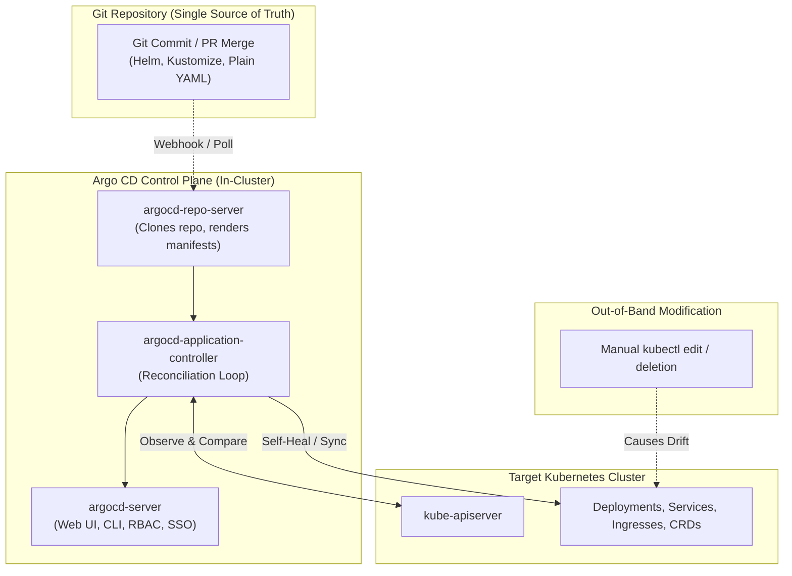

In modern cloud-native engineering, Git is the single source of truth for both application and infrastructure configurations. **Argo CD** is a declarative, GitOps continuous delivery tool for Kubernetes that monitors Git repositories and automatically synchronizes live cluster state with desired state.

Argo CD eliminates the security risk of CI/CD runners having broad cluster admin permissions. Instead of external push pipelines running `kubectl apply`, Argo CD pulls manifests from Git inside the cluster firewall, detects out-of-band drift, and self-heals workloads automatically.



## Core Primitives of Argo CD

1. **Application CRD:** Connects a specific Git repository path and branch to a destination Kubernetes cluster and namespace.
2. **ApplicationSet CRD:** Multi-cluster and multi-tenant generator that automates provisioning hundreds of applications across clusters using templating generators (List, Cluster, Git Directory).
3. **Sync Waves & Hooks:** Coordinates multi-tier deployments by sequencing database migrations before web server rollouts using numerical waves (`argocd.argoproj.io/sync-wave`).
4. **Automated Self-Healing:** Instantly overrides unapproved manual changes or accidental resource deletions made via `kubectl`.

## Defining a Production `Application` Manifest

Create `production-ecommerce-app.yaml`:

```yaml
apiVersion: argoproj.io/v1alpha1
kind: Application
metadata:
  name: ecommerce-backend
  namespace: argocd
  finalizers:
    - resources-finalizer.argocd.argoproj.io
spec:
  project: default
  source:
    repoURL: "https://github.com/my-org/gitops-manifests.git"
    targetRevision: main
    path: environments/production
    helm:
      valueFiles:
        - values.yaml
        - values-prod.yaml
  destination:
    server: "https://kubernetes.default.svc"
    namespace: ecommerce
  syncPolicy:
    automated:
      prune: true
      selfHeal: true
    syncOptions:
      - CreateNamespace=true
      - ApplyOutOfSyncOnly=true
    retry:
      limit: 5
      backoff:
        duration: 5s
        factor: 2
        maxDuration: 3m
```

## Sequencing Deployments with Sync Waves

To ensure a database migration Job completes successfully before new web deployment pods are scheduled, annotate the resources with sync waves:

```yaml
# Step 1: Run migration job first (Wave 0)
apiVersion: batch/v1
kind: Job
metadata:
  name: db-migration-v2
  annotations:
    argocd.argoproj.io/sync-wave: "0"
    argocd.argoproj.io/hook: Sync
spec:
  template:
    spec:
      containers:
        - name: migrate
          image: my-org/db-migrator:v2.0
      restartPolicy: Never
---
# Step 2: Deploy web pods after migration succeeds (Wave 1)
apiVersion: apps/v1
kind: Deployment
metadata:
  name: web-api
  annotations:
    argocd.argoproj.io/sync-wave: "1"
spec:
  replicas: 5
  template:
    spec:
      containers:
        - name: web
          image: my-org/web-api:v2.0
```

## Scaling with ApplicationSets across Multiple Clusters

The `ApplicationSet` controller dynamically spins up `Application` resources based on git directories or registered cluster secrets:

```yaml
apiVersion: argoproj.io/v1alpha1
kind: ApplicationSet
metadata:
  name: microservices
  namespace: argocd
spec:
  generators:
    - git:
        repoURL: "https://github.com/my-org/gitops-manifests.git"
        revision: HEAD
        directories:
          - path: services/*
  template:
    metadata:
      name: "{{path.basename}}"
    spec:
      project: default
      source:
        repoURL: "https://github.com/my-org/gitops-manifests.git"
        targetRevision: HEAD
        path: "{{path}}"
      destination:
        server: "https://kubernetes.default.svc"
        namespace: "{{path.basename}}"
      syncPolicy:
        automated:
          prune: true
          selfHeal: true
```

## Production Gotchas to Avoid

- **Resource Finalizers:** Always specify `resources-finalizer.argocd.argoproj.io` on Applications. Without it, deleting an Argo CD Application object leaves all the live child resources running orphaned in the cluster.
- **Git Webhook Configuration:** Configure GitHub or GitLab push webhooks to hit `/api/webhook` on `argocd-server` to eliminate the default 3-minute Git polling latency.
- **Avoid Storing Secrets Unencrypted in Git:** Pair Argo CD with Sealed Secrets, External Secrets Operator (ESO), or HashiCorp Vault to prevent leaking plaintext credentials.

