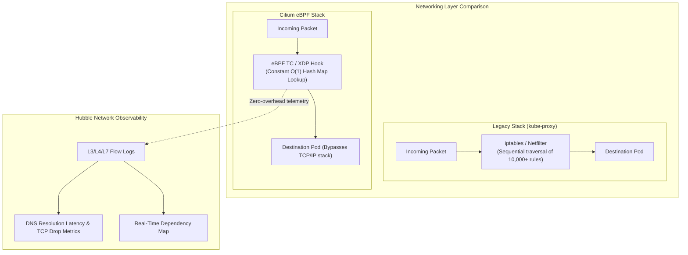

Legacy Kubernetes networking relies on `iptables` or IPVS managed by `kube-proxy`. While sufficient for small clusters, `iptables` scales linearly with $O(N)$ rule evaluations: when a cluster grows to thousands of services and pods, rule updates stall packet processing, increase latency, and degrade CPU performance.

**Cilium** (a CNCF Graduated project) replaces the entire `kube-proxy` networking stack using **eBPF (extended Berkeley Packet Filter)**. By compiling routing, load balancing, security policies, and visibility logic directly into Linux kernel bytecode, Cilium achieves $O(1)$ constant-time lookup performance, native L7 security filtering, and transparent wire-speed encryption.



## Core Capabilities of Cilium

1. **`kube-proxy` Replacement:** Completely eliminates `kube-proxy` and `iptables`. ClusterIP and NodePort translations occur directly at the socket level (`sockops`), eliminating packet encapsulation overhead.
2. **L7-Aware Network Policies:** Standard Kubernetes NetworkPolicies only understand IP addresses and ports (L3/L4). Cilium policies can restrict traffic by HTTP methods, URL paths, and DNS names (e.g., allow `GET /public/*` but deny `POST /admin`).
3. **Hubble Observability:** Built-in eBPF network tracing that visualizes real-time service dependency graphs, HTTP response codes, DNS lookup latencies, and TCP drops without sidecar injection.
4. **Transparent Encryption:** Encrypts all node-to-node and pod-to-pod transit traffic at wire speed using WireGuard or IPsec with a single configuration flag.

## Defining an L7 API NetworkPolicy

Enforce granular HTTP endpoint protection using `CiliumNetworkPolicy`:

```yaml
apiVersion: "cilium.io/v2"
kind: CiliumNetworkPolicy
metadata:
  name: secure-payment-api
  namespace: default
spec:
  endpointSelector:
    matchLabels:
      app: payment-api
  ingress:
    - fromEndpoints:
        - matchLabels:
            app: frontend
      toPorts:
        - ports:
            - port: "8080"
              protocol: TCP
          rules:
            http:
              - method: "GET"
                path: "/api/v1/payments/status"
              - method: "POST"
                path: "/api/v1/payments/charge"
```

Any attempt by the `frontend` pod to execute `DELETE /api/v1/payments/*` or access unapproved endpoints is blocked at the kernel layer with an HTTP 403 response.

## Restricting Egress to External Domain Names (FQDN)

Prevent compromised pods from exfiltrating data to arbitrary internet IPs while permitting access only to legitimate APIs:

```yaml
apiVersion: "cilium.io/v2"
kind: CiliumNetworkPolicy
metadata:
  name: allow-stripe-egress
  namespace: default
spec:
  endpointSelector:
    matchLabels:
      app: payment-api
  egress:
    - toFQDNs:
        - matchName: "api.stripe.com"
      toPorts:
        - ports:
            - port: "443"
              protocol: TCP
    # Allow DNS resolution so FQDN lookups succeed
    - toEndpoints:
        - matchLabels:
            "k8s:io.kubernetes.pod.namespace": kube-system
            k8s-app: kube-dns
      toPorts:
        - ports:
            - port: "53"
              protocol: ANY
          rules:
            dns:
              - matchPattern: "*"
```

## Installing Cilium via CLI with `kube-proxy` Replacement

Deploy Cilium with WireGuard encryption and Hubble enabled:

```bash
cilium install \
  --set kubeProxyReplacement=true \
  --set encryption.enabled=true \
  --set encryption.type=wireguard

# Enable Hubble Network Observability
cilium hubble enable --ui
```

Verify that all eBPF maps and endpoints are synchronized:

```bash
cilium status
```

Inspect live network traffic flows:

```bash
hubble observe --namespace default --follow
```

## Production Tuning Recommendations

- **Kernel Requirements:** For full `kube-proxy` replacement, socket load balancing (`bpf-sock`), and host routing, ensure worker nodes run Linux kernel 5.10 or newer.
- **Direct Server Return (DSR):** Enable DSR (`--set loadBalancer.mode=dsr`) on bare-metal and hybrid deployments to preserve the client source IP without extra NAT hops on response packets.
- **MTU Configuration:** If running in overlay mode (Geneve/VXLAN), ensure node MTU is properly tuned (typically 1450 on standard 1500-byte networks) to prevent packet fragmentation.

