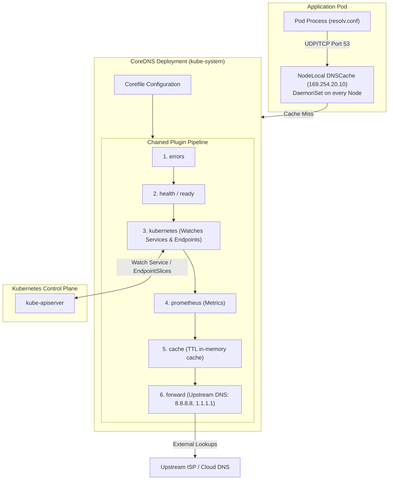

DNS resolution is the hidden backbone of every Kubernetes cluster. When an application pod connects to `db-service.production.svc.cluster.local`, an efficient, non-blocking lookup must occur in microseconds. If DNS degrades, the entire cluster grinds to a halt.

**CoreDNS** is the CNCF Graduated default DNS server in Kubernetes. Written in Go, it features a modular, chained plugin architecture where each incoming DNS query passes through a sequence of configurable plugins (such as caching, Kubernetes service discovery, rewriting, health checks, and metrics).



## Anatomy of the Kubernetes `Corefile`

The CoreDNS configuration lives inside a `ConfigMap` named `coredns` in the `kube-system` namespace.

Here is a standard production `Corefile`:

```text
.:53 {
    errors
    health {
       lameduck 5s
    }
    ready
    kubernetes cluster.local in-addr.arpa ip6.arpa {
       pods insecure
       fallthrough in-addr.arpa ip6.arpa
       ttl 30
    }
    prometheus :9153
    forward . /etc/resolv.conf {
       max_concurrent 1000
    }
    cache 30 {
       success 10000 30
       denial 2500 5
    }
    loop
    reload
    loadbalance
}
```

### Key Plugins Explained

- **`kubernetes`:** The core plugin that answers queries for `<service>.<namespace>.svc.cluster.local`. It watches Kubernetes API `EndpointSlices` to map DNS names directly to active pod IPs.
- **`cache`:** Caches positive responses (success TTL: 30s) and negative responses (NXDOMAIN denial TTL: 5s). Caching prevents CoreDNS from overloading the API server.
- **`forward`:** Forwards non-cluster external domain queries (e.g. `api.github.com`) to the upstream DNS resolvers specified in `/etc/resolv.conf`.
- **`loadbalance`:** Randomizes the A/AAAA record ordering in multi-replica DNS responses to distribute traffic across endpoints.

## Solving the `ndots:5` DNS Latency Bottleneck

By default, the kubelet configures every pod's `/etc/resolv.conf` with:

```text
search default.svc.cluster.local svc.cluster.local cluster.local
nameserver 10.96.0.10
options ndots:5
```

When an application queries `api.stripe.com`, because it contains only 2 dots (less than `ndots:5`), the Linux resolver sequentially searches:
1. `api.stripe.com.default.svc.cluster.local.` $\rightarrow$ **NXDOMAIN**
2. `api.stripe.com.svc.cluster.local.` $\rightarrow$ **NXDOMAIN**
3. `api.stripe.com.cluster.local.` $\rightarrow$ **NXDOMAIN**
4. `api.stripe.com.` $\rightarrow$ **SUCCESS (200ms latency penalty!)**

### Solution 1: Use Fully Qualified Domain Names (Trailing Dot)
In application code and configurations, append a trailing dot to external domain names: `api.stripe.com.`. This bypasses the search list entirely!

### Solution 2: Deploy `NodeLocal DNSCache`
NodeLocal DNSCache runs a DNS agent as a DaemonSet with a link-local IP (`169.254.20.10`) on every worker node. Queries are answered locally via local cache, bypassing conntrack table locks and reducing UDP packet drops:

```bash
kubectl apply -f https://raw.githubusercontent.com/kubernetes/kubernetes/master/cluster/addons/dns/nodelocaldns/nodelocaldns.yaml
```

## Monitoring CoreDNS with PromQL

Monitor DNS response codes to detect upstream outages or service discovery issues:

```promql
# Rate of DNS lookup failures (NXDOMAIN or SERVFAIL)
sum(rate(coredns_dns_responses_total{rcode=~"SERVFAIL|NXDOMAIN"}[5m])) by (rcode)

# 99th percentile DNS request duration
histogram_quantile(0.99, sum(rate(coredns_dns_request_duration_seconds_bucket[5m])) by (le))
```

## Production Scaling Guidelines

- **Autoscaling CoreDNS (`cluster-proportional-autoscaler`):** Ensure CoreDNS scales automatically with cluster size (e.g., 1 CoreDNS replica per 25 nodes or 250 cores).
- **Graceful Shutdown (`lameduck`):** Always configure `lameduck 5s` inside the `health` plugin so terminating CoreDNS pods stop accepting new requests before SIGKILL.

