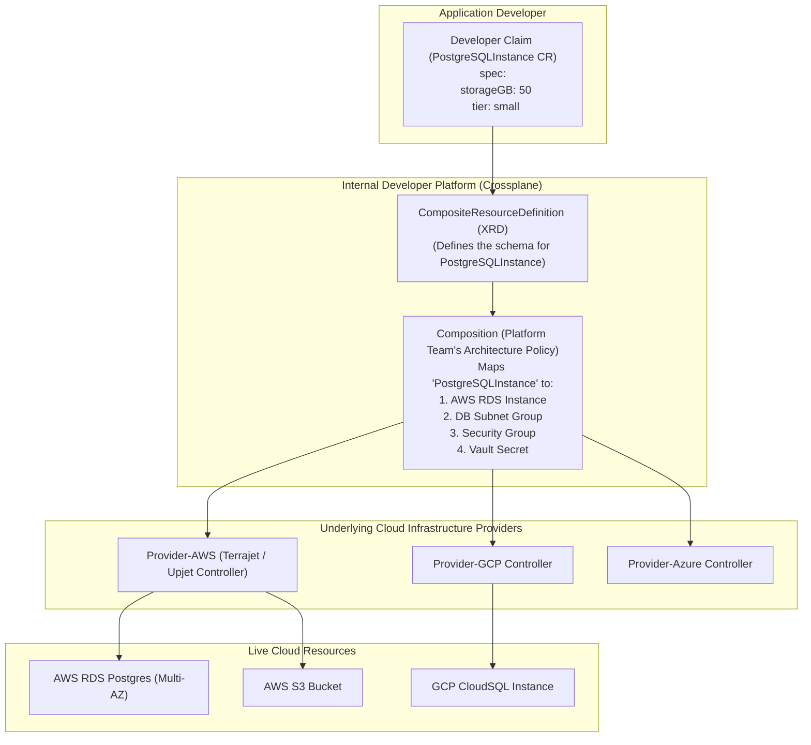

Platform engineering teams frequently struggle to bridge the gap between application deployment and cloud infrastructure provisioning. While Kubernetes manages containers natively, provisioning the backing cloud services (PostgreSQL databases, S3 buckets, SQS queues, IAM roles) usually requires external tools like Terraform, breaking GitOps workflows and creating ticket queues.

**Crossplane** (a CNCF Graduated project) turns any Kubernetes cluster into a universal cloud control plane. By extending the Kubernetes API with Managed Resources and Composite Resource Definitions (**XRDs**), Crossplane allows platform teams to build customized, self-service infrastructure APIs tailored for their developers using pure Kubernetes YAML.



## The Three Architecture Tiers of Crossplane

1. **Managed Resources (MRs):** Low-level Kubernetes Custom Resources representing specific cloud provider primitives (e.g., `RDSInstance`, `Bucket`, `Subnet`).
2. **Composite Resource Definitions (XRDs):** The schema defined by the platform engineering team establishing a clean, simplified abstraction (e.g. `AppDatabase`) hiding 90% of cloud provider complexity from developers.
3. **Compositions:** The policy engine that binds an XRD to real Managed Resources, enforcing corporate standards (encryption at rest, automated daily backups, multi-AZ high availability, cost tagging).

## Building an Internal Self-Service Database API

### Step 1: The Platform Team Defines the `Composition`

The platform team defines what actually gets provisioned behind the scenes when a developer asks for an `AppDatabase`:

```yaml
apiVersion: apiextensions.crossplane.io/v1
kind: Composition
metadata:
  name: production-postgresql-aws
  labels:
    provider: aws
    environment: production
spec:
  compositeTypeRef:
    apiVersion: database.kubedaily.com/v1alpha1
    kind: AppDatabase
  resources:
    - name: rds-instance
      base:
        apiVersion: rds.aws.upbound.io/v1beta1
        kind: Instance
        spec:
          forProvider:
            engine: postgres
            engineVersion: "15.4"
            instanceClass: db.t4g.medium
            allocatedStorage: 20
            storageEncrypted: true
            publiclyAccessible: false
            skipFinalSnapshot: false
      patches:
        - type: FromCompositeFieldPath
          fromFieldPath: "spec.storageGB"
          toFieldPath: "spec.forProvider.allocatedStorage"
        - type: FromCompositeFieldPath
          fromFieldPath: "spec.instanceClass"
          toFieldPath: "spec.forProvider.instanceClass"
```

### Step 2: The Developer Claims a Database in YAML

The application developer does not need to learn AWS IAM, VPC peering, or RDS subnets. They submit a simple claim alongside their application deployment:

```yaml
apiVersion: database.kubedaily.com/v1alpha1
kind: AppDatabase
metadata:
  name: order-service-db
  namespace: order-service
spec:
  storageGB: 50
  instanceClass: db.t4g.large
  compositionSelector:
    matchLabels:
      provider: aws
      environment: production
  writeConnectionSecretToRef:
    name: db-credentials
```

Crossplane provisions the AWS RDS instance, generates a high-entropy password, and writes the connection endpoint, username, and password directly into a native Kubernetes `Secret` (`db-credentials`) in the developer's namespace!

## Crossplane vs Terraform: Why Modern Platform Teams Switch

| Feature | Terraform | Crossplane |
| :--- | :--- | :--- |
| **Execution Model** | Static, batch CLI runs (`plan` & `apply`) | **Continuous async reconciliation loop (24/7)** |
| **Drift Detection & Self-Healing** | Only detected during scheduled CI runs | **Instantaneous self-healing (overrides out-of-band changes)** |
| **Developer Interface** | HCL files and separate pipeline triggers | **Standard Kubernetes YAML alongside app manifests** |
| **Secret Management** | Sensitive values stored in statefile | **Direct injection into Kubernetes `Secrets`** |
| **GitOps Integration** | Requires external Terraform orchestrators | **Native integration with Argo CD and Flux CD** |

## Production Best Practices

- **Pair with Argo CD:** Store your Crossplane claims in Git. Argo CD reconciles both the application containers and their backing cloud databases in a single unified GitOps pipeline.
- **Provider Scoping:** Install only the specific Upbound provider families you need (e.g. `provider-aws-rds`, `provider-aws-s3`) rather than the monolithic all-inclusive AWS provider to minimize controller memory consumption.

