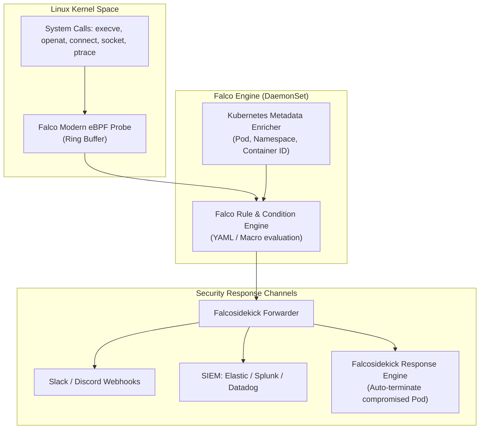

Static vulnerability scanners and admission controllers safeguard your cluster before a pod starts. But what happens when an attacker exploits a remote code execution (RCE) vulnerability in a running container, spawns a reverse shell, or attempts privilege escalation?

This is where **Falco**, the CNCF graduated runtime security engine, comes in. Falco acts as a security camera for the Linux kernel, monitoring low-level system calls in real time via an eBPF probe or kernel module to detect anomalous and malicious behavior.



## How Falco Works Under the Hood

Unlike user-space security agents that parse text log files after the fact, Falco hooks directly into the host kernel's system call boundary:

1. **Kernel System Call Interception:** Captures syscalls such as `execve()` (process creation), `openat()` (file reads/writes), and `connect()` (network connections).
2. **Context Enrichment:** Correlates the kernel-level PID and cgroup with active Kubernetes API metadata (Namespace, Pod name, container image).
3. **Rule Evaluation:** Evaluates each event against an extensible library of security rules defined in readable YAML expressions.
4. **Instant Alerting:** Emits structured JSON alerts within milliseconds to SIEMs, Slack, or webhook endpoints.

## Real-World Attack Scenarios Falco Detects

- **Spawning an Interactive Shell:** An attacker executes `bash` or `sh` inside a production web server container.
- **Reading Sensitive Host Files:** A compromised pod attempts to inspect `/etc/shadow`, `/etc/kubernetes/pki`, or `/proc/kcore`.
- **Modifying System Binaries:** Writing files to immutable directories such as `/bin`, `/usr/bin`, or `/sbin`.
- **Outbound Crypto Mining Traffic:** Establishing unauthorized connections to known Monero mining pools or unusual ports.
- **Container Escape Attempts:** Loading malicious kernel modules or invoking `ptrace` on host processes.

## Crafting Custom Falco Rules

Falco rules use condition expressions consisting of fields, macros, and lists.

Here is a rule detecting interactive shell creation inside production namespaces:

```yaml
- list: production_namespaces
  items: [prod, billing, payments]

- macro: container_started
  condition: container.id != host

- macro: spawned_process
  condition: evt.type = execve and evt.dir = <

- rule: Terminal Shell Spawned in Production
  desc: Detects an interactive bash or sh session spawned within a sensitive production pod
  condition: >
    spawned_process and
    container_started and
    k8s.ns.name in (production_namespaces) and
    proc.name in (bash, sh, zsh, dash)
  output: >
    CRITICAL: Interactive shell spawned in container!
    (user=%user.name container=%container.name pod=%k8s.pod.name ns=%k8s.ns.name cmd=%proc.cmdline parent=%proc.pname)
  priority: CRITICAL
  tags: [container, shell, mitre_execution]
```

## Deploying Falco on Kubernetes with Helm

The recommended deployment mode leverages the modern **eBPF driver** without needing to compile host kernel headers:

```bash
helm repo add falcosecurity https://falcosecurity.github.io/charts
helm repo update

helm install falco falcosecurity/falco \
  --namespace falco \
  --create-namespace \
  --set driver.kind=modern_ebpf \
  --set falcosidekick.enabled=true \
  --set falcosidekick.config.slack.webhookurl="https://hooks.slack.com/services/XXX"
```

Verify that the DaemonSet is running across every cluster worker node:

```bash
kubectl get pods -n falco -o wide
```

## Production Hardening Tips

- **Adopt Modern eBPF:** Prefer `driver.kind=modern_ebpf` on Linux kernel >= 5.8 to eliminate dependencies on dynamic kernel headers or third-party DKMS modules.
- **Tune Falco Rules to Avoid Alert Fatigue:** Use `falcoctl` to maintain and update the default rule stream, and maintain custom override files to whitelist legitimate CI/CD debuggers or cron jobs.
- **Automated Quarantine via Falcosidekick-UI:** Combine Falco with `falcosidekick` response actions to automatically isolate or delete pods when `CRITICAL` rules trigger.

