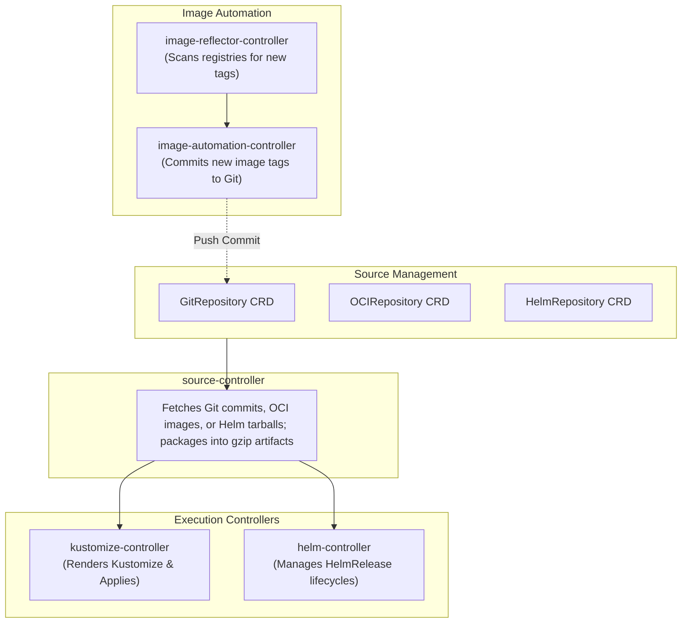

While Argo CD provides an integrated web dashboard and single controller architecture, **Flux CD** (a CNCF Graduated project) is designed as a modular set of composable Kubernetes controllers known as the **GitOps Toolkit**.

Flux implements a pure Unix philosophy for GitOps: dedicated controllers handle source synchronization, Kustomize overlays, Helm chart releases, notification webhooks, and automated container image updates.



## The GitOps Toolkit Controllers

1. **`source-controller`:** The foundation of Flux. Clones Git repositories, pulls OCI artifacts, and downloads Helm chart repositories, caching them in memory as immutable tarballs.
2. **`kustomize-controller`:** Reconciles cluster state with plain Kubernetes YAML or Kustomize overlays, with built-in decryption for SOPS-encrypted secrets.
3. **`helm-controller`:** Manages the full lifecycle of Helm charts declaratively using `HelmRelease` Custom Resources.
4. **`image-automation-controller`:** Automatically scans container registries for new version tags matching semver rules and commits the updated tags directly back to Git.

## Defining a HelmRelease with Flux

Manage a third-party Helm chart declaratively:

```yaml
apiVersion: source.toolkit.fluxcd.io/v1
kind: HelmRepository
metadata:
  name: bitnami
  namespace: flux-system
spec:
  interval: 1h
  url: https://charts.bitnami.com/bitnami
---
apiVersion: helm.toolkit.fluxcd.io/v2
kind: HelmRelease
metadata:
  name: redis-cache
  namespace: database
spec:
  interval: 30m
  chart:
    spec:
      chart: redis
      version: "18.x"
      sourceRef:
        kind: HelmRepository
        name: bitnami
        namespace: flux-system
  values:
    architecture: standalone
    auth:
      enabled: false
    master:
      persistence:
        size: 10Gi
```

## Secret Management with Mozilla SOPS

Flux features native integration with Mozilla SOPS, allowing you to commit encrypted secrets into public or private Git repositories safely:

```yaml
apiVersion: kustomize.toolkit.fluxcd.io/v1
kind: Kustomization
metadata:
  name: app-secrets
  namespace: flux-system
spec:
  interval: 10m
  path: "./deploy/secrets"
  prune: true
  sourceRef:
    kind: GitRepository
    name: fleet-infra
  decryption:
    provider: sops
    secretRef:
      name: sops-gpg-key
```

## Automated Image Tag Updates Back to Git

Configure Flux to automatically commit new container image tags to your repository whenever a new version is built by CI:

```yaml
apiVersion: image.toolkit.fluxcd.io/v1beta2
kind: ImagePolicy
metadata:
  name: backend-policy
  namespace: flux-system
spec:
  imageRepositoryRef:
    name: backend-repo
  policy:
    semver:
      range: ">=1.0.0 <2.0.0"
---
apiVersion: image.toolkit.fluxcd.io/v1beta2
kind: ImageUpdateAutomation
metadata:
  name: auto-commit-images
  namespace: flux-system
spec:
  interval: 5m
  sourceRef:
    kind: GitRepository
    name: fleet-infra
  git:
    checkout:
      ref:
        branch: main
    commit:
      author:
        email: fluxbot@kubedaily.com
        name: Flux Bot
      messageTemplate: "chore: update {{range .Updated.Images}}{{.}}{{end}}"
    push:
      branch: main
  update:
    path: "./deploy"
    strategy: Setters
```

## Argo CD vs Flux CD: Architectural Comparison

| Dimension | Flux CD | Argo CD |
| :--- | :--- | :--- |
| **Architecture** | Micro-controllers (GitOps Toolkit) | Unified monolithic controller + UI server |
| **Web UI** | Headless CLI / optional Weave GitOps | Built-in multi-tenant UI |
| **Secret Decryption** | Native Mozilla SOPS & age support | Requires plugins or External Secrets |
| **OCI Artifacts** | Native support for OCI-packaged manifests | Supported via Helm OCI |
| **Automated Git Writes**| Native `image-automation-controller` | Requires external CI scripts or Argo Image Updater |

