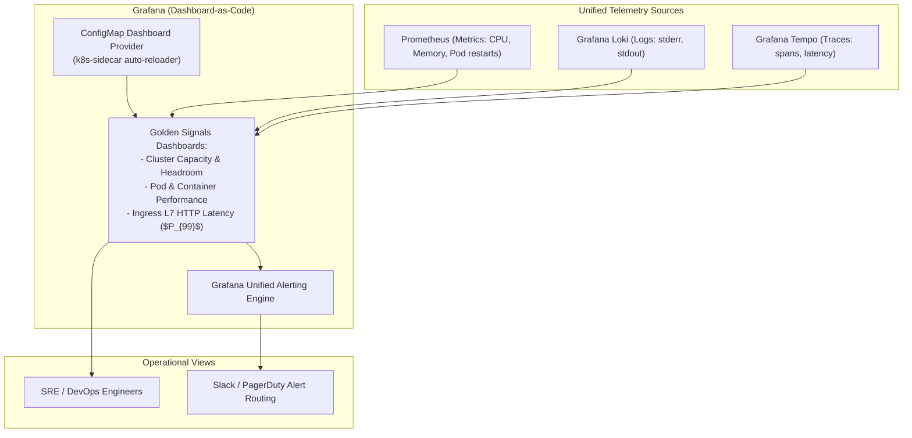

Metrics stored in Prometheus or logs collected in Loki are only as effective as the engineering team's ability to interpret them during an incident. **Grafana** is the defacto standard visualization and analytics platform for cloud-native infrastructure.

When configured as **Dashboard-as-Code** on Kubernetes, Grafana eliminates manual dashboard drift, tracks Golden Signals across microservices, and enables instant drill-downs from high-level cluster capacity down to individual container logs and traces.



## The Four Golden Signals for Kubernetes Workloads

Every production Kubernetes dashboard must prioritize Google's Four Golden Signals:

1. **Latency:** Time taken to service requests ($P_{50}$, $P_{90}$, $P_{99}$).
2. **Traffic:** Demand placed on the service (HTTP requests per second or IOPS).
3. **Errors:** Rate of requests that fail (HTTP 5xx status codes or dropped connections).
4. **Saturation:** Resource utilization and headroom (CPU throttling %, Memory usage vs limit, Node ephemeral disk fullness).

## Dashboards-as-Code with the Grafana Sidecar

Never configure production dashboards manually via the Grafana web UI—manual changes are wiped when pods restart. Instead, deploy the Grafana sidecar which watches Kubernetes `ConfigMaps` with a specific label:

```yaml
apiVersion: v1
kind: ConfigMap
metadata:
  name: kubernetes-pod-overview-dashboard
  namespace: monitoring
  labels:
    # The sidecar automatically discovers this label and loads the dashboard!
    grafana_dashboard: "1"
data:
  pod-overview.json: |
    {
      "title": "Production Pod Overview",
      "panels": [
        {
          "title": "Container CPU Usage vs Limit",
          "type": "timeseries",
          "targets": [
            {
              "expr": "sum(rate(container_cpu_usage_seconds_total{namespace=~\"$namespace\"}[5m])) by (pod)",
              "legendFormat": "{{pod}} (Usage)"
            },
            {
              "expr": "sum(kube_pod_container_resource_limits{resource=\"cpu\", namespace=~\"$namespace\"}) by (pod)",
              "legendFormat": "{{pod}} (Limit)"
            }
          ]
        }
      ]
    }
```

## Useful PromQL Queries for Kubernetes Dashboards

### 1. Pod Memory Saturation (% of Limit)
Detect pods approaching OOMKill:
```promql
sum(container_memory_working_set_bytes{container!=""}) by (namespace, pod)
/
sum(kube_pod_container_resource_limits{resource="memory"}) by (namespace, pod) * 100
```

### 2. CFS CPU Throttling Rate
Identify microservices being slowed down by aggressive CPU limits:
```promql
sum(increase(container_cpu_cfs_throttled_periods_total[5m])) by (namespace, pod)
/
sum(increase(container_cpu_cfs_periods_total[5m])) by (namespace, pod) * 100
```

### 3. CrashLooping Pods
```promql
sum(rate(kube_pod_container_status_restarts_total[15m])) by (namespace, pod) > 0
```

## Correlating Metrics to Logs and Traces

Modern Grafana leverages **Data Links** to turn metric spikes into interactive links:
- Clicking a latency spike on an HTTP graph automatically opens **Grafana Tempo** filtered by trace spans during that exact minute.
- Clicking a failed pod status automatically queries **Grafana Loki** with `{pod="$pod"} |= "error"`.

## Production Hardening Recommendations

- **Enable Anonymous Viewer Mode in Staging:** Configure `GF_AUTH_ANONYMOUS_ENABLED=true` with `role: Viewer` in staging to simplify team access, but enforce strict SSO (Okta, GitHub, Google) with RBAC in production.
- **Resource Limits:** Give Grafana adequate memory (minimum 512Mi request, 2Gi limit) if serving concurrent large dashboard reloads across dozens of team members.

