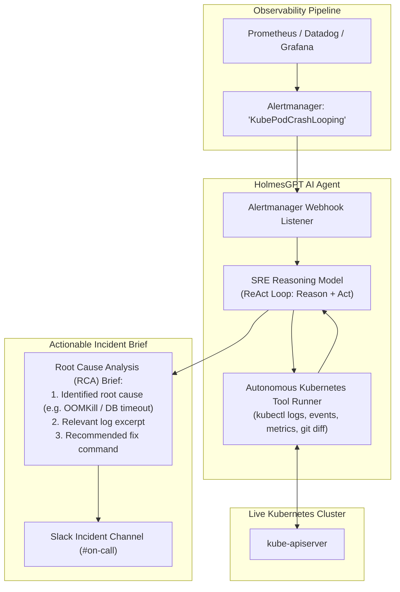

When a high-priority PagerDuty or Prometheus Alertmanager notification wakes an on-call SRE at 3:00 AM, the first 15 minutes are typically lost to manual, repetitive triage: checking pod logs, inspecting events, running `top pods`, and correlating metric spikes.

**HolmesGPT** (created by the Robust Intelligence team) is an autonomous AI on-call investigator that acts as an automated first responder. Integrated directly with Prometheus Alertmanager, Slack, and Kubernetes clusters, HolmesGPT autonomously investigates alert triggers, correlates logs and metrics, identifies the root cause, and delivers an executive diagnostic summary to Slack before the engineer opens their terminal.



## How the HolmesGPT Autonomous ReAct Loop Works

Unlike static chatbots that only respond to user prompts, HolmesGPT implements a dynamic **ReAct (Reasoning + Acting)** execution loop:

1. **Alert Parsing:** Reads incoming Prometheus Alertmanager JSON payloads, extracting the firing metric, alert name, namespace, and labels.
2. **Autonomous Tool Selection:** Holmes decides which diagnostic commands to run based on the alert type:
   - For `KubePodCrashLooping`: Inspects previous container logs (`--previous`) and cluster events (`kubectl get events`).
   - For `KubeCPUThrottlingHigh`: Checks current CPU limits against CFS throttling metrics.
   - For `KubeDeploymentReplicasMismatch`: Checks node capacity, taint tolerations, and PVC volume bindings.
3. **Synthesis & Root Cause Isolation:** Distills hundreds of lines of noise into a concise root cause analysis.
4. **Interactive Slack Escalation:** Delivers an actionable brief with suggested remediation commands to the engineering channel.

## Hands-On: Running HolmesGPT via CLI

Investigate an active alert directly from your terminal:

```bash
# Ask Holmes to investigate why a deployment is failing
holmes investigate "The checkout-service in namespace staging is failing health checks"
```

Sample output:
```text
🔍 Investigating: checkout-service in namespace staging...
⚙️ Running: kubectl get pods -n staging -l app=checkout-service
⚙️ Running: kubectl logs -n staging checkout-service-78f99b8-4klz --previous
⚙️ Running: kubectl describe pod -n staging checkout-service-78f99b8-4klz

📊 Root Cause Analysis:
The checkout-service pod is failing due to a fatal database connection timeout.
The pod attempted to connect to 'postgres.staging.svc.cluster.local:5432', but the connection was refused.

📋 Recommended Remediation:
1. Verify Postgres state: kubectl get pods -n staging -l app=postgres
2. Check Postgres logs: kubectl logs -n staging deployment/postgres
```

## Integrating HolmesGPT with Prometheus Alertmanager

Configure Alertmanager to dispatch webhook notifications directly to HolmesGPT:

```yaml
# alertmanager.yaml
route:
  receiver: "holmesgpt-webhook"
  group_by: ["alertname", "namespace", "job"]
  routes:
    - match_re:
        severity: critical|warning
      receiver: "holmesgpt-webhook"

receivers:
  - name: "holmesgpt-webhook"
    webhook_configs:
      - url: "http://holmesgpt.monitoring.svc.cluster.local:5000/webhook"
        send_resolved: false
```

Deploy HolmesGPT into the cluster:

```yaml
apiVersion: apps/v1
kind: Deployment
metadata:
  name: holmesgpt
  namespace: monitoring
spec:
  replicas: 1
  selector:
    matchLabels:
      app: holmesgpt
  template:
    metadata:
      labels:
        app: holmesgpt
    spec:
      serviceAccountName: holmesgpt-sa
      containers:
        - name: holmesgpt
          image: ghcr.io/robust-intelligence/holmesgpt:latest
          env:
            - name: OPENAI_API_KEY
              valueFrom:
                secretKeyRef:
                  name: llm-secrets
                  key: api-key
            - name: SLACK_WEBHOOK_URL
              valueFrom:
                secretKeyRef:
                  name: slack-secrets
                  key: webhook-url
          ports:
            - containerPort: 5000
```

## Security Guardrails for AI SRE Agents

- **Read-Only RBAC Binding:** Bind HolmesGPT exclusively to a read-only `ClusterRole` (verbs: `get`, `list`, `watch`). Never grant `create`, `delete`, or `patch` permissions to autonomous diagnostic tools.
- **Audit Logging:** Enable Kubernetes API audit logging for the agent's ServiceAccount to review every command run during incident investigations.
- **Sensitive Data Masking:** Configure log sanitizers to scrub environment variables containing database credentials or API keys before transmitting context to the LLM.

