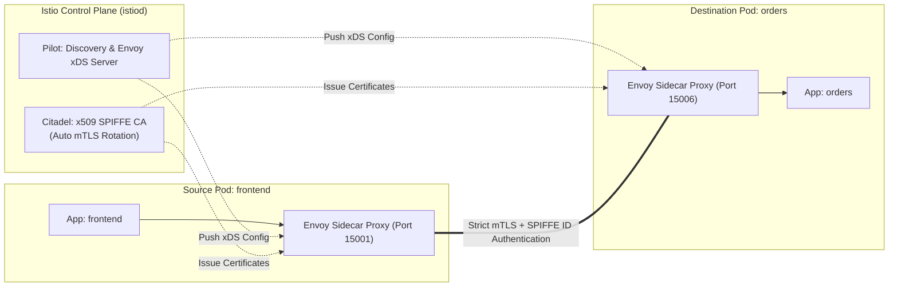

As microservice architectures scale, managing service-to-service communication, mutual TLS (mTLS) certificate rotation, Canary traffic splitting, and fault tolerance at the application layer becomes untenable. **Istio** is the industry-leading, CNCF Graduated service mesh that provides transparent traffic management, zero-trust security, and observability across microservices.

Istio injects a high-performance **Envoy** proxy alongside each application container (or uses ambient node-level ztunnels), intercepting all inbound and outbound traffic to enforce policies without touching application source code.



## The Three Pillars of Istio

1. **Zero-Trust Security & Strict mTLS:** Automatically issues cryptographically verified SPIFFE identities (`spiffe://cluster.local/ns/prod/sa/orders-sa`) and establishes mutual TLS encryption for all pod-to-pod transit traffic.
2. **Fine-Grained Traffic Routing:** Implements Canary releases, weighted percentage traffic splits (e.g., 90% v1, 10% v2), and header-based routing (e.g., send beta testers to v2).
3. **Resilience & Fault Tolerance:** Configures circuit breakers, request timeouts, retries with exponential backoff, and fault injection directly in declarative YAML.

## Enabling Strict Zero-Trust Mutual TLS

By default, Istio runs in `PERMISSIVE` mode. To guarantee that all plaintext traffic is rejected, enforce `STRICT` mTLS cluster-wide:

```yaml
apiVersion: security.istio.io/v1beta1
kind: PeerAuthentication
metadata:
  name: default
  namespace: istio-system
spec:
  mtls:
    mode: STRICT
```

Now, any unmeshed pod or rogue container attempting to communicate over unencrypted plaintext will be rejected at the Envoy handshake boundary.

## Canary Traffic Shifting with VirtualService & DestinationRule

Split incoming user traffic smoothly between stable (`v1`) and canary (`v2`) versions of a service:

```yaml
apiVersion: networking.istio.io/v1alpha3
kind: DestinationRule
metadata:
  name: product-service
  namespace: default
spec:
  host: product-service
  subsets:
    - name: v1
      labels:
        version: v1
    - name: v2
      labels:
        version: v2
---
apiVersion: networking.istio.io/v1alpha3
kind: VirtualService
metadata:
  name: product-service-route
  namespace: default
spec:
  hosts:
    - product-service
  http:
    - route:
        - destination:
            host: product-service
            subset: v1
          weight: 90
        - destination:
            host: product-service
            subset: v2
          weight: 10
```

## Implementing Circuit Breaking and Outlier Detection

Prevent cascading failures across the cluster when a downstream microservice starts failing:

```yaml
apiVersion: networking.istio.io/v1alpha3
kind: DestinationRule
metadata:
  name: inventory-circuit-breaker
  namespace: default
spec:
  host: inventory-service
  trafficPolicy:
    connectionPool:
      tcp:
        maxConnections: 100
      http:
        http1MaxPendingRequests: 10
        maxRequestsPerConnection: 10
    outlierDetection:
      consecutive5xxErrors: 3
      interval: 10s
      baseEjectionTime: 30s
      maxEjectionPercent: 50
```

If a pod instance returns 3 consecutive 5xx errors, Envoy automatically ejects it from the healthy load-balancing pool for 30 seconds.

## Istio Ambient Mode: The Sidecar-Less Evolution

For environments where injecting a sidecar proxy into every pod adds too much memory overhead (~50MB per pod), Istio provides **Ambient Mesh**:
- **ztunnel (Zero-Trust Tunnel):** A node-level DaemonSet that handles L4 mutual TLS encryption and identity at wire speed.
- **waypoint proxy:** Dedicated Envoy instances deployed per namespace that handle L7 traffic management only when needed.

## Production Checklist

- **Sidecar Resource Requests:** Set reasonable memory/CPU requests on `istio-proxy` containers (`100m` CPU, `128Mi` RAM) to prevent eviction during cluster load surges.
- **ExportTo Scoping:** Use `exportTo: ["."]` on VirtualServices and Services to limit xDS configuration distribution to local namespaces, preventing `istiod` CPU spikes on large clusters with thousands of services.

