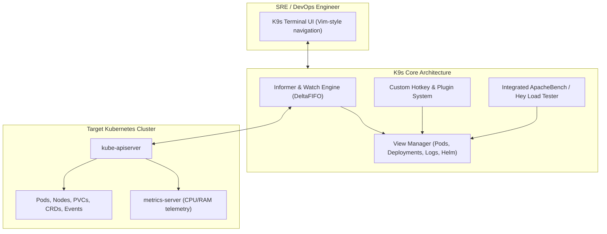

Typing repetitive `kubectl get pods`, `kubectl describe`, and `kubectl logs` commands during an incident is slow and error-prone. **K9s** is a terminal-based UI (TUI) written in Go that provides a lightning-fast, keyboard-driven interface to observe, navigate, and manage Kubernetes clusters in real time.

K9s watches cluster resources via the Kubernetes API streaming channels, continuously refreshing views without manual re-runs while highlighting pod restarts, CPU/Memory throttling, and failed health probes.



## Essential K9s Keybindings and Workflows

K9s is designed for speed. Navigation follows intuitive Vim and shell conventions:

| Keybinding | Action |
| :--- | :--- |
| `:pod` | Jump to Pods view across all namespaces |
| `:deploy` | Jump to Deployments view |
| `:sec` | Jump to Secrets view (auto-decodes base64 with `x`) |
| `:cr` | List all registered Custom Resource Definitions (CRDs) |
| `/query` | Filter resources matching a regex or text string |
| `<ctrl-d>` | Delete the selected resource (with confirmation modal) |
| `l` | Stream real-time logs for the selected pod or container |
| `s` | Open an interactive `exec` shell session into the selected pod |
| `d` | Run `kubectl describe` on the highlighted resource |
| `y` | View and edit the resource YAML live |

## Viewing Decoded Secrets Instantly

Instead of copying base64 strings and running `echo "..." | base64 -d` in a separate terminal:
1. Type `:secret` and press `Enter`.
2. Highlight your target Secret and press `Enter`.
3. Press `x` (toggle secret decoding) to view all key-value pairs in plaintext!

## Customizing K9s with Plugins

K9s allows you to attach custom bash scripts and tools to single-letter hotkeys. Create `~/.config/k9s/plugins.yaml`:

```yaml
plugin:
  # Press 't' to open a Trivy vulnerability scan on the selected pod
  trivy:
    shortCut: Shift-T
    confirm: false
    description: "Trivy Scan"
    scopes:
      - pods
    command: trivy
    background: false
    args:
      - k8s
      - --report=summary
      - $NAMESPACE/$NAME

  # Press 'r' to trigger a rollout restart on the selected deployment
  restart:
    shortCut: Shift-R
    confirm: true
    description: "Rollout Restart"
    scopes:
      - deployments
    command: kubectl
    background: true
    args:
      - rollout
      - restart
      - deployment/$NAME
      - -n
      - $NAMESPACE
```

## Port-Forwarding Without Complex Flags

To access an internal database or web service running inside your cluster:
1. Highlight the target Pod or Service in K9s.
2. Press `Shift-F` (Port Forward).
3. Specify the local port (e.g. `8080`) and container port.
4. K9s manages the port-forward session in the background; view active forwards anytime by typing `:portforward`.

## Production Power Tips

- **Skin & Color Profiles:** Customize `~/.config/k9s/skins/` to assign high-visibility red themes to production cluster contexts to prevent accidental destructive actions.
- **Read-Only Mode:** Run `k9s --readonly` when pairing with junior developers or presenting live demonstrations to disable all delete, edit, and restart mutations.
- **Context Switching:** Type `:ctx` to switch instantly between AWS EKS, Google GKE, and local Kind cluster contexts without touching `kubectx`.

