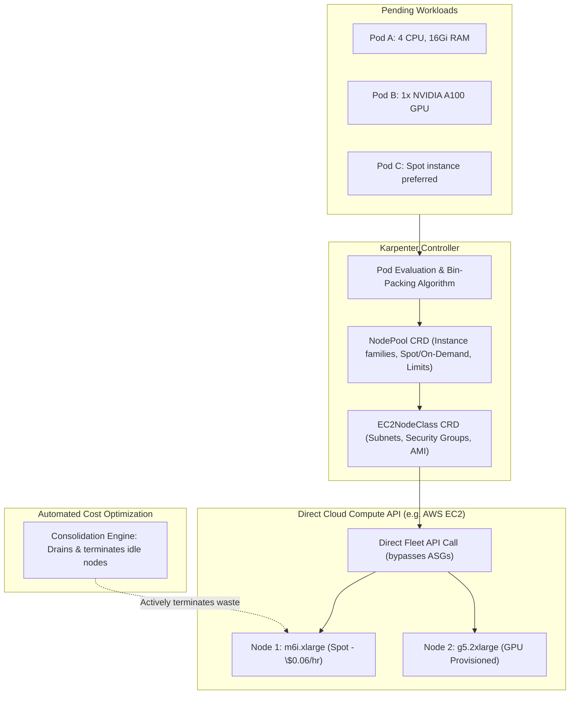

Legacy Kubernetes node autoscaling relies on **Cluster Autoscaler**, which couples pod scheduling to pre-configured, static cloud provider Auto Scaling Groups (ASGs) or Managed Node Groups. When an un-schedulable pod requests specialized GPU resources or large memory, Cluster Autoscaler must negotiate with cloud APIs, often taking **3 to 10 minutes** to provision a node.

**Karpenter** (a CNCF project open-sourced by AWS) is a flexible, high-performance, group-less node autoscaler. By observing un-schedulable pods directly and communicating with raw cloud compute APIs (EC2, Azure VM), Karpenter provisions right-sized nodes in **under 45 seconds** and consolidates underutilized workloads automatically to reduce cloud spend.



## How Karpenter Differs from Cluster Autoscaler

| Dimension | Legacy Cluster Autoscaler | Karpenter |
| :--- | :--- | :--- |
| **Node Groups** | Requires static, pre-defined Auto Scaling Groups (ASGs) | **Group-less:** Evaluates all available cloud instance types dynamically |
| **Scale-Up Latency** | 3 to 10 minutes (ASG signaling overhead) | **30 to 60 seconds** (direct Fleet API calls) |
| **Bin-Packing** | Blind scaling within fixed ASG instance size | **Right-sized:** Selects the cheapest instance matching exact pod shapes |
| **Disruption & Consolidation**| Basic scale-down after idle timeout | **Active Consolidation:** Defragments cluster, replacing expensive nodes with cheaper options |
| **Bare Metal / Hybrid** | Cloud-provider specific | Extensible architecture supporting AWS, Azure, and future providers |

## Defining a Production `NodePool` and `EC2NodeClass`

With Karpenter v1, configuration is split cleanly into workload policy (`NodePool`) and cloud infrastructure (`EC2NodeClass`):

```yaml
apiVersion: karpenter.sh/v1
kind: NodePool
metadata:
  name: general-compute
spec:
  template:
    spec:
      requirements:
        # Prefer Spot instances, fallback to On-Demand
        - key: "karpenter.sh/capacity-type"
          operator: In
          values: ["spot", "on-demand"]
        # Allow modern cost-effective Graviton and x86 instances
        - key: "kubernetes.io/arch"
          operator: In
          values: ["amd64", "arm64"]
        - key: "karpenter.k8s.aws/instance-category"
          operator: In
          values: ["c", "m", "r"]
        - key: "karpenter.k8s.aws/instance-generation"
          operator: Gt
          values: ["5"]
      nodeClassRef:
        group: karpenter.k8s.aws
        kind: EC2NodeClass
        name: default-ec2
  limits:
    cpu: "1000"
    memory: 2000Gi
  disruption:
    consolidationPolicy: WhenEmptyOrUnderutilized
    consolidateAfter: 1m
---
apiVersion: karpenter.k8s.aws/v1
kind: EC2NodeClass
metadata:
  name: default-ec2
spec:
  amiFamily: AL2023
  role: "KarpenterNodeRole-my-cluster"
  subnetSelectorTerms:
    - tags:
        karpenter.sh/discovery: "my-cluster"
  securityGroupSelectorTerms:
    - tags:
        karpenter.sh/discovery: "my-cluster"
```

## How Karpenter Consolidation Cuts Cloud Spend

When traffic subsides at night:
1. Karpenter continuously calculates whether all pods running across multiple partially filled nodes can fit onto fewer nodes or a single cheaper instance.
2. It provisions the smaller replacement node.
3. It gracefully cordons and drains the old nodes using the Kubernetes Eviction API, respecting `PodDisruptionBudgets`.
4. It terminates the expensive old instances, immediately eliminating cloud waste.

## Production Best Practices

- **Always Configure `PodDisruptionBudgets` (PDBs):** Karpenter respects PDBs during consolidation. Without PDBs, consolidation could evict too many replicas simultaneously.
- **Set Realistic Resource Requests:** Because Karpenter provisions nodes based on pod resource *requests*, accurate requests ensure optimal bin-packing without over-allocating physical hardware.
- **Enable Spot Instance Diversification:** Allow Karpenter to choose from at least 15-20 different instance types (`c6g.xlarge`, `m6i.xlarge`, `c5.xlarge`) to maximize Spot availability and prevent allocation interruptions.

