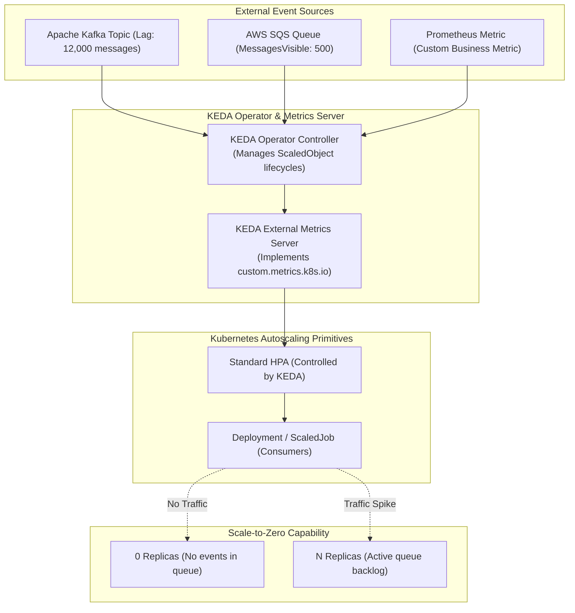

The standard Kubernetes Horizontal Pod Autoscaler (HPA) works primarily on internal resource metrics like CPU and Memory utilization. However, modern asynchronous workloads (message consumer workers, batch processors, stream analytics) are driven by **events**, not CPU spikes.

A queue with 50,000 pending messages might consume almost no CPU if consumer pods are idle or blocked on network I/O, preventing the HPA from scaling until it's too late.

**KEDA (Kubernetes Event-driven Autoscaling)** is a CNCF Graduated project that extends the HPA with over **60+ external event scalers** (Kafka, RabbitMQ, AWS SQS, Redis, PostgreSQL, Prometheus). Furthermore, KEDA can scale workloads **to and from zero**, completely eliminating idle compute costs.



## How KEDA Coordinates with Kubernetes HPA

1. **Scale 0 to 1 (KEDA Controller):** Standard HPA cannot scale a deployment from 0 to 1 replicas because no pods exist to report metrics. The KEDA operator monitors the external event source directly. As soon as a message appears, KEDA scales the deployment from `0 -> 1`.
2. **Scale 1 to N (Kubernetes HPA):** Once at least one replica is active, KEDA delegates scaling from `1 -> N` to the native HPA, serving as the `external.metrics.k8s.io` provider.
3. **Scale N to 0 (KEDA Controller):** When the message queue drains and stays empty for the configured `cooldownPeriod`, KEDA steps in and scales the workload cleanly back to `0`.

## Scaling a Kafka Consumer with `ScaledObject`

Scale a consumer deployment based on Kafka consumer group lag:

```yaml
apiVersion: keda.sh/v1alpha1
kind: ScaledObject
metadata:
  name: order-processor-scaler
  namespace: default
spec:
  scaleTargetRef:
    name: order-processor-deployment
  minReplicaCount: 0
  maxReplicaCount: 30
  cooldownPeriod: 300
  pollingInterval: 15
  triggers:
    - type: kafka
      metadata:
        bootstrapServers: "kafka.messaging.svc.cluster.local:9092"
        consumerGroup: "order-consumers"
        topic: "orders-topic"
        lagThreshold: "50"
      authenticationRef:
        name: keda-kafka-auth
```

If the consumer group lag reaches 1,000 messages and the `lagThreshold` is 50, KEDA instructs the HPA to scale out to $1000 / 50 = 20$ pods immediately.

## Auto-Scaling Ephemeral Kubernetes Jobs with `ScaledJob`

For batch operations where each message represents a discrete task that should run to completion rather than a long-lived consumer pod, use `ScaledJob`:

```yaml
apiVersion: keda.sh/v1alpha1
kind: ScaledJob
metadata:
  name: video-transcoder-job
  namespace: default
spec:
  jobTargetRef:
    template:
      spec:
        containers:
          - name: transcoder
            image: my-org/video-processor:v1.0
        restartPolicy: Never
  maxReplicaCount: 50
  successfulJobsHistoryLimit: 5
  triggers:
    - type: aws-sqs-queue
      metadata:
        queueURL: "https://sqs.us-east-1.amazonaws.com/123456789/video-render-queue"
        queueLength: "1"
        awsRegion: "us-east-1"
      authenticationRef:
        name: keda-aws-credentials
```

KEDA spins up one ephemeral Kubernetes `Job` per message in the SQS queue, allowing pods to complete their work and terminate without staying idle.

## Production Tuning & Best Practices

- **Damping & Stabilization:** Configure `behavior.scaleDown.stabilizationWindowSeconds: 300` in the `ScaledObject` advanced spec to prevent "flapping" (rapidly scaling up and down when message queues arrive in bursts).
- **Graceful Shutdown for Message Consumers:** Ensure your consumer applications handle `SIGTERM` gracefully, allowing in-flight message processing to complete before exiting.
- **Trigger Authentication via SecretProvider:** Use `TriggerAuthentication` linked to IAM Roles for Service Accounts (IRSA on AWS) or Workload Identity (GCP/Azure) to avoid embedding static access keys in manifests.

