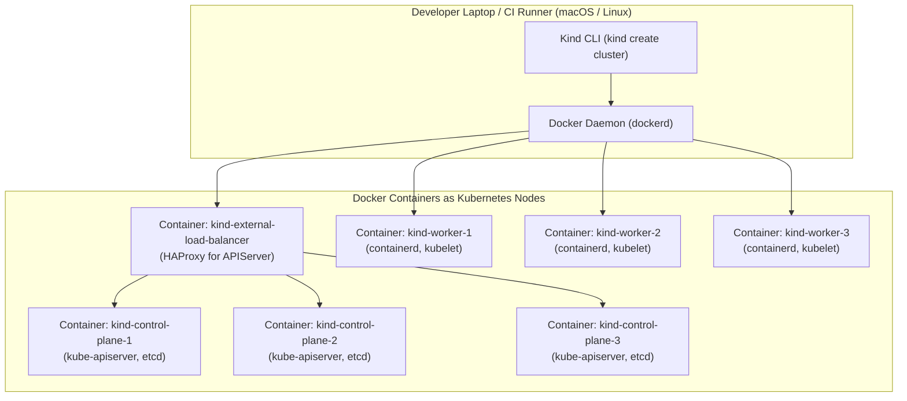

Testing multi-node Kubernetes behaviors (such as node affinity, pod topology spread constraints, cordon/drain operations, and HA control plane failover) requires multi-node clusters. Spinning up multi-node clusters on cloud providers is slow and expensive, while Minikube defaults to a single VM.

**Kind (Kubernetes IN Docker)** is a tool maintained by the Kubernetes Special Interest Group (SIG Testing) that runs fully compliant multi-node Kubernetes clusters where each Kubernetes "node" is simply an isolated Docker container.

With Kind, you can spin up a complete 3-control-plane, 3-worker HA cluster on a developer laptop in **under 60 seconds**.



## Provisioning a Multi-Node HA Cluster with Ingress Port Mapping

Create a cluster configuration file named `kind-ha-config.yaml`:

```yaml
kind: Cluster
apiVersion: kind.x-k8s.io/v1alpha4
nodes:
  # Highly Available Control Plane with HAProxy
  - role: control-plane
    kubeadmConfigPatches:
      - |
        kind: InitConfiguration
        nodeRegistration:
          kubeletExtraArgs:
            node-labels: "ingress-ready=true"
    extraPortMappings:
      - containerPort: 80
        hostPort: 80
        protocol: TCP
      - containerPort: 443
        hostPort: 443
        protocol: TCP
  - role: control-plane
  - role: control-plane
  # Worker Nodes
  - role: worker
  - role: worker
  - role: worker
```

Launch the cluster:

```bash
kind create cluster --name lab-cluster --config kind-ha-config.yaml
```

Verify that all 6 nodes are online:

```bash
kubectl get nodes -o wide
```

## Sideloading Images Without Pushing to a Remote Registry

Waiting for CI to push large 2GB container images to Docker Hub or GHCR only to pull them right back down into a local cluster wastes time and bandwidth.

Kind allows you to sideload images directly from your host Docker daemon into the cluster nodes:

```bash
# 1. Build image locally on your workstation
docker build -t my-app:local .

# 2. Sideload image directly into Kind cluster nodes
kind load docker-image my-app:local --name lab-cluster
```

Now, set `imagePullPolicy: IfNotPresent` in your deployment manifest, and Kubernetes will launch the container immediately without touching the internet!

## Deploying an Ingress Controller on Kind

Deploy the official NGINX Ingress controller optimized for Kind's host port mappings:

```bash
kubectl apply -f https://raw.githubusercontent.com/kubernetes/ingress-nginx/main/deploy/static/provider/kind/deploy.yaml
```

Wait for ingress pods to become ready:

```bash
kubectl wait --namespace ingress-nginx \
  --for=condition=ready pod \
  --selector=app.kubernetes.io/component=controller \
  --timeout=90s
```

You can now reach any in-cluster HTTP service directly on `http://localhost:80` using standard `Ingress` manifests!

## Kind in Automated CI/CD Pipelines (GitHub Actions)

Kind is the gold standard for testing Helm charts, operators, and end-to-end Kubernetes integration tests in GitHub Actions:

```yaml
name: E2E Tests
on: [push, pull_request]

jobs:
  test:
    runs-on: ubuntu-latest
    steps:
      - uses: actions/checkout@v4
      - name: Create Kind Cluster
        uses: helm/kind-action@v1.9.0
        with:
          cluster_name: ci-cluster
      - name: Run E2E Tests
        run: |
          kubectl get nodes
          helm install my-chart ./chart
```

## Production Tips for Local Development

- **Ephemeral Cluster Teardown:** Clean up your environment anytime with a single command: `kind delete cluster --name lab-cluster`.
- **Mount Local Workstation Folders:** Use `extraMounts` in your Kind config to mount source code folders directly into container nodes for hot-reloading development loops.

