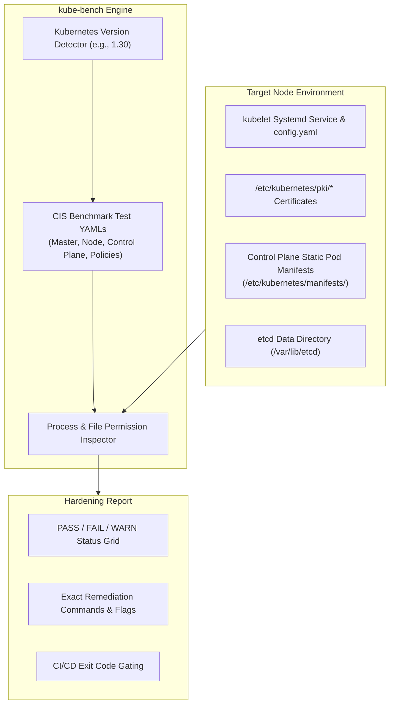

The Center for Internet Security (CIS) maintains the industry-standard benchmark for hardening Kubernetes control plane and worker node components. However, manually inspecting hundreds of file permissions, API server arguments, and kubelet flags across a multi-node cluster is error-prone.

**kube-bench** (developed by Aqua Security) is an automated Go tool that audits Kubernetes nodes against the official CIS Kubernetes Benchmark specifications, outputting precise PASS/FAIL ratings and remediation scripts.



## What kube-bench Audits

kube-bench checks the five critical architectural sections defined by the CIS Kubernetes Benchmark:

1. **Control Plane Components:**
   - `kube-apiserver`: Enforces `--anonymous-auth=false`, audits `--profiling=false`, and validates encryption provider configurations.
   - `kube-controller-manager`: Checks `--service-account-private-key-file` and `--use-service-account-credentials=true`.
   - `kube-scheduler`: Disables insecure profiling and validates secure TLS port bindings.
2. **etcd Configuration:**
   - File permissions on `/var/lib/etcd` (must be `700` owned by `etcd:etcd`).
   - Strong client/peer TLS certificates (`--cert-file`, `--key-file`, `--client-cert-auth=true`).
3. **Control Plane Configuration Files:**
   - File permissions and ownership on `/etc/kubernetes/manifests/*.yaml` (must be `600` or `644` owned by `root:root`).
   - PKI certificate authority permissions (`/etc/kubernetes/pki/*`).
4. **Worker Node Security:**
   - `kubelet` configuration: Enforces `--read-only-port=0`, verifies `--anonymous-auth=false`, and ensures `--protect-kernel-defaults=true`.
   - Kubelet service file permissions.
5. **Kubernetes Policies:**
   - RBAC privilege minimization and default service account token mounting policies.

## Running kube-bench as a Kubernetes Job

The cleanest way to audit worker and control plane nodes without installing host packages is deploying kube-bench as an ephemeral Kubernetes Job with host mounts:

```yaml
apiVersion: batch/v1
kind: Job
metadata:
  name: kube-bench-audit
  namespace: default
spec:
  template:
    spec:
      hostPID: true
      containers:
        - name: kube-bench
          image: aquasec/kube-bench:latest
          command: ["kube-bench", "--benchmark", "cis-1.8"]
          volumeMounts:
            - name: var-lib-etcd
              mountPath: /var/lib/etcd
              readOnly: true
            - name: var-lib-kubelet
              mountPath: /var/lib/kubelet
              readOnly: true
            - name: etc-systemd
              mountPath: /etc/systemd
              readOnly: true
            - name: etc-kubernetes
              mountPath: /etc/kubernetes
              readOnly: true
      restartPolicy: Never
      volumes:
        - name: var-lib-etcd
          hostPath:
            path: "/var/lib/etcd"
        - name: var-lib-kubelet
          hostPath:
            path: "/var/lib/kubelet"
        - name: etc-systemd
          hostPath:
            path: "/etc/systemd"
        - name: etc-kubernetes
          hostPath:
            path: "/etc/kubernetes"
```

Inspect the job logs for the audit outcome:

```bash
kubectl logs job/kube-bench-audit
```

Example output:
```text
[PASS] 1.1.1 Ensure that the API server pod specification file permissions are set to 600 or more restrictive
[FAIL] 1.2.1 Ensure that the --anonymous-auth argument is set to false
[WARN] 1.2.6 Ensure that the --kubelet-certificate-authority argument is set as appropriate

== Remediations ==
1.2.1 Edit the /etc/kubernetes/manifests/kube-apiserver.yaml file
on the control plane and set the following parameter:
--anonymous-auth=false
```

## Running kube-bench on Managed Kubernetes (EKS, GKE, AKS)

On managed public cloud Kubernetes offerings, cloud providers manage the underlying control plane nodes. In these environments, run kube-bench specifically targeting the worker nodes:

```bash
kube-bench run --targets node --benchmark cis-eks-1.4
```

## Remediation Workflow

1. **Automate in CI/CD:** Run scheduled kube-bench cron jobs weekly or after node AMI updates.
2. **Treat CIS as Code:** Encode CIS remediations into your Ansible, Terraform, or Packer image-baking pipelines.
3. **Combine with Policy Engines:** Use Kyverno or Falco to enforce CIS recommendations continuously at runtime.

