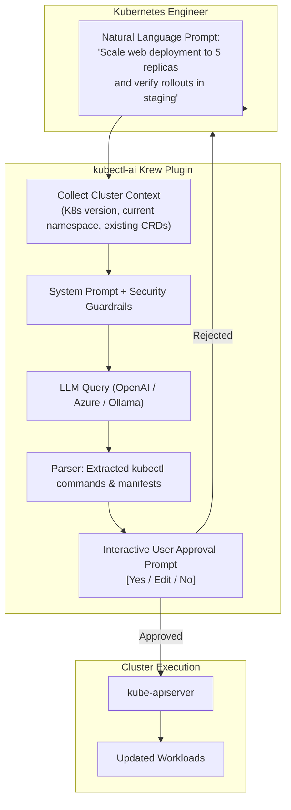

Navigating Kubernetes CLI commands requires memorizing dozens of subcommands, JSONPath selectors, and API specifications. **kubectl-ai** is a Kubernetes CLI plugin that translates natural language requests into fully formed, valid `kubectl` commands and manifests, complete with interactive diff previews and safety confirmation prompts.

Rather than blindly running commands on your cluster, `kubectl-ai` implements a **human-in-the-loop** execution pattern: it queries an LLM (such as OpenAI GPT-4, Claude, or local Ollama), generates the required command or manifest, explains the operational impact, and asks for confirmation before executing.



## Installing `kubectl-ai`

Install `kubectl-ai` via the standard Kubernetes package manager, `krew`:

```bash
kubectl krew install ai
```

Configure your LLM provider backend (OpenAI, Azure OpenAI, or a self-hosted local model):

```bash
# Set OpenAI API Key
export OPENAI_API_KEY="sk-..."

# Or connect to a local in-cluster Ollama instance
export OPENAI_BASE_URL="http://localhost:11434/v1"
```

## Real-World Use Cases & Prompt Examples

### 1. Generating Complex Manifests on the Fly

Prompt:
```bash
kubectl ai "Create an NGINX deployment with 3 replicas, port 80, readiness probe on /healthz, and limit memory to 256Mi"
```

Generated Output:
```yaml
✨ Generated manifest:
apiVersion: apps/v1
kind: Deployment
metadata:
  name: nginx-deployment
spec:
  replicas: 3
  selector:
    matchLabels:
      app: nginx
  template:
    metadata:
      labels:
        app: nginx
    spec:
      containers:
        - name: nginx
          image: nginx:latest
          ports:
            - containerPort: 80
          resources:
            limits:
              memory: 256Mi
          readinessProbe:
            httpGet:
              path: /healthz
              port: 80
            initialDelaySeconds: 5
            periodSeconds: 10

Apply this manifest to cluster? [y/N/e (edit)]:
```

### 2. Formulating Complex JSONPath Queries

Finding problematic pods without searching through documentation:

```bash
kubectl ai "List all pods across all namespaces that were restarted more than 3 times, formatted as a table"
```

Generated Command:
```bash
kubectl get pods --all-namespaces -o custom-columns='NAMESPACE:.metadata.namespace,NAME:.metadata.name,RESTARTS:.status.containerStatuses[0].restartCount' | awk '$3 > 3'
```

### 3. Triage & Incident Investigation

Prompt:
```bash
kubectl ai "Why is the payment-gateway pod in CrashLoopBackOff?"
```

Generated Action:
```bash
kubectl logs deployment/payment-gateway --previous --tail=50
kubectl describe pod -l app=payment-gateway
```

## Security Best Practices with AI CLI Tools

- **Never Pipe Without Review:** Avoid running `--quiet` or automated apply flags on production clusters. Always review generated manifests before confirming.
- **Redact Sensitive Cluster Data:** When using external public cloud LLMs, avoid transmitting prompts that contain production database connection strings, passwords, or customer PII.
- **Use Self-Hosted Models for Strict Compliance:** Point `kubectl-ai` to internal vLLM or Ollama instances running inside your own VPC to maintain zero external network exposure.

