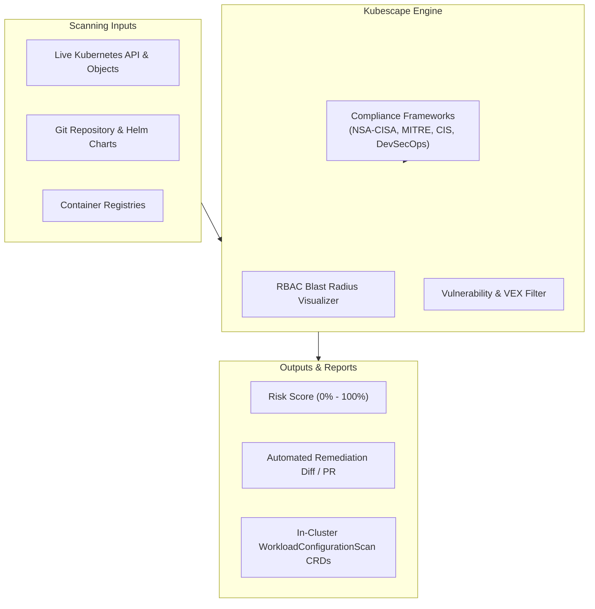

Kubernetes clusters are complex multi-tenant systems where security misconfigurations in RBAC roles, network policies, or container capabilities can quietly expose workloads to attack. **Kubescape** (an open-source project by ARMO and part of the CNCF) provides an end-to-end security and compliance platform for Kubernetes.

Kubescape tests running clusters, Helm charts, and CI/CD manifests against major compliance frameworks including **NSA-CISA**, **MITRE ATT&CK®**, and **CIS Benchmarks**, while mapping RBAC attack paths and computing risk scores.



## Core Differentiators of Kubescape

1. **NSA-CISA Hardening Guidance:** Evaluates workloads against the strict security guidance released jointly by the National Security Agency (NSA) and Cybersecurity and Infrastructure Security Agency (CISA).
2. **RBAC Visualizer and Attack Path Mapping:** Analyzes complex RoleBindings to detect service accounts with dangerous privilege paths (e.g., impersonation rights, secrets read access, wildcard permissions).
3. **Contextual Vulnerability Filtering (VEX):** Filters out unexploitable CVEs when the vulnerable code binary or function is never loaded into memory during execution.
4. **GitOps & Admission Control:** Prevents risky Helm charts from ever being merged into Git repositories.

## Hands-On: Scanning with the Kubescape CLI

### 1. Scanning a Live Cluster Against NSA-CISA Framework

```bash
# Scan cluster against NSA-CISA framework with detailed results
kubescape scan framework nsa-cisa --submit=false
```

Example output:
```text
+------------------------------------+------------------+----------------+
| CONTROL NAME                       | FAILED RESOURCES | COMPLIANCE (%) |
+------------------------------------+------------------+----------------+
| Non-root containers                | 8                | 65%            |
| Immutable container filesystem     | 12               | 48%            |
| Privileged container               | 0                | 100%           |
| HostPath volume mount              | 2                | 91%            |
+------------------------------------+------------------+----------------+
Overall Compliance Score: 76%
```

### 2. Scanning Helm Charts in CI/CD

Before deploying a third-party Helm chart, evaluate its security posture:

```bash
kubescape scan /path/to/helm/chart --format json --output results.json
```

### 3. Detecting Dangerous RBAC Roles

Find all service accounts and users that have permissions to create pods with host access or read cluster secrets:

```bash
kubescape scan control "Access Kubernetes dashboard" --verbose
kubescape scan control "Exec into container" --verbose
```

## Installing the In-Cluster Kubescape Operator

The Kubescape operator continually assesses in-cluster security posture and exports metrics directly to Prometheus:

```bash
helm repo add kubescape https://kubescape.github.io/helm-charts/
helm repo update

helm install kubescape kubescape/kubescape-operator \
  --namespace kubescape \
  --create-namespace \
  --set capabilities.continuousScanning=enable \
  --set capabilities.vulnerabilityScan=enable
```

Verify the operator's Custom Resources:

```bash
kubectl get workloadconfigurationscans -A
```

## Production Recommendations

- **Integrate into Git Pre-Commit Hooks:** Catch hardcoded credentials and non-root violations before code is pushed.
- **Prioritize Top 5 Remediations:** Kubescape automatically ranks the top 5 changes that yield the greatest percentage increase in compliance score. Address those first to make fast, measurable security progress.
- **Leverage VEX to Mitigate CVE Fatigue:** Filter out unreachable CVEs to focus developer attention on genuine, exploitable vulnerabilities.

