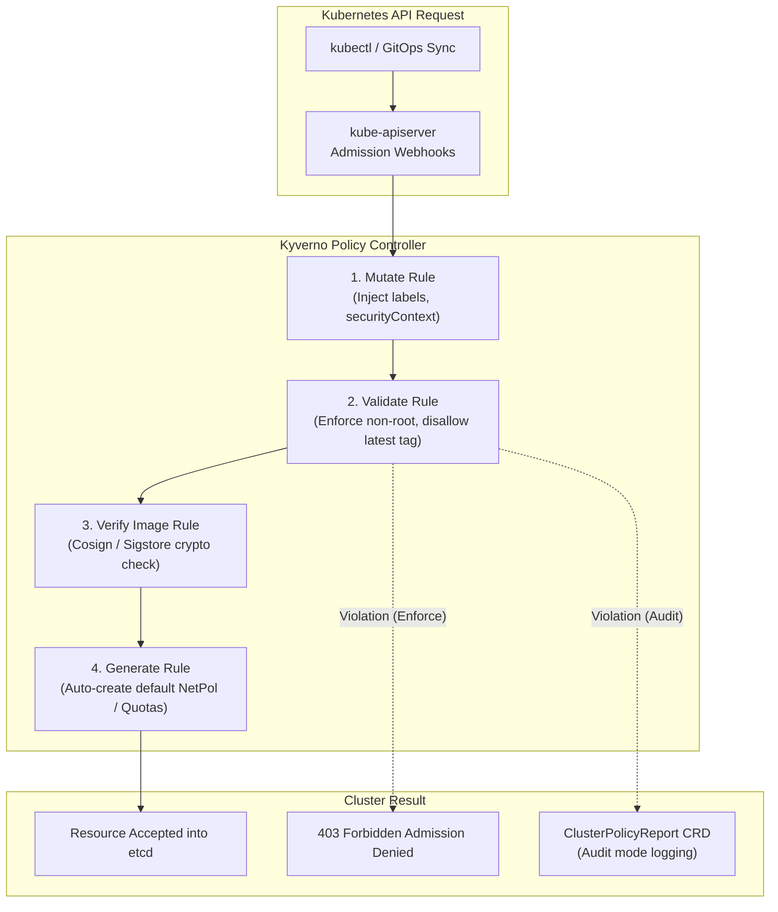

Securing a Kubernetes cluster requires deterministic guardrails. While Open Policy Agent (OPA) Gatekeeper relies on a custom declarative language (Rego), **Kyverno** brings Kubernetes-native policy management directly into your cluster using pure YAML.

With Kyverno, policies are defined as standard Kubernetes Custom Resources. You can validate configurations, mutate incoming manifests on the fly, generate default resources (like NetworkPolicies or ConfigMaps for new namespaces), and verify container image signatures without writing a single line of procedural code.



## The Four Capabilities of Kyverno

### 1. Validation (Enforce or Audit)
Block or audit workloads that fail organizational security policies (e.g., running as root, mounting host paths, or exposing sensitive host ports).

### 2. Mutation (Inject Defaults)
Automatically amend incoming manifests. For example, inject default resource requests if the developer omitted them, or append mandatory enterprise labels (`cost-center`, `owner`).

### 3. Generation (Automated Scaffolding)
Watch for cluster events (such as creating a new `Namespace`) and automatically generate companion resources like standard `LimitRanges`, `ResourceQuotas`, and default-deny `NetworkPolicies`.

### 4. Image Verification (Supply Chain Attestation)
Check that container images are cryptographically signed using Cosign/Sigstore before allowing them to run, ensuring unauthorized or tampered images never reach production.

## Hands-On: Production Kyverno Policy Manifests

### Enforcing Non-Root Execution

The following `ClusterPolicy` blocks any pod from running with root UID:

```yaml
apiVersion: kyverno.io/v1
kind: ClusterPolicy
metadata:
  name: disallow-root-user
spec:
  validationFailureAction: Enforce
  background: true
  rules:
    - name: check-run-as-non-root
      match:
        any:
          - resources:
              kinds:
                - Pod
      validate:
        message: "Containers must run as non-root. Please specify 'securityContext.runAsNonRoot: true'."
        pattern:
          spec:
            securityContext:
              runAsNonRoot: true
            =(containers):
              - =(securityContext):
                  =(runAsNonRoot): true
```

### Mutating Workloads to Inject Resource Requests

If an engineering team submits a deployment without memory requests, Kyverno can automatically inject safe defaults:

```yaml
apiVersion: kyverno.io/v1
kind: ClusterPolicy
metadata:
  name: inject-default-requests
spec:
  rules:
    - name: add-default-memory-request
      match:
        any:
          - resources:
              kinds:
                - Pod
      mutate:
        patchStrategicMerge:
          spec:
            containers:
              - (name): "?*"
                resources:
                  requests:
                    +(memory): "128Mi"
                    +(cpu): "100m"
```

### Auto-Generating NetworkPolicies for New Namespaces

```yaml
apiVersion: kyverno.io/v1
kind: ClusterPolicy
metadata:
  name: default-deny-ingress
spec:
  rules:
    - name: generate-deny-all
      match:
        any:
          - resources:
              kinds:
                - Namespace
      generate:
        apiVersion: networking.k8s.io/v1
        kind: NetworkPolicy
        name: default-deny-ingress
        namespace: "{{request.object.metadata.name}}"
        synchronize: true
        data:
          spec:
            podSelector: {}
            policyTypes:
              - Ingress
```

## Kyverno vs OPA Gatekeeper

| Feature | Kyverno | OPA Gatekeeper |
| :--- | :--- | :--- |
| **Language** | Pure Kubernetes YAML | Custom Rego DSL |
| **Learning Curve** | Low (familiar to any K8s user) | Moderate/High (requires learning Rego syntax) |
| **Resource Mutation** | Native strategic merge & JSONPatch | Supported via `Assign` / `ModifyData` CRDs |
| **Resource Generation** | Native `generate` directive | Requires custom controllers or external tools |
| **Image Verification** | Built-in Sigstore / Cosign primitives | Requires external webhook integration |
| **CLI Testing** | `kyverno test` validates policies locally | `gator` test runner |

## Production Best Practices

- **Stage with Audit Mode First:** Always deploy new policies with `validationFailureAction: Audit` for at least one release cycle. Review `PolicyReport` and `ClusterPolicyReport` custom resources to ensure legitimate workloads aren't unintentionally blocked.
- **Set Webhook Failure Policy:** During maintenance windows or controller restarts, set `failurePolicy: Ignore` on non-critical webhooks to prevent `kube-apiserver` admission deadlocks.
- **Run the CLI in CI:** Incorporate the `kyverno test` command in pull request checks to validate developer Helm charts before pushing to the cluster.

