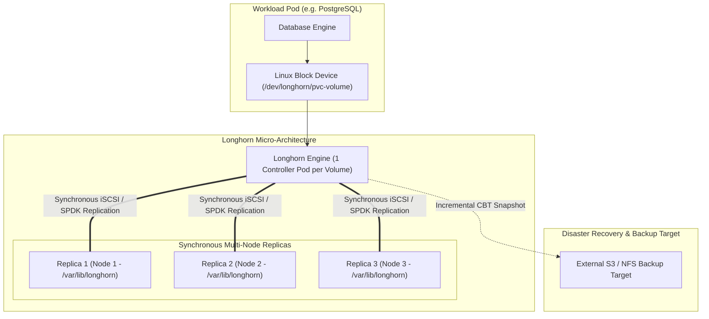

Cloud provider managed block storage solutions (like AWS EBS or Google Persistent Disk) often suffer from strict multi-attach limitations (`ReadWriteOnce` only within the same Availability Zone) and costly IOPS tiers. On bare-metal or on-premises clusters, block storage options are even more constrained.

**Longhorn** (a CNCF Graduated project originated by Rancher/SUSE) is a lightweight, highly available distributed block storage system built natively for Kubernetes. Longhorn turns local node disks (NVMe, SSD) into resilient, replicated block storage volumes with automated cross-node failover, incremental snapshots, and external S3 backup sync.



## Architectural Superpowers of Longhorn

1. **Volume Micro-Controllers:** Unlike monolithic storage clusters where a centralized daemon manages everything, Longhorn provisions an independent, dedicated controller instance for *each* volume. If one volume fails or encounters high I/O, other volumes remain completely unaffected.
2. **Synchronous Cross-Node Replication:** Replicates data blocks synchronously across multiple distinct failure domains (different nodes, racks, or availability zones). If a node crashes, Longhorn immediately directs the pod to surviving replicas.
3. **SPDK High-Performance Engine (v2):** Longhorn v2 supports Intel SPDK (Storage Performance Development Kit), bypassing Linux kernel context switches to deliver ultra-low latency NVMe-oF performance for high-IOPS databases.
4. **Incremental Change Block Tracking (CBT) Backups:** Periodically uploads deduplicated, incremental volume snapshots to off-cluster object storage (AWS S3, MinIO, or NFS).

## Deploying a High-Availability Volume via StorageClass

Define a dynamic `StorageClass` with 3 synchronous replicas:

```yaml
apiVersion: storage.k8s.io/v1
kind: StorageClass
metadata:
  name: longhorn-fast
provisioner: driver.longhorn.io
allowVolumeExpansion: true
reclaimPolicy: Delete
volumeBindingMode: Immediate
parameters:
  numberOfReplicas: "3"
  staleReplicaTimeout: "2880"
  fromBackup: ""
  fsType: "ext4"
  dataLocality: "best-effort"
```

Provision a `PersistentVolumeClaim` (PVC) for a stateful database:

```yaml
apiVersion: v1
kind: PersistentVolumeClaim
metadata:
  name: postgres-data-pvc
  namespace: database
spec:
  accessModes:
    - ReadWriteOnce
  storageClassName: longhorn-fast
  resources:
    requests:
      storage: 50Gi
```

## Configuring Automated Scheduled S3 Backups

Configure Longhorn to take daily incremental snapshots and push backups to an off-site S3 bucket:

```yaml
apiVersion: longhorn.io/v1beta2
kind: RecurringJob
metadata:
  name: daily-s3-backup
  namespace: longhorn-system
spec:
  cron: "0 2 * * *"
  task: "backup"
  retain: 14
  concurrency: 2
  labels:
    recurring-job-group.longhorn.io/default: "enabled"
```

## Production Hardening Best Practices

- **Dedicated Storage Disks:** Avoid sharing Longhorn's mount path with the host root filesystem (`/`). Dedicate a fast NVMe partition formatted with `ext4` or `XFS` mounted at `/var/lib/longhorn`.
- **Tune `dataLocality`:** Setting `dataLocality: best-effort` instructs Longhorn to always keep one replica on the local node where the consumer pod runs, eliminating network latency for local reads!
- **Disk Space Over-Provisioning Limit:** Keep Longhorn's Storage Over-Provisioning Percentage around 150-200% to protect against unexpected disk saturation across physical nodes.

