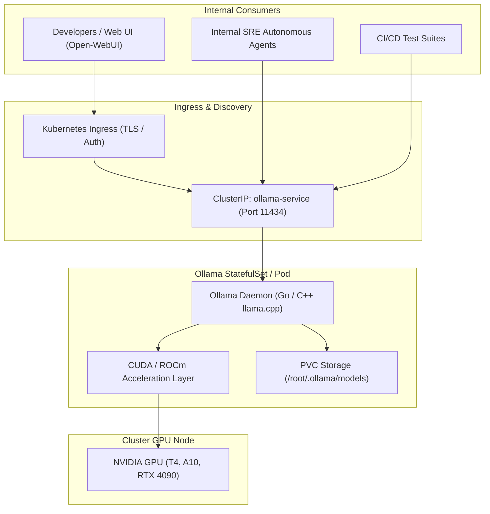

Running open-weights artificial intelligence models locally without external cloud API vendor lock-in is a priority for data-sensitive enterprise engineering teams. **Ollama** bundles model weights, runtime configurations, quantization, and GPU execution into an intuitive CLI and local HTTP server.

Deploying Ollama on Kubernetes turns your cluster into a private, self-hosted AI compute platform capable of running models like Mistral, Llama 3, Phi-3, and DeepSeek with hardware acceleration.



## Why Ollama in Kubernetes?

1. **Zero External Data Leakage:** Prompts, corporate intellectual property, and internal logs never leave your private VPC or on-prem datacenter.
2. **Quantized Footprint:** Ollama automatically serves GGUF 4-bit and 8-bit quantized models, enabling modern LLMs to execute smoothly on modest 16GB GPUs or even multi-core CPU nodes.
3. **OpenAI Compatibility Layer:** Emits standard `/v1/chat/completions` REST endpoints, enabling instant integration with LangChain, LlamaIndex, and Copilot tools.
4. **Dynamic Model Switching:** Loads and unloads different models into GPU VRAM on-demand based on incoming user request headers.

## Kubernetes Deployment with GPU Passthrough

Deploying Ollama with an attached PersistentVolume ensures that pulled models persist across pod restarts:

```yaml
apiVersion: apps/v1
kind: StatefulSet
metadata:
  name: ollama
  namespace: ai
spec:
  serviceName: "ollama"
  replicas: 1
  selector:
    matchLabels:
      app: ollama
  template:
    metadata:
      labels:
        app: ollama
    spec:
      containers:
        - name: ollama
          image: ollama/ollama:latest
          ports:
            - containerPort: 11434
              name: http
          env:
            - name: OLLAMA_HOST
              value: "0.0.0.0"
            - name: OLLAMA_KEEP_ALIVE
              value: "24h"
          resources:
            limits:
              nvidia.com/gpu: 1
              memory: 16Gi
              cpu: "4"
            requests:
              nvidia.com/gpu: 1
              memory: 8Gi
              cpu: "2"
          volumeMounts:
            - name: ollama-storage
              mountPath: /root/.ollama
  volumeClaimTemplates:
    - metadata:
        name: ollama-storage
      spec:
        accessModes: ["ReadWriteOnce"]
        storageClassName: "standard"
        resources:
          requests:
            storage: 50Gi
```

## Pulling and Testing Models Inside the Cluster

Once the pod is running, execute a model download directly:

```bash
# Pull Llama 3 into the cluster storage
kubectl exec -it statefulset/ollama -n ai -- ollama pull llama3:8b

# Run an interactive prompt test
kubectl exec -it statefulset/ollama -n ai -- ollama run llama3:8b "Why is Kubernetes declarative?"
```

## Connecting Open-WebUI for an Enterprise Chatbot Experience

Pair Ollama with the popular open-source ChatGPT UI (`open-webui`):

```yaml
apiVersion: apps/v1
kind: Deployment
metadata:
  name: open-webui
  namespace: ai
spec:
  replicas: 1
  selector:
    matchLabels:
      app: open-webui
  template:
    metadata:
      labels:
        app: open-webui
    spec:
      containers:
        - name: open-webui
          image: ghcr.io/open-webui/open-webui:main
          ports:
            - containerPort: 8080
          env:
            - name: OLLAMA_BASE_URL
              value: "http://ollama.ai.svc.cluster.local:11434"
```

## Key Operational Best Practices

- **VRAM Keep-Alive:** Set `OLLAMA_KEEP_ALIVE="24h"` to avoid cold-start delays caused by swapping model weights back and forth from disk to GPU memory between requests.
- **CPU Fallback:** On development clusters lacking dedicated GPUs, Ollama automatically falls back to CPU execution with AVX2 instruction acceleration.
- **Node Affinity:** Use `nodeSelector: { "nvidia.com/gpu.present": "true" }` to ensure Ollama pods only land on GPU-equipped worker nodes.

