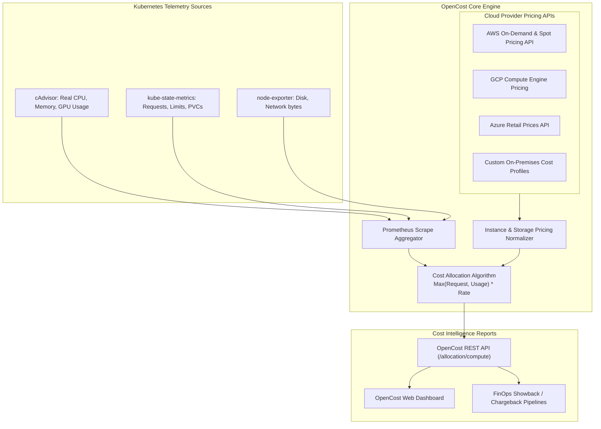

Running shared, multi-tenant Kubernetes clusters makes cloud cost visibility notoriously difficult. Cloud provider bills (AWS, Azure, Google Cloud) arrive as aggregate charges for EC2 instances, EBS volumes, and load balancers, with zero insight into which engineering team, namespace, or pod was responsible for the spend.

**OpenCost** (a CNCF Sandbox project and the open-source specification behind Kubecost) provides real-time, granular cost allocation down to the pod, namespace, label, and controller level across multi-cloud and on-premise clusters.



## How OpenCost Calculates Pod-Level Costs

Traditional tools divide node cost by the count of pods. This is flawed because a pod requesting 16 cores costs 16x more than a pod requesting 1 core.

OpenCost calculates cost using the **allocation formula**:

$$\text{Cost} = \max(\text{Requested Resources}, \text{Actual Resource Usage}) \times \text{Hourly Cloud Node Rate}$$

1. **Idle Cost Allocation:** If a \$100/mo node only has \$60 of pods scheduled on it, OpenCost identifies the \$40 as *idle cluster waste* that can be reclaimed.
2. **Network Egress Allocation:** Tracks cross-zone and cross-region egress byte transfers, pinpointing pods driving high data transfer fees.
3. **Storage Allocation:** Matches PersistentVolumeClaims directly to cloud volume pricing (gp3, io2, Standard SSD).

## Installing OpenCost on Kubernetes

Install OpenCost using Helm in less than 2 minutes:

```bash
helm repo add opencost https://opencost.github.io/opencost-helm-chart
helm repo update

helm install opencost opencost/opencost \
  --namespace opencost \
  --create-namespace \
  --set opencost.exporter.cloudProvider=aws
```

Verify that the OpenCost server and UI are running:

```bash
kubectl get pods -n opencost
```

Port-forward to the web dashboard:

```bash
kubectl port-forward -n opencost svc/opencost 9090:9090
```

## Querying Cost Allocation via REST API

OpenCost provides a comprehensive REST API for integrating into internal developer portals, FinOps reporting, and CI/CD cost checks:

```bash
# Query cost breakdown by namespace over the past 7 days
curl "http://localhost:9090/allocation/compute?window=7d&aggregate=namespace" | jq .
```

Example JSON response:
```json
{
  "code": 200,
  "data": [
    {
      "payments": {
        "cpuCost": 142.50,
        "gpuCost": 0.00,
        "ramCost": 38.20,
        "pvCost": 15.00,
        "networkCost": 8.40,
        "totalCost": 204.10
      },
      "staging": {
        "cpuCost": 45.10,
        "gpuCost": 0.00,
        "ramCost": 12.30,
        "pvCost": 5.00,
        "networkCost": 1.20,
        "totalCost": 63.60
      }
    }
  ]
}
```

## Top 3 FinOps Strategies with OpenCost

1. **Reclaim Abandoned Workloads:** Use the API to identify namespaces with low CPU usage (<5%) that have not seen code updates in 30 days.
2. **Right-Size Memory Requests:** Filter by workloads where `request - usage > 2GiB` and reduce container requests to free up allocatable node capacity.
3. **Automate Showback Reports:** Schedule weekly Slack digests breaking down infrastructure spend by team label (`app.kubernetes.io/part-of` or `cost-center`).

