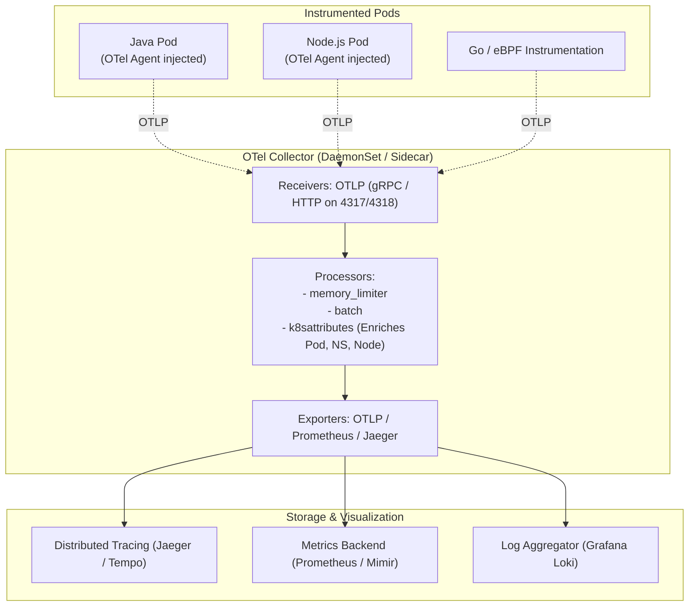

Observability in microservices requires correlating traces, metrics, and logs across distributed boundaries. Vendor-specific SDKs lock organizations into proprietary agents and billing models. **OpenTelemetry (OTel)**, the second most active CNCF project behind Kubernetes, delivers a vendor-neutral, unified telemetry standard.

On Kubernetes, the **OpenTelemetry Operator** automates everything: it manages the OTel Collector pipeline and uses admission webhooks to inject auto-instrumentation agents into Java, Node.js, Python, .NET, and Go pods with zero application code modifications.



## The Architecture of OpenTelemetry on Kubernetes

1. **OpenTelemetry Collector:** The telemetry router. It accepts OTLP traces, metrics, and logs, buffers and batches them in memory, attaches Kubernetes metadata (pod name, namespace, container UID, node name), and exports to backends.
2. **OpenTelemetry Operator:** A custom controller providing two game-changing CRDs:
   - `OpenTelemetryCollector`: Manages the collector lifecycle as a Deployment, DaemonSet, or Sidecar.
   - `Instrumentation`: Automatically configures zero-code SDK injection.

## Step 1: Deploying the OpenTelemetry Collector

Create a DaemonSet collector that gathers node-local telemetry and enriches it with Kubernetes metadata:

```yaml
apiVersion: opentelemetry.io/v1beta1
kind: OpenTelemetryCollector
metadata:
  name: otel-collector
  namespace: monitoring
spec:
  mode: daemonset
  config:
    receivers:
      otlp:
        protocols:
          grpc:
            endpoint: 0.0.0.0:4317
          http:
            endpoint: 0.0.0.0:4318

    processors:
      memory_limiter:
        check_interval: 1s
        limit_percentage: 75
        spike_limit_percentage: 20
      batch:
        send_batch_size: 1000
        timeout: 10s
      k8sattributes:
        auth_type: "serviceAccount"
        passthrough: false
        extract:
          metadata:
            - k8s.pod.name
            - k8s.pod.uid
            - k8s.namespace.name
            - k8s.node.name
            - k8s.deployment.name

    exporters:
      otlp/tempo:
        endpoint: tempo.monitoring.svc.cluster.local:4317
        tls:
          insecure: true
      prometheus:
        endpoint: 0.0.0.0:8889

    service:
      pipelines:
        traces:
          receivers: [otlp]
          processors: [memory_limiter, k8sattributes, batch]
          exporters: [otlp/tempo]
        metrics:
          receivers: [otlp]
          processors: [memory_limiter, k8sattributes, batch]
          exporters: [prometheus]
```

## Step 2: Zero-Code Auto-Instrumentation

Define an `Instrumentation` CRD that configures automatic bytecode / runtime instrumentation:

```yaml
apiVersion: opentelemetry.io/v1alpha1
kind: Instrumentation
metadata:
  name: auto-instrumentation
  namespace: default
spec:
  exporter:
    endpoint: http://otel-collector.monitoring.svc.cluster.local:4318
  propagators:
    - tracecontext
    - baggage
    - b3
  java:
    image: ghcr.io/open-telemetry/opentelemetry-operator/autoinstrumentation-java:latest
  nodejs:
    image: ghcr.io/open-telemetry/opentelemetry-operator/autoinstrumentation-nodejs:latest
  python:
    image: ghcr.io/open-telemetry/opentelemetry-operator/autoinstrumentation-python:latest
```

## Step 3: Enabling Instrumentation on Workloads

Simply add a single annotation to your application deployment pod template:

```yaml
apiVersion: apps/v1
kind: Deployment
metadata:
  name: order-service
  namespace: default
spec:
  replicas: 2
  template:
    metadata:
      annotations:
        # Injects the Java OTel Javaagent at container startup!
        instrumentation.opentelemetry.io/inject-java: "true"
      labels:
        app: order-service
    spec:
      containers:
        - name: app
          image: my-org/order-service:v1.0
          ports:
            - containerPort: 8080
```

The operator mutates the pod, mounts an ephemeral volume containing the OpenTelemetry SDK agent, and sets `JAVA_TOOL_OPTIONS=-javaagent:/otel/opentelemetry-javaagent.jar`.

## Production Considerations

- **Always Include `memory_limiter`:** The `memory_limiter` processor must always be placed first in your pipeline processors to drop or backpressure data during high traffic spikes before the pod is OOMKilled.
- **Trace Sampling Rate:** In high-volume systems, avoid 100% trace capture. Use the `tail_sampling` processor to keep 100% of error traces and slow requests while sampling healthy 200 OK traffic at 5%.
- **Context Propagation:** Ensure all ingress gateways (Envoy, NGINX, Kong) pass W3C TraceContext headers (`traceparent`, `tracestate`) downstream.

