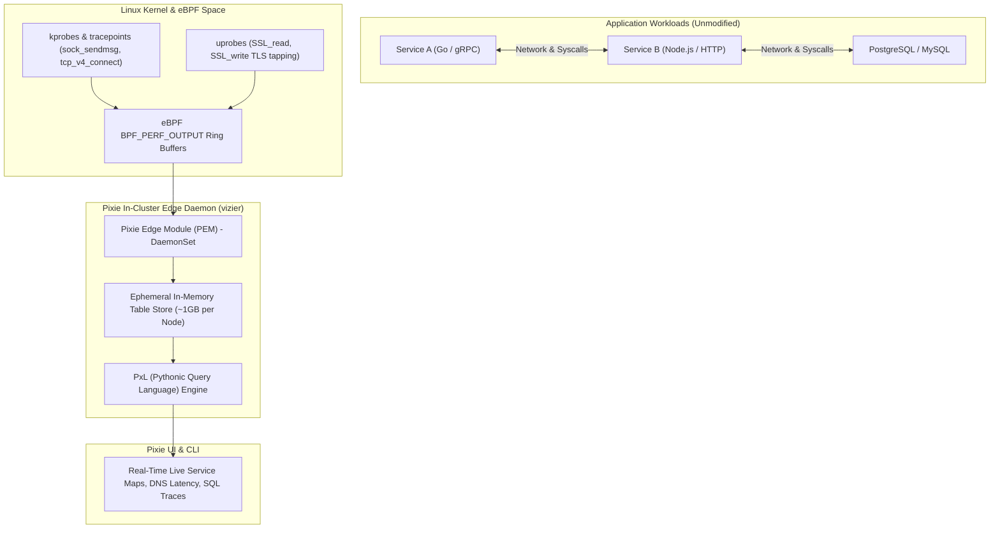

Traditional application observability requires modifying source code, adding client libraries, re-compiling container images, and managing sampling rates. **Pixie** (a CNCF project developed by New Relic) delivers instant, zero-instrumentation observability for Kubernetes applications using extended Berkeley Packet Filter (**eBPF**).

Pixie automatically monitors network traffic, captures HTTP/gRPC/SQL messages in plaintext (even under OpenSSL/TLS encryption), traces CPU flamegraphs, and detects memory leaks—with **less than 2% CPU overhead** and zero code changes.



## How Pixie Works Without Code Changes

1. **Kernel eBPF Probing:** Pixie attaches eBPF programs to Linux kernel socket operations (`tcp_sendmsg`, `tcp_recvmsg`), tracking connection lifecycles, round-trip times (RTT), and TCP drops.
2. **Dynamic OpenSSL Uprobes:** Pixie dynamically attaches user-space probes (`uprobes`) to the entry and exit of `SSL_read()` and `SSL_write()` in OpenSSL, BoringSSL, and Go's runtime. It captures decrypted HTTP, gRPC, and SQL payloads before they are encrypted or after they are decrypted!
3. **Continuous Profiling:** Collects stack traces every 10ms across all running containers to build always-on CPU and memory flame graphs.
4. **Local Edge Storage:** Stores telemetry in circular in-memory tables directly on each node, retaining high-granularity data for ~24 hours without incurring heavy cloud transfer or storage fees.

## Installing Pixie via the CLI

Install the `px` CLI and deploy the Vizier daemon into your cluster:

```bash
# Install CLI
bash -c "$(curl -fsSL https://withpixie.ai/install.sh)"

# Deploy Pixie into your current Kubernetes context
px deploy
```

Verify that the `vizier` pods are running on every node:

```bash
kubectl get pods -n pl
```

## Querying Real-Time Cluster Health with PxL

Pixie uses **PxL**, a Pythonic data science query language.

### 1. Visualizing Live HTTP Request Latency & Errors

Run the built-in HTTP request live monitor:

```bash
px live px/http_data
```

This returns live HTTP transactions with methods, latency percentiles ($P_{50}$, $P_{90}$, $P_{99}$), and status codes across the cluster.

### 2. Tracing Database Queries & Slow SQL Statements

Inspect SQL statements hitting your Postgres or MySQL pods in real time:

```bash
px live px/sql_queries
```

Output highlights query execution duration and unindexed queries without modifying database server configurations.

### 3. Continuous CPU Flamegraphs

Generate a system-wide CPU flamegraph for any specific pod:

```bash
px live px/pod_flamegraph -- --pod default/checkout-service
```

## When to Choose Pixie vs Traditional APM

| Feature | Pixie (eBPF) | Traditional APM (OTel / Datadog) |
| :--- | :--- | :--- |
| **Code Changes** | **Zero** (no SDKs, no recompilation) | Requires language SDK or bytecode injection |
| **Encrypted Traffic Inspection**| Automatically intercepts via `uprobes` | Requires interceptor or reverse proxy tracing |
| **Storage Architecture** | Distributed edge in-memory (local to nodes) | Centralized SaaS or cloud TSDB ingestion |
| **Overhead** | Very low (<2% CPU) | Low to moderate (5-10% depending on sampling) |
| **Data Retention** | Ephemeral (~24 hours in RAM) | Long-term (weeks to months) |

## Production Best Practices

- **Pair with OpenTelemetry for Long-Term Storage:** Use the Pixie OpenTelemetry exporter to stream aggregated Golden Signals (Request rate, Error rate, Duration) to long-term Prometheus/Thanos storage while keeping raw high-cardinality logs in Pixie's local RAM buffer.
- **Kernel Compatibility:** Ensure worker nodes run Linux kernel >= 4.14 with BPF enabled (standard on Amazon Linux 2023, Ubuntu 20.04+, RHEL 8+).

