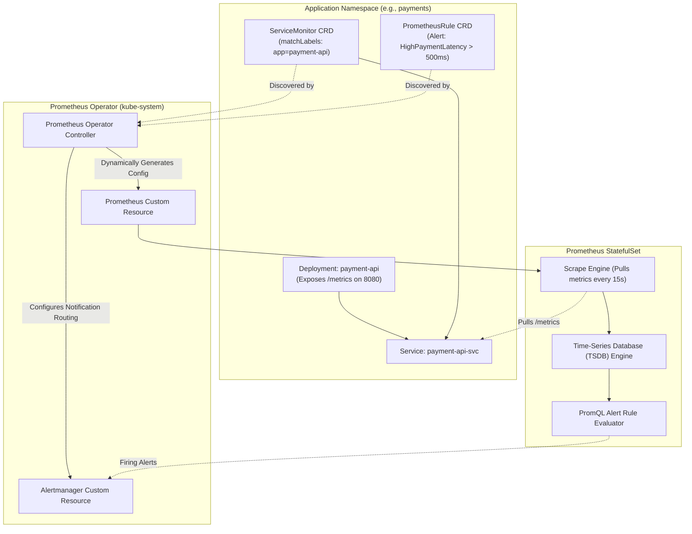

Manually updating static Prometheus scrape targets (`prometheus.yaml`) and reloading the server whenever microservices are deployed or scaled is unmaintainable. The **Prometheus Operator** (part of the CNCF kube-prometheus stack) brings Kubernetes-native automation to metric collection and alerting.

Using Custom Resources like `ServiceMonitor`, `PodMonitor`, and `PrometheusRule`, application developers can configure their own monitoring endpoints directly alongside their application manifests without touching central monitoring configurations.



## The Core Custom Resources

1. **`Prometheus`:** Defines the desired Prometheus deployment (replicas, storage, retention, version, memory requests).
2. **`ServiceMonitor`:** Discovers Kubernetes `Services` matching label selectors and configures Prometheus to scrape their HTTP metrics endpoints.
3. **`PodMonitor`:** Scrapes pods directly when no intervening Kubernetes Service is needed (e.g., batch jobs, DaemonSets).
4. **`PrometheusRule`:** Defines PromQL alerting and recording rules evaluated periodically by Prometheus.
5. **`Alertmanager`:** Manages alert deduplication, grouping, silencing, and notification routing to Slack, PagerDuty, or webhooks.

## Practical Manifest: Defining a `ServiceMonitor`

Expose a microservice's `/metrics` endpoint to Prometheus automatically:

```yaml
apiVersion: monitoring.coreos.com/v1
kind: ServiceMonitor
metadata:
  name: payment-api-monitor
  namespace: payments
  labels:
    release: prometheus-stack
spec:
  selector:
    matchLabels:
      app: payment-api
  endpoints:
    - port: metrics
      path: /metrics
      interval: 15s
      scrapeTimeout: 10s
```

## Defining Firing Alerts with `PrometheusRule`

Define actionable alerts based on latency and error rates using PromQL:

```yaml
apiVersion: monitoring.coreos.com/v1
kind: PrometheusRule
metadata:
  name: payment-api-alerts
  namespace: payments
  labels:
    release: prometheus-stack
spec:
  groups:
    - name: payment-api.rules
      rules:
        - alert: HighHTTPErrorRate
          expr: |
            sum(rate(http_requests_total{status=~"5.."}[5m]))
            /
            sum(rate(http_requests_total[5m])) * 100 > 5
          for: 2m
          labels:
            severity: critical
          annotations:
            summary: "High 5xx error rate on payment-api"
            description: "Error rate is currently {{ $value | printf '%.2f' }}% for more than 2 minutes."

        - alert: ServiceSlowResponse
          expr: |
            histogram_quantile(0.99, sum(rate(http_request_duration_seconds_bucket[5m])) by (le)) > 0.5
          for: 5m
          labels:
            severity: warning
          annotations:
            summary: "99th percentile latency exceeding 500ms"
```

## Deploying via `kube-prometheus-stack` Helm Chart

The fastest, production-hardened deployment installs Prometheus, Alertmanager, Grafana, and node-exporter together:

```bash
helm repo add prometheus-community https://prometheus-community.github.io/helm-charts
helm repo update

helm install prometheus prometheus-community/kube-prometheus-stack \
  --namespace monitoring \
  --create-namespace \
  --set prometheus.prometheusSpec.serviceMonitorSelectorNilUsesHelmValues=false \
  --set prometheus.prometheusSpec.retention=30d \
  --set prometheus.prometheusSpec.storageSpec.volumeClaimTemplate.spec.resources.requests.storage=100Gi
```

> **Critical Flag:** Setting `serviceMonitorSelectorNilUsesHelmValues=false` ensures Prometheus discovers `ServiceMonitors` created by developers in *any* namespace across the cluster, rather than strictly matching the Helm release label.

## Production Tuning Tips

- **Headroom for Compactions:** Ensure Prometheus local PVCs have at least 25% free disk buffer; TSDB blocks require temporary working room during 2-hour compactions.
- **Relabel Configurations for Cardinality Control:** Drop noisy high-cardinality labels (like ephemeral user IDs or UUIDs) using `metricRelabelings` to protect Prometheus TSDB memory consumption.
- **Horizontal Multi-Cluster Aggregation:** For multi-cluster setups, forward compressed time-series to Thanos or Cortex for long-term retention.

