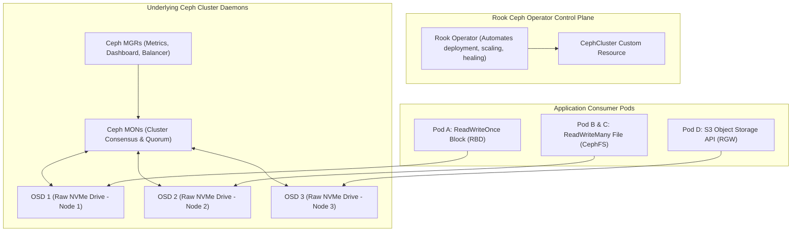

Managing enterprise storage clusters requires juggling raw physical disks, network fabrics, replication topologies, and complex rebalancing operations. **Ceph** is the industry standard for distributed storage, but historically required specialized storage administrator teams.

**Rook** (a CNCF Graduated project) turns Ceph into a self-managing, self-healing, cloud-native storage platform by embedding the operational knowledge of Ceph administrators directly into a Kubernetes Operator.

With Rook, bare physical storage drives attached to Kubernetes nodes are dynamically unified into high-performance **Block (RBD)**, **Shared Filesystem (CephFS)**, and **S3-compatible Object Storage (RGW)**.



## The Three Storage Personalities of Rook-Ceph

1. **CephBlockPool (RBD - ReadWriteOnce):** High-throughput block storage formatted with `ext4` or `xfs`, ideal for relational databases (PostgreSQL, MySQL) and message queues (Kafka).
2. **CephFilesystem (CephFS - ReadWriteMany):** A POSIX-compliant distributed filesystem that can be mounted simultaneously by hundreds of pods across different nodes (ideal for CMS media uploads, shared data analysis, and AI model weights).
3. **CephObjectStore (RGW - S3 Compatible):** A distributed object storage gateway compatible with AWS S3 APIs, allowing applications to upload blobs, backups, and artifacts directly inside the cluster.

## Practical Manifest: Defining a `CephCluster`

Configure Rook to automatically claim unformatted raw SSD/NVMe drives across worker nodes:

```yaml
apiVersion: ceph.rook.io/v1
kind: CephCluster
metadata:
  name: rook-ceph
  namespace: rook-ceph
spec:
  cephVersion:
    image: quay.io/ceph/ceph:v18.2.2
  dataDirHostPath: /var/lib/rook
  mon:
    count: 3
    allowMultiplePerNode: false
  mgr:
    count: 2
  storage:
    useAllNodes: true
    useAllDevices: false
    deviceFilter: "^nvme[0-9]n1"
  healthCheck:
    daemonHealth:
      mon:
        interval: 45s
      osd:
        interval: 1m
```

## Creating a ReadWriteMany (RWX) CephFS Shared StorageClass

Enable multiple pods across multiple nodes to share the exact same filesystem:

```yaml
apiVersion: ceph.rook.io/v1
kind: CephFilesystem
metadata:
  name: shared-fs
  namespace: rook-ceph
spec:
  metadataPool:
    replicated:
      size: 3
  dataPools:
    - failureDomain: host
      replicated:
        size: 3
  metadataServer:
    activeCount: 1
    activeStandby: true
---
apiVersion: storage.k8s.io/v1
kind: StorageClass
metadata:
  name: cephfs-shared
provisioner: rook-ceph.cephfs.csi.ceph.com
parameters:
  clusterID: rook-ceph
  fsName: shared-fs
  pool: shared-fs-data0
reclaimPolicy: Retain
allowVolumeExpansion: true
```

Pods can now claim this storage using standard `ReadWriteMany` access:

```yaml
apiVersion: v1
kind: PersistentVolumeClaim
metadata:
  name: shared-media-pvc
  namespace: default
spec:
  accessModes:
    - ReadWriteMany
  storageClassName: cephfs-shared
  resources:
    requests:
      storage: 500Gi
```

## Production Hardening Best Practices

- **Never Run MONs on the Same Node:** Always set `allowMultiplePerNode: false` for MONs (Ceph Monitors) to prevent a single node failure from taking down the cluster quorum.
- **Dedicated Storage Network:** In high-throughput clusters, separate Ceph's internal OSD replication traffic from application traffic using Multus CNI with dedicated 25GbE/100GbE network interfaces.
- **Drive Health Monitoring:** Rook integrates with Ceph's disk prediction model, automatically alerting operators when SSD drive wear indicators forecast hardware failure.

