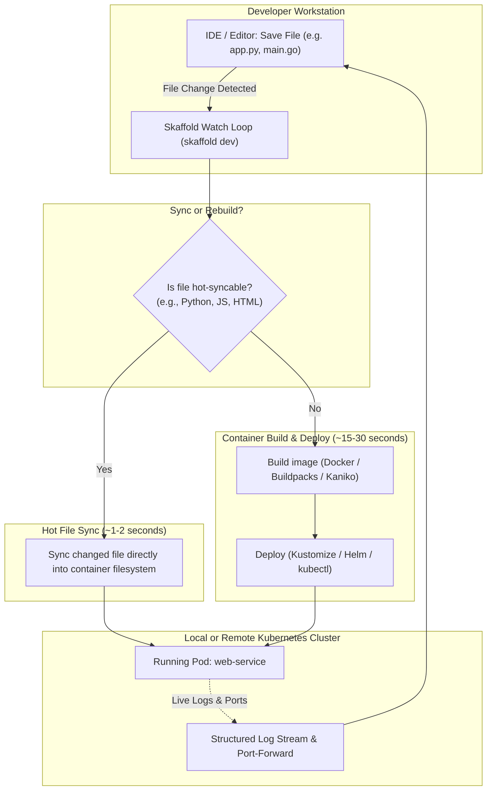

The inner-loop development cycle for Kubernetes is notoriously slow: write code, build container image, tag image, push to remote registry, update deployment manifest, run `kubectl apply`, wait for pod restart, and check logs. A simple 1-line code change can easily take 3 to 5 minutes to test.

**Skaffold** (developed by Google) automates the entire inner-loop development workflow. Skaffold detects source code file edits, automatically syncs changed files directly into running containers (or rebuilds using BuildKit/Kaniko), deploys manifests via Helm/Kustomize, and streams logs to your terminal—shortening feedback cycles from minutes to **seconds**.



## Configuring `skaffold.yaml` with Hot File Sync

The real power of Skaffold lies in **file sync**, which copies source code changes directly into the running container without rebuilding the Docker image:

```yaml
apiVersion: skaffold/v4beta11
kind: Config
metadata:
  name: microservice-backend
build:
  artifacts:
    - image: ghcr.io/my-org/web-service
      context: .
      docker:
        dockerfile: Dockerfile
      sync:
        # Sync source files directly into container!
        manual:
          - src: "src/**/*.py"
            dest: "/app/src"
          - src: "templates/**/*.html"
            dest: "/app/templates"
manifests:
  kustomize:
    paths:
      - k8s/overlays/dev
portForward:
  - resourceType: Service
    resourceName: web-service
    port: 8080
    localPort: 8080
```

## Running `skaffold dev`

Start the continuous development loop:

```bash
skaffold dev --port-forward
```

What happens automatically:
1. Builds the container image and tags it with a git commit hash.
2. Deploys the application into your local (Kind/Minikube) or remote dev cluster.
3. Sets up bidirectional port forwarding to `localhost:8080`.
4. Streams logs from all deployed pods into your terminal.
5. Listens for code changes. When you edit `src/handler.py`, it copies the file directly into the container in **1.2 seconds**, triggering your app's live reloader.
6. When you press `Ctrl+C`, Skaffold cleans up and deletes all deployed resources automatically!

## Multi-Environment Profiles

Skaffold supports profiles for toggling between local dev clusters and staging pipelines:

```yaml
profiles:
  - name: staging
    build:
      googleCloudBuild:
        projectId: my-gcp-project
    manifests:
      kustomize:
        paths:
          - k8s/overlays/staging
```

Deploy to staging with:

```bash
skaffold run -p staging
```

## Key Developer Tips

- **Use with Kind or K3d:** When combined with a local Kind cluster, Skaffold avoids remote container registry upload times by loading images directly into the local Docker daemon.
- **Auto-Cleanup Safety:** If your laptop crashes, run `skaffold delete` to cleanly prune all dev deployments from the cluster.

