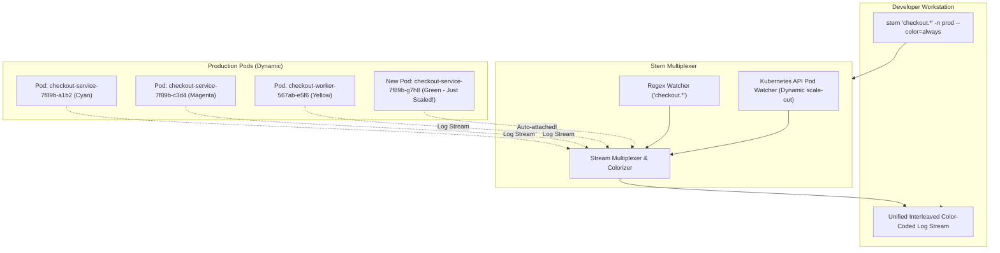

When debugging an incident across a microservice scaled to 20 replicas, standard `kubectl logs` fails you: it requires you to target one pod at a time. If an intermittent bug or HTTP 500 error only strikes 1 out of 20 pods, you are left playing whack-a-mole across pod hashes.

**Stern** solves this problem by allowing you to tail multiple pods and containers simultaneously using regular expressions. Stern dynamically streams logs, color-codes each pod with a distinct terminal color, and automatically attaches to newly spawned pods as workloads scale.



## Essential Stern Workflows

### 1. Tail All Pods in a Deployment with Regex

Tail all pods matching the regex `payment.*` across the `production` namespace:

```bash
stern "payment.*" --namespace production
```

Stern assigns a distinct terminal color to each pod ID:
```text
payment-api-5c94d8745b-abc12 [payment] INFO: Received payment intent id=pi_9012
payment-api-5c94d8745b-xyz99 [payment] WARN: Upstream bank latency 840ms
payment-worker-84d9f6789-qwe34 [worker] INFO: Batch reconciliation started
```

### 2. Tailing Multi-Container Pods (Filtering Sidecars)

In microservices with Envoy sidecars or Istio proxies, `kubectl logs` errors out asking you to specify a container name. With Stern, you can filter directly by container:

```bash
# Tail only the application container, ignoring the istio-proxy sidecar
stern "orders-.*" -c "app" --namespace default
```

### 3. Filtering by Time and Log Level

Stream logs emitted in the last 15 minutes, filtering for lines matching error patterns:

```bash
stern "auth-.*" --since 15m --include "ERROR|Exception|FATAL"
```

Conversely, eliminate noisy health check pings:

```bash
stern "web-.*" --exclude "GET /healthz|GET /readyz"
```

### 4. Tailing Across All Namespaces

Find all pods throwing database connection errors anywhere in the cluster:

```bash
stern ".*" --all-namespaces --include "connection refused|deadlock"
```

## Stern vs kubectl logs: Why Engineers Switch

| Capability | `kubectl logs` | `stern` |
| :--- | :--- | :--- |
| **Targeting** | 1 pod or 1 deployment at a time | **Multiple pods, services & namespaces via regex** |
| **New Pod Auto-Attachment** | No (stops when pod dies) | **Yes (attaches to new pods as HPA scales out)** |
| **Terminal Output** | Monochrome text | **Color-coded distinct pod hashes** |
| **Sidecar Filtering** | Requires explicit `-c` on every pod | **Glob and regex matching across container names** |
| **Time Filtering** | Basic `--since` | **Human-readable units (`--since 10m`, `--since 1h`)** |

## Production Best Practices

- **Set Shell Alias:** Add `alias s='stern'` to your `~/.zshrc` or `~/.bashrc` for instantaneous incident log tailing.
- **Output Formats for Scripting:** Pipe into jq or structured parsers by passing `--output json` or `--output raw` to bypass terminal escape codes during automated troubleshooting scripts.

