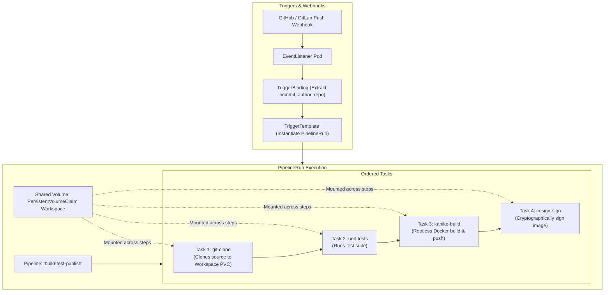

Traditional CI/CD systems like Jenkins or GitLab CI run jobs inside heavyweight virtual machines or long-lived static agents. **Tekton** (a CNCF Graduated project) provides a completely Kubernetes-native pipeline framework where every build step executes inside an ephemeral container on the cluster.

Tekton standardizes CI/CD primitives as native Custom Resources, providing isolated, reproducible, and auto-scaling builds that eliminate idle runner costs.



## The Four Building Blocks of Tekton

1. **Step:** An individual container spec that executes a single command (e.g., `git clone` or `mvn clean test`). Steps within the same Task execute sequentially and share the same local pod storage.
2. **Task:** A collection of sequential Steps that execute together inside a single Kubernetes Pod.
3. **Pipeline:** Defines an execution graph (DAG) connecting multiple Tasks together with ordering constraints (`runAfter`), parameter passing, and conditions (`when`).
4. **PipelineRun:** An instantiation of a Pipeline that allocates real cluster resources, binds PersistentVolumeClaims, and executes the build.

## Building and Pushing Without Docker-in-Docker (Kaniko Task)

Running Docker-in-Docker (`dind`) requires insecure, privileged containers. Tekton leverages **Kaniko** to build container images completely in user-space without root privileges:

```yaml
apiVersion: tekton.dev/v1
kind: Task
metadata:
  name: kaniko-build
  namespace: ci
spec:
  params:
    - name: IMAGE
      type: string
      description: Target container registry image reference
  workspaces:
    - name: source
  steps:
    - name: build-and-push
      image: gcr.io/kaniko-project/executor:v1.20.0
      args:
        - "--dockerfile=$(workspaces.source.path)/Dockerfile"
        - "--context=$(workspaces.source.path)"
        - "--destination=$(params.IMAGE)"
        - "--cache=true"
        - "--cache-dir=/cache"
      securityContext:
        runAsNonRoot: true
        allowPrivilegeEscalation: false
```

## Creating the Complete CI/CD Pipeline

Chain git cloning, testing, and container image building together:

```yaml
apiVersion: tekton.dev/v1
kind: Pipeline
metadata:
  name: application-pipeline
  namespace: ci
spec:
  params:
    - name: git-url
      type: string
    - name: image-name
      type: string
  workspaces:
    - name: shared-data
  tasks:
    - name: fetch-repository
      taskRef:
        resolver: git
        params:
          - name: url
            value: https://github.com/tektoncd/catalog.git
          - name: pathInRepo
            value: task/git-clone/0.9/git-clone.yaml
      workspaces:
        - name: output
          workspace: shared-data
      params:
        - name: url
          value: $(params.git-url)

    - name: build-container
      runAfter: ["fetch-repository"]
      taskRef:
        name: kaniko-build
      workspaces:
        - name: source
          workspace: shared-data
      params:
        - name: IMAGE
          value: $(params.image-name)
```

## Triggering Pipelines with Tekton CLI (`tkn`)

Execute a manual pipeline run from your local workstation:

```bash
tkn pipeline start application-pipeline \
  --namespace ci \
  --param git-url="https://github.com/my-org/backend-service.git" \
  --param image-name="ghcr.io/my-org/backend-service:v1.0.0" \
  --workspace name=shared-data,claimName=ci-pipeline-pvc \
  --showlog
```

Inspect live pipeline execution:

```bash
tkn pipelinerun list -n ci
```

## Why Organizations Choose Tekton

- **True Cloud-Native Autoscaling:** Kubernetes automatically scales pipeline runners to zero when no builds are active.
- **Supply Chain Security:** Integrates natively with Tekton Chains to generate in-toto attestations and sign build outputs cryptographically.
- **Portability:** Works identically across on-prem bare-metal clusters, AWS EKS, Google GKE, and Red Hat OpenShift (OpenShift Pipelines).

