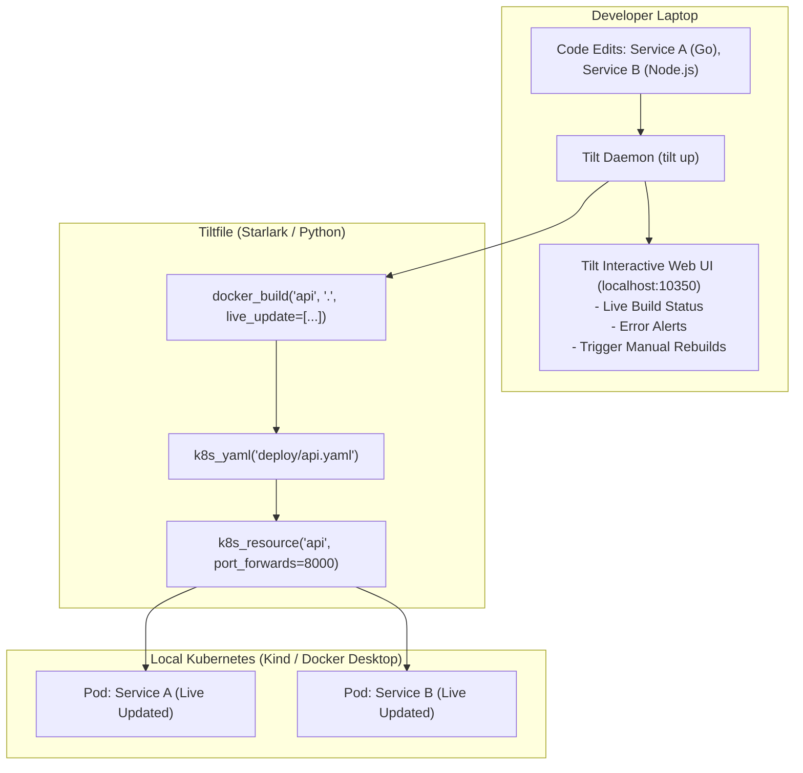

When an application consists of 10 or more interconnected microservices, running them locally with `docker-compose` fails to mirror production Kubernetes primitives (Ingress, ConfigMaps, Secrets, RBAC). However, managing raw YAML files across 10 services during local development quickly becomes unmanageable.

**Tilt** solves multi-service Kubernetes development by treating development environments as code using **Tiltfiles** (written in Starlark, a dialect of Python). Tilt provides an interactive web dashboard showing live service build times, error logs, dependencies, and lightning-fast in-container hot reloads.



## The Power of the `Tiltfile`

A `Tiltfile` defines how services are built, packaged, and wired together using familiar Python syntax:

```python
# Tiltfile

# 1. Build container with live-updating for instant reloads
docker_build(
    'ghcr.io/my-org/frontend',
    './frontend',
    live_update=[
        # Sync JS and CSS directly into the container in milliseconds!
        sync('./frontend/src', '/app/src'),
        # Re-run build command inside container when package.json changes
        run('npm install', trigger='./frontend/package.json'),
    ]
)

# 2. Deploy Kubernetes manifests
k8s_yaml(['./deploy/frontend.yaml', './deploy/backend.yaml'])

# 3. Configure port forwards and custom UI buttons
k8s_resource(
    'frontend',
    port_forwards='3000:3000',
    labels=['ui']
)

k8s_resource(
    'backend',
    port_forwards='8080:8080',
    labels=['api']
)
```

## Running `tilt up`

Launch your multi-service stack with a single command:

```bash
tilt up
```

Tilt automatically opens a rich web dashboard at `http://localhost:10350`.

The dashboard shows:
- Green/Red health indicators across all services.
- Real-time aggregated error logs with stack traces.
- Custom interactive UI buttons (e.g. "Run Database Seed", "Reset Redis Cache").
- Build timing benchmarks so you can see which Dockerfile stages are slow.

## Fast Live Updates vs Image Rebuilds

With `live_update`, saving a React component or Go file syncs the changes to the container in **under 500 milliseconds**, completely bypassing the Docker build daemon and Kubernetes scheduler.

If a critical file changes that cannot be live-synced (like a new native C dependency or OS package), Tilt automatically falls back to a clean container image build.

## Tilt vs Skaffold: Which Should You Use?

| Feature | Tilt | Skaffold |
| :--- | :--- | :--- |
| **Config Language** | Starlark (Python dialect with loops, functions, conditionals) | Declarative YAML |
| **Web Dashboard** | Native, interactive browser UI | Headless terminal output (or Cloud Code plugin) |
| **Multi-Service Dependencies** | Native `k8s_resource(..., resource_deps=[...])` | Profile-based |
| **Custom Actions** | Custom buttons in UI (`uibutton`) | Requires external scripts |
| **Ecosystem** | Focused on rich local developer experience | Integrated with Google Cloud Build & CI/CD pipelines |

