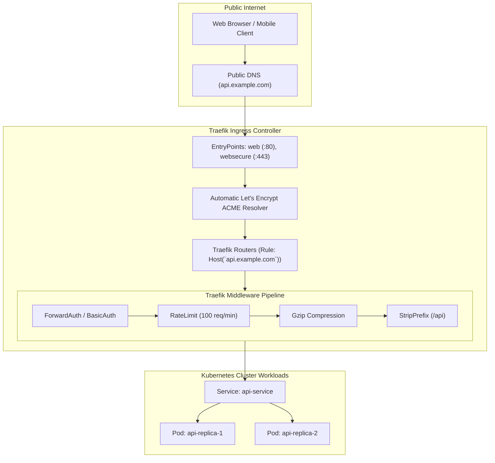

Managing external traffic ingress into Kubernetes requires robust HTTP routing, TLS termination, path rewriting, rate limiting, and middleware authentication. While NGINX Ingress has historically been widespread, **Traefik** is a cloud-native, Go-based reverse proxy designed specifically for dynamic container orchestration environments.

Traefik eliminates static configuration reloads: it listens natively to the Kubernetes API for `Ingress`, `IngressRoute` (Custom Resource), and **Kubernetes Gateway API** resources, dynamically updating routing tables in memory with zero connection drops.



## Why Traefik Shines in Kubernetes

1. **Zero-Reload Dynamic Updates:** When pods scale or services update, Traefik updates its internal routing table in memory without reloading the process or dropping active keep-alive HTTP/2 connections.
2. **Composable Middleware Architecture:** Chain authentication, rate limiting, header manipulation, and circuit breaking into modular, reusable `Middleware` Custom Resources.
3. **Automated Let's Encrypt TLS:** Built-in ACME challenge resolver automatically provisions and renews TLS certificates without requiring external certificate managers for simple setups.
4. **First-Class Kubernetes Gateway API Support:** Full conformance with the modern Kubernetes Gateway API (`GatewayClass`, `Gateway`, `HTTPRoute`).

## Defining Advanced Routing with `IngressRoute` CRD

While Traefik fully supports standard Kubernetes `Ingress`, its native `IngressRoute` CRD allows for powerful routing rules and middleware chaining:

```yaml
apiVersion: traefik.io/v1alpha1
kind: Middleware
metadata:
  name: api-rate-limit
  namespace: default
spec:
  rateLimit:
    average: 100
    burst: 50
    period: 1m
---
apiVersion: traefik.io/v1alpha1
kind: Middleware
metadata:
  name: strip-api-prefix
  namespace: default
spec:
  stripPrefix:
    prefixes:
      - /api/v1
---
apiVersion: traefik.io/v1alpha1
kind: IngressRoute
metadata:
  name: secure-api-route
  namespace: default
spec:
  entryPoints:
    - websecure
  routes:
    - match: Host(`api.kubedaily.com`) && PathPrefix(`/api/v1/users`)
      kind: Rule
      services:
        - name: user-service
          port: 8080
      middlewares:
        - name: api-rate-limit
        - name: strip-api-prefix
  tls:
    secretName: kubedaily-wildcard-tls
```

## Canary Deployments & Traffic Mirroring

Traefik enables weighted canary traffic splitting and silent request mirroring directly at the Ingress layer:

```yaml
apiVersion: traefik.io/v1alpha1
kind: IngressRoute
metadata:
  name: canary-routing
  namespace: default
spec:
  entryPoints:
    - websecure
  routes:
    - match: Host(`checkout.kubedaily.com`)
      kind: Rule
      services:
        - name: checkout-v1
          port: 8080
          weight: 80
        - name: checkout-v2
          port: 8080
          weight: 20
```

To test a new release with production traffic without affecting real users, enable **request mirroring**:

```yaml
apiVersion: traefik.io/v1alpha1
kind: TraefikService
metadata:
  name: mirror-service
  namespace: default
spec:
  mirroring:
    name: production-backend
    port: 8080
    mirrors:
      - name: experimental-backend
        port: 8080
        percent: 10
```

## Deploying Traefik via Helm

```bash
helm repo add traefik https://traefik.github.io/charts
helm repo update

helm install traefik traefik/traefik \
  --namespace traefik \
  --create-namespace \
  --set ingressClass.enabled=true \
  --set ingressClass.isDefaultClass=true \
  --set ports.web.redirectTo.port=websecure
```

## Production Hardening Tips

- **Force HTTPS Redirection:** Configure the entrypoint to automatically redirect all unencrypted HTTP port 80 requests to secure HTTPS port 443 with an HTTP 301 Permanent Redirect.
- **Access Logs with Structured JSON:** Configure `--accesslog.format=json` and ship access logs to Loki or Elasticsearch to trace client IP, user agent, latency, and status codes.
- **Resource Limits:** Scale Traefik horizontally using Horizontal Pod Autoscaler (HPA) targeting CPU utilization to absorb massive external DDoS traffic surges.

