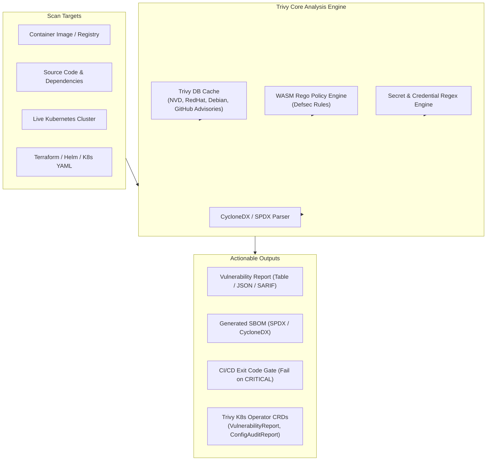
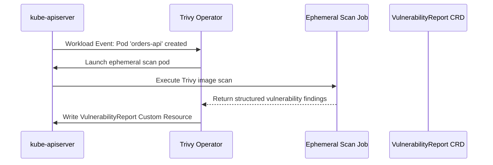

Security in containerized environments must operate as an automated pipeline gate rather than a manual audit. **Trivy** (developed by Aqua Security) is an open-source, comprehensive vulnerability, misconfiguration, secret, and Software Bill of Materials (SBOM) scanner for containers and Kubernetes.

Unlike older legacy scanners that require heavy database daemons or external API calls, Trivy operates as a single static binary with an embedded, locally cached vulnerability database that can scan container images, file systems, Git repositories, virtual machine images, and live Kubernetes clusters.



## Why Trivy is Essential for Cloud-Native Workloads

Container base images frequently carry hundreds of unpatched OS packages and vulnerable application libraries. Trivy addresses four critical vectors:

1. **OS and Language Dependency Vulnerabilities:** Scans alpine, debian, ubuntu, rhel, and detects CVEs in language packages (`npm`, `pip`, `gomod`, `cargo`, `maven`).
2. **Infrastructure as Code (IaC) Misconfigurations:** Analyzes Dockerfiles, Kubernetes manifests, and Terraform scripts against CIS benchmarks.
3. **Hardcoded Secrets Detection:** Discovers leaked API keys, tokens, and private SSH certificates before images are pushed to registries.
4. **SBOM Generation & Attestation:** Emits compliant CycloneDX and SPDX SBOMs required for modern supply chain compliance.

## Hands-On: Scanning Images and Filesystems

### 1. Comprehensive Container Image Scan

Scan an image and filter out unfixed vulnerabilities while setting a hard failure threshold for CI pipelines:

```bash
# Scan image, exit with code 1 if CRITICAL vulnerabilities exist
trivy image \
  --severity HIGH,CRITICAL \
  --ignore-unfixed \
  --exit-code 1 \
  ghcr.io/my-org/backend-api:v1.2.0
```

### 2. Scanning Kubernetes Manifests for Misconfigurations

Scan your local deployment manifests before pushing them to Git or applying them to a cluster:

```bash
trivy config ./k8s/
```

Example finding:
```text
FAIL: Deployment 'payment-service' runs as root user
HIGH: Missing memory and CPU resource limits (CIS Benchmark 5.1.3)
MEDIUM: Root filesystem is writable; set 'readOnlyRootFilesystem: true'
```

### 3. Generating an SBOM (Software Bill of Materials)

Generate a standardized CycloneDX JSON SBOM:

```bash
trivy image --format cyclonedx --output sbom.cdx.json python:3.11-slim
```

## Deploying the Trivy Kubernetes Operator

Running Trivy inside a live cluster ensures that newly published zero-day CVEs are detected even in pods that were deployed weeks ago.

### Operator Architecture

The Trivy Operator watches Kubernetes workloads and automatically spins up ephemeral scan jobs, publishing findings directly as native Custom Resources:



### Installing via Helm

```bash
helm repo add aqua https://aquasecurity.github.io/helm-charts/
helm repo update

helm install trivy-operator aqua/trivy-operator \
  --namespace trivy-system \
  --create-namespace \
  --set="trivy.ignoreUnfixed=true" \
  --set="operator.scanJobsConcurrentLimit=3"
```

### Querying Vulnerabilities with kubectl

Once installed, query the cluster's vulnerability posture using standard `kubectl`:

```bash
# View vulnerability summaries across all pods in default namespace
kubectl get vulnerabilityreports -n default

# Inspect detailed CVEs on a specific deployment
kubectl get vulnerabilityreport deployment-payment-service -o jsonpath='{.report.vulnerabilities[*].vulnerabilityID}'
```

## Production Gotchas & Best Practices

- **Air-Gapped Database Caching:** In restricted networks, configure an internal Harbor registry or S3 bucket to mirror Trivy's DB (`ghcr.io/aquasecurity/trivy-db:2`) to avoid rate limits or outbound internet dependencies.
- **Ignore Files (`.trivyignore`):** Document accepted risks with expiration dates and justification tickets:
  ```text
  # Accepted risk: CVE-2023-XXXX pending vendor patch. Expiry: 2026-12-01
  CVE-2023-XXXX
  ```
- **Filter Out Unfixed CVEs:** When gating pull requests, always pass `--ignore-unfixed` so developers are only blocked by issues that actually have available upstream patches.

