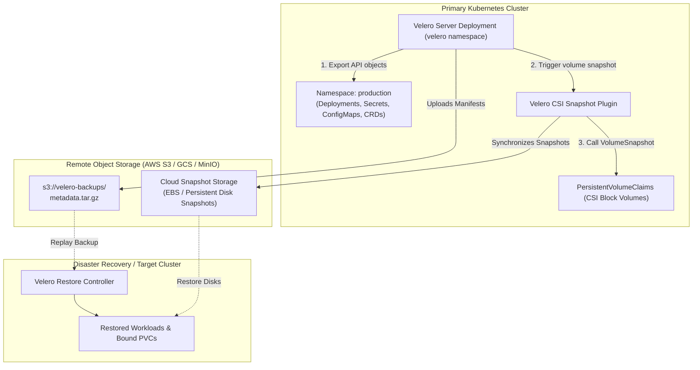

Disaster recovery in Kubernetes is more than just backing up an etcd snapshot. An etcd snapshot captures cluster state, but it does not capture the underlying physical data stored in PersistentVolumes, nor can it selectively restore individual namespaces, migrate workloads across cloud providers, or run in hybrid environments.

**Velero** (a CNCF project originated by VMware Tanzu) is the enterprise standard for Kubernetes backup, migration, and disaster recovery. Velero backs up Kubernetes API objects into compressed tarballs and coordinates with the Container Storage Interface (**CSI**) to capture point-in-time storage volume snapshots, streaming all data to external object storage (AWS S3, Google Cloud Storage, Azure Blob, or MinIO).



## The Four Capabilities of Velero

1. **Disaster Recovery:** Recover your entire cluster (or specific critical namespaces) following catastrophic control plane failure or accidental deletion.
2. **Cross-Cluster & Cross-Cloud Migration:** Back up workloads running on on-premise OpenShift or bare-metal clusters and restore them cleanly onto AWS EKS or Google GKE.
3. **CSI Volume Snapshots:** Takes storage-level snapshots across all major CSI storage drivers (AWS EBS, Ceph, Longhorn, Portworx).
4. **Kopia / Restic File-Level Backup:** For storage drivers lacking native CSI snapshot capabilities, Velero embeds Kopia/Restic to perform file-level block deduplicated backups.

## Hands-On: Backing Up and Restoring with the Velero CLI

### 1. Creating an Instant On-Demand Backup

Back up the entire `production` namespace including all persistent volumes:

```bash
velero backup create prod-backup-20261101 \
  --include-namespaces production \
  --snapshot-volumes \
  --wait
```

Check the backup progress and status:

```bash
velero backup describe prod-backup-20261101 --details
```

Output:
```text
Phase:  Completed
Namespaces:
  Included: production
Persistent Volumes:
  Included: 4 of 4 snapshots completed successfully
```

### 2. Simulating Disaster and Executing Full Recovery

Accidentally delete the production namespace:

```bash
kubectl delete namespace production
```

Restore the entire namespace and its persistent volumes from object storage:

```bash
velero restore create --from-backup prod-backup-20261101 --wait
```

Verify that all deployments, statefulsets, and PVCs are re-created and healthy:

```bash
kubectl get all -n production
kubectl get pvc -n production
```

## Scheduling Automated Daily Backups

Set up automated recurring backup schedules with retention periods:

```yaml
apiVersion: velero.io/v1
kind: Schedule
metadata:
  name: daily-prod-backup
  namespace: velero
spec:
  schedule: "0 1 * * *"
  template:
    includedNamespaces:
      - production
      - billing
    ttl: 720h0m0s # Retain backups for 30 days
    snapshotVolumes: true
```

## Production Disaster Recovery Tips

- **Test Restores Automatically in CI:** A backup that hasn't been tested is not a real backup. Set up a weekly CI pipeline that spins up an ephemeral Kind or cloud cluster and restores your latest Velero backup to verify application boot health.
- **Cross-Account S3 Bucket Replication:** Store Velero backup buckets in a separate, isolated cloud account with S3 Object Lock (Write-Once-Read-Many / WORM) enabled to prevent ransomware attacks from destroying your backup archives.
- **Resource Modifiers:** Use Velero's `ResourceModifier` ConfigMap to rewrite StorageClasses dynamically during migration (e.g. mapping `gp2` on AWS to `standard-rwo` on GKE).

