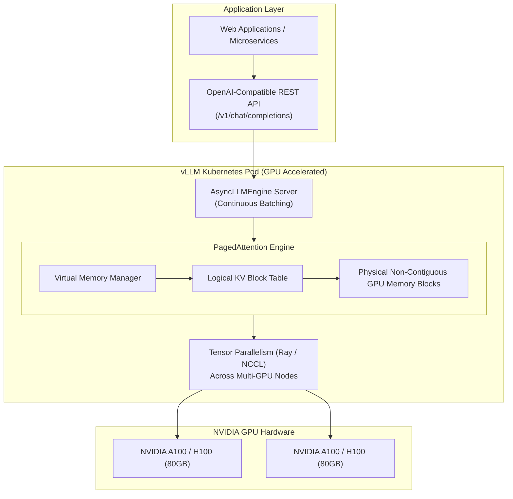

Deploying Large Language Models (LLMs) on Kubernetes presents severe memory and computational bottlenecks. Standard PyTorch model servers suffer from memory fragmentation and low GPU utilization due to the unbounded growth of Key-Value (KV) cache tensors during autoregressive decoding.

**vLLM** is an open-source, high-throughput LLM serving library that fundamentally solves GPU memory waste through **PagedAttention**—an algorithm inspired by virtual memory paging in operating systems. When deployed on Kubernetes with NVIDIA GPU operators, vLLM delivers up to 24x higher throughput compared to HuggingFace TGI without compromising precision.



## How PagedAttention Unlocks GPU Throughput

In traditional serving systems, memory for the KV cache must be pre-allocated contiguously for the maximum anticipated sequence length (e.g., 4,096 tokens). This leads to:
- **Internal Fragmentation:** Memory reserved for tokens that are never generated.
- **External Fragmentation:** GPUs running out of memory even when plenty of non-contiguous chunks remain.

**PagedAttention** divides the KV cache into fixed-size physical blocks (e.g., 16 tokens). Tokens are stored in non-contiguous GPU memory pages managed by a logical page table. This reduces memory waste from over 60% down to less than **4%**, enabling massive continuous batching of concurrent user requests.

## Deploying vLLM on Kubernetes (Production Manifest)

Here is a production-ready Kubernetes Deployment serving `meta-llama/Meta-Llama-3-8B-Instruct` using an NVIDIA A10G/A100 GPU:

```yaml
apiVersion: apps/v1
kind: Deployment
metadata:
  name: vllm-llama3
  namespace: ai-workloads
spec:
  replicas: 1
  selector:
    matchLabels:
      app: vllm-llama3
  template:
    metadata:
      labels:
        app: vllm-llama3
    spec:
      containers:
        - name: vllm-server
          image: vllm/vllm-openai:v0.5.0
          args:
            - "--model"
            - "meta-llama/Meta-Llama-3-8B-Instruct"
            - "--gpu-memory-utilization"
            - "0.95"
            - "--max-model-len"
            - "8192"
            - "--port"
            - "8000"
          env:
            - name: HUGGING_FACE_HUB_TOKEN
              valueFrom:
                secretKeyRef:
                  name: hf-token-secret
                  key: token
          ports:
            - containerPort: 8000
              name: http
          resources:
            limits:
              nvidia.com/gpu: 1
              memory: 32Gi
              cpu: "8"
            requests:
              nvidia.com/gpu: 1
              memory: 16Gi
              cpu: "4"
          readinessProbe:
            httpGet:
              path: /health
              port: 8000
            initialDelaySeconds: 120
            periodSeconds: 10
          volumeMounts:
            - name: model-cache
              mountPath: /root/.cache/huggingface
      volumes:
        - name: model-cache
          persistentVolumeClaim:
            claimName: model-cache-pvc
```

Expose the inference server via an internal Service:

```yaml
apiVersion: v1
kind: Service
metadata:
  name: vllm-llama3-svc
  namespace: ai-workloads
spec:
  selector:
    app: vllm-llama3
  ports:
    - protocol: TCP
      port: 8000
      targetPort: 8000
```

## Testing Inference via OpenAI-Compatible API

vLLM provides native drop-in compatibility with OpenAI client libraries. Query the server inside the cluster:

```bash
curl http://vllm-llama3-svc.ai-workloads.svc.cluster.local:8000/v1/chat/completions \
  -H "Content-Type: application/json" \
  -d '{
    "model": "meta-llama/Meta-Llama-3-8B-Instruct",
    "messages": [
      {"role": "system", "content": "You are a Kubernetes SRE expert."},
      {"role": "user", "content": "Explain CrashLoopBackOff in 2 sentences."}
    ],
    "temperature": 0.2
  }'
```

## Production Optimization Checklist

- **Shared Model Cache:** Use a ReadWriteMany (RWX) Persistent Volume (NFS, CephFS, or EFS) mounted at `/root/.cache/huggingface` so newly provisioned pods don't re-download 30GB model weights from the internet.
- **Continuous Batching Tuning:** Set `--max-num-seqs` based on token latency SLAs; higher concurrency increases total throughput at the expense of marginal time-to-first-token (TTFT).
- **Multi-GPU Tensor Parallelism:** For 70B+ models, specify `--tensor-parallel-size 4` or `8` and configure the NVIDIA GPU operator for NVLink communication.

