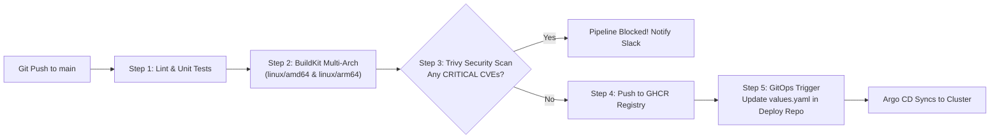
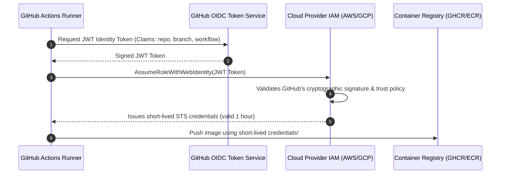

# Cloud-Native CI/CD Pipelines: GitHub Actions, OIDC & Automated Delivery

Build an enterprise-grade container continuous integration and delivery pipeline using **GitHub Actions**. Eliminate static cloud credentials with **OIDC keyless authentication**, accelerate multi-architecture image compilation with **BuildKit**, enforce zero-CVE release gates with **Trivy**, and trigger automated GitOps reconciliations.



---

## 1. Keyless Cloud Authentication with OIDC

Storing long-lived cloud credentials (`AWS_ACCESS_KEY_ID`, `AWS_SECRET_ACCESS_KEY`, Docker Hub tokens) in GitHub repository secrets is a major security vulnerability.

**OpenID Connect (OIDC)** allows GitHub Actions workflows to request short-lived, dynamically generated tokens from the cloud provider (AWS IAM, GCP Workload Identity, or Azure AD) directly using cryptographic identity assertions.



---

## 2. Complete Production GitHub Actions Workflow

Create `.github/workflows/container-delivery.yaml`:

```yaml
name: Production Container Delivery Pipeline

on:
  push:
    branches: [ "main" ]
    tags: [ "v*.*.*" ]
  pull_request:
    branches: [ "main" ]

permissions:
  contents: read
  packages: write
  id-token: write # Required for requesting the OIDC JWT token
  security-events: write # Required for uploading Trivy SARIF reports

env:
  REGISTRY: ghcr.io
  IMAGE_NAME: ${{ github.repository }}

jobs:
  test-and-build:
    name: Build, Test & Security Scan
    runs-on: ubuntu-latest
    steps:
      - name: Checkout Source Code
        uses: actions/checkout@v4

      # 1. Set up QEMU for multi-architecture emulation (amd64 + arm64)
      - name: Set up QEMU
        uses: docker/setup-qemu-action@v3

      # 2. Set up BuildKit with caching
      - name: Set up Docker Buildx
        uses: docker/setup-buildx-action@v3

      # 3. Authenticate to GitHub Container Registry using GITHUB_TOKEN
      - name: Log in to Registry
        uses: docker/login-action@v3
        with:
          registry: ${{ env.REGISTRY }}
          username: ${{ github.actor }}
          password: ${{ secrets.GITHUB_TOKEN }}

      # 4. Extract Docker metadata (tags, labels, commit SHA)
      - name: Extract Metadata
        id: meta
        uses: docker/metadata-action@v5
        with:
          images: ${{ env.REGISTRY }}/${{ env.IMAGE_NAME }}
          tags: |
            type=semver,pattern={{version}}
            type=sha,prefix=sha-
            type=ref,event=branch

      # 5. Build and export locally for security scanning
      - name: Build Container Image
        uses: docker/build-push-action@v5
        with:
          context: .
          load: true # Exports image to local Docker daemon for vulnerability scanning
          tags: ${{ env.REGISTRY }}/${{ env.IMAGE_NAME }}:${{ github.sha }}
          cache-from: type=gha
          cache-to: type=gha,mode=max

      # 6. Security Scan with Trivy (Block pipeline on CRITICAL CVEs)
      - name: Run Trivy Vulnerability Scanner
        uses: aquasecurity/trivy-action@master
        with:
          image-ref: ${{ env.REGISTRY }}/${{ env.IMAGE_NAME }}:${{ github.sha }}
          format: 'table'
          exit-code: '1' # Fails the pipeline if vulnerabilities match criteria
          ignore-unfixed: true
          severity: 'CRITICAL'

      # 7. Push Multi-Architecture Image to Registry
      - name: Build and Push Multi-Arch Image
        if: github.event_name != 'pull_request'
        uses: docker/build-push-action@v5
        with:
          context: .
          platforms: linux/amd64,linux/arm64
          push: true
          tags: ${{ steps.meta.outputs.tags }}
          labels: ${{ steps.meta.outputs.labels }}
          cache-from: type=gha
          cache-to: type=gha,mode=max
```

---

## 3. Automated GitOps Promotion Workflow

Once the container image is built and verified, the CI pipeline updates the image tag in the GitOps repository holding the Helm values or Kustomize manifests:

```yaml
  promote-gitops:
    name: Promote to Staging GitOps
    needs: test-and-build
    if: github.ref == 'refs/heads/main'
    runs-on: ubuntu-latest
    steps:
      - name: Checkout GitOps Repository
        uses: actions/checkout@v4
        with:
          repository: my-org/gitops-deployments
          token: ${{ secrets.GITOPS_PROMOTION_TOKEN }}

      - name: Update Image Tag in Helm values
        run: |
          sed -i 's|tag:.*|tag: "sha-${{ github.sha }}"|' environments/staging/values.yaml
          git config user.name "gitops-bot"
          git config user.email "bot@myorg.internal"
          git commit -am "chore(staging): promote ${{ github.repository }} to sha-${{ github.sha }}"
          git push origin main
```

Argo CD or Flux watching the `gitops-deployments` repository instantly reconciles the change into the target Kubernetes cluster!

---

## Summary Checklist

- [x] Eliminate static credentials by using **OIDC keyless cloud authentication**.
- [x] Configure **QEMU** and **Buildx** to cross-compile multi-architecture (`linux/amd64` and `linux/arm64`) images.
- [x] Utilize GitHub Actions cache (`type=gha`) to drastically accelerate build times.
- [x] Gate deliveries using **Trivy** with `exit-code: 1` on unfixed CRITICAL CVEs.
- [x] Automate environment promotion by updating image tags in GitOps repositories via automated pull requests or commits.

