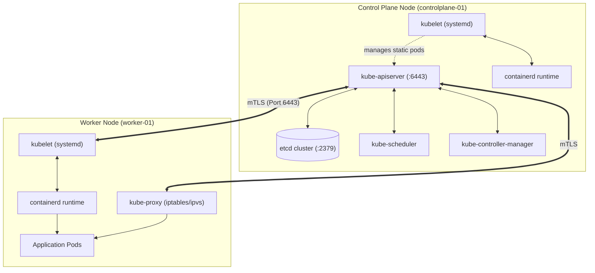
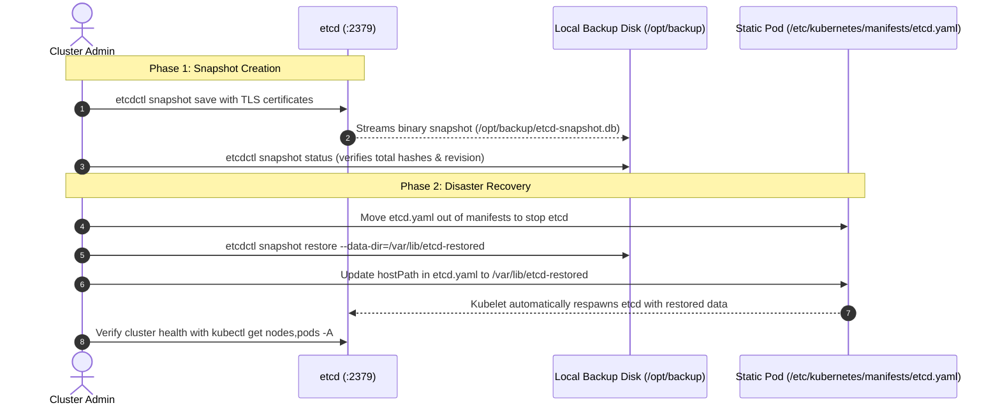
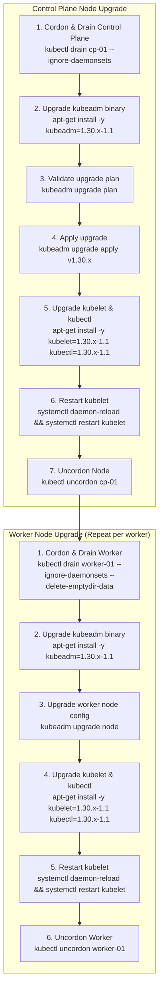
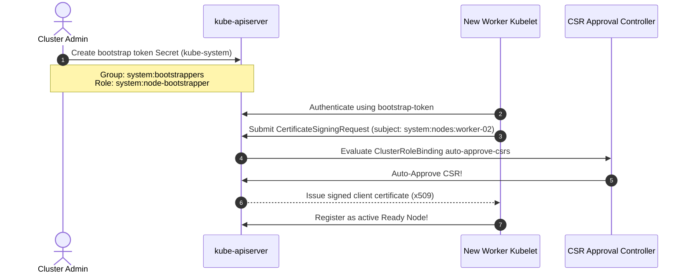
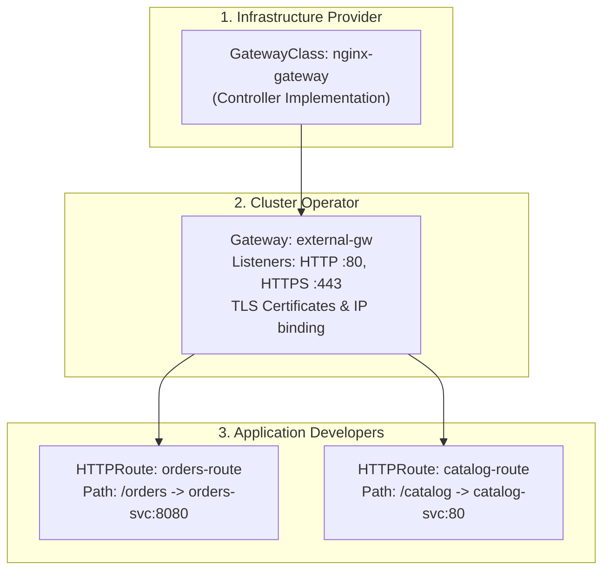
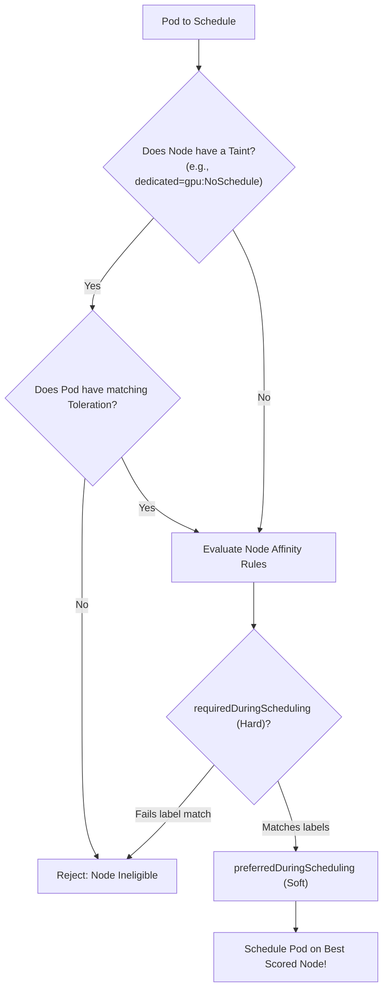
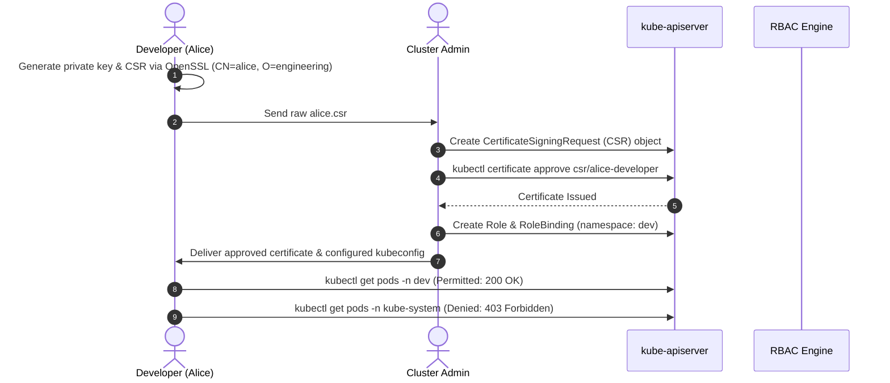

# CKA Master Lab: Cluster Administration, Upgrades & Troubleshooting

Master the core operational competencies required for the **Certified Kubernetes Administrator (CKA)** exam and enterprise infrastructure engineering. Based on battle-tested production blueprints, this lab covers control plane architecture, zero-downtime `kubeadm` upgrades, etcd disaster recovery, worker node TLS bootstrapping, kubelet systemd troubleshooting, the next-generation **Gateway API**, advanced workload scheduling, and secure RBAC onboarding.



---

## 1. etcd Snapshot Backup & Disaster Recovery

etcd is the sole source of truth for all Kubernetes cluster state. If etcd is lost or corrupted, your cluster is gone.



### Step 1.1: Environment & Certificate Discovery

Inspect the running etcd static pod manifest to locate the TLS certificates and cluster endpoints:

```bash
cat /etc/kubernetes/manifests/etcd.yaml | grep -E "cert-file|key-file|trusted-ca-file|listen-client-urls|data-dir"
```

Typical outputs:
- CA Certificate: `/etc/kubernetes/pki/etcd/ca.crt`
- Server Certificate: `/etc/kubernetes/pki/etcd/server.crt`
- Server Private Key: `/etc/kubernetes/pki/etcd/server.key`
- Client Endpoint: `https://127.0.0.1:2379`
- Data Directory: `/var/lib/etcd`

### Step 1.2: Capture a Snapshot

Use `etcdctl` with the `ETCDCTL_API=3` environment variable:

```bash
# Set API version 3
export ETCDCTL_API=3

# Create the backup directory
sudo mkdir -p /opt/backup

# Take snapshot
sudo ETCDCTL_API=3 etcdctl \
  --endpoints=https://127.0.0.1:2379 \
  --cacert=/etc/kubernetes/pki/etcd/ca.crt \
  --cert=/etc/kubernetes/pki/etcd/server.crt \
  --key=/etc/kubernetes/pki/etcd/server.key \
  snapshot save /opt/backup/etcd-snapshot-pre-upgrade.db
```

### Step 1.3: Verify Snapshot Integrity

Always verify the snapshot immediately. Never assume a 0 exit code guarantees validity:

```bash
sudo ETCDCTL_API=3 etcdctl --write-out=table snapshot status /opt/backup/etcd-snapshot-pre-upgrade.db
```

Expected output:
```text
+----------+----------+------------+------------+
|   HASH   | REVISION | TOTAL KEYS | TOTAL SIZE |
+----------+----------+------------+------------+
| 3c8e4a91 |    48291 |       1240 |     4.2 MB |
+----------+----------+------------+------------+
```

### Step 1.4: Restore from Snapshot

To restore during a failure or test drill:

```bash
# 1. Stop the active etcd static pod by moving its manifest out of the kubelet watch path
sudo mv /etc/kubernetes/manifests/etcd.yaml /tmp/

# 2. Execute snapshot restore into a brand-new data directory
sudo ETCDCTL_API=3 etcdctl snapshot restore /opt/backup/etcd-snapshot-pre-upgrade.db \
  --data-dir=/var/lib/etcd-restored

# 3. Update the volume hostPath in /tmp/etcd.yaml:
# Change: path: /var/lib/etcd
# To:     path: /var/lib/etcd-restored

# 4. Move the manifest back to re-spawn etcd:
sudo mv /tmp/etcd.yaml /etc/kubernetes/manifests/

# 5. Verify cluster restoration
kubectl get nodes
kubectl get pods -A
```

---

## 2. Zero-Downtime Cluster Upgrade with kubeadm

Kubernetes upgrades follow a strict sequence: **Control Plane First, Worker Nodes Second**. You can only jump **one minor version at a time** (e.g., `1.29.x` -> `1.30.x`).



### Step 2.1: Upgrading the Control Plane Node

```bash
# 1. Drain workloads from the control plane node
kubectl drain controlplane-01 --ignore-daemonsets

# 2. Update package cache and install target kubeadm version
sudo apt-get update && sudo apt-get install -y --allow-change-held-packages kubeadm=1.30.0-1.1

# 3. Verify the upgrade plan
sudo kubeadm upgrade plan

# 4. Apply the upgrade
sudo kubeadm upgrade apply v1.30.0 -y

# 5. Upgrade kubelet and kubectl packages
sudo apt-get install -y --allow-change-held-packages kubelet=1.30.0-1.1 kubectl=1.30.0-1.1

# 6. Reload systemd daemon and restart kubelet
sudo systemctl daemon-reload
sudo systemctl restart kubelet

# 7. Uncordon the control plane node
kubectl uncordon controlplane-01
```

### Step 2.2: Upgrading Worker Nodes

On each worker node:

```bash
# 1. On your management terminal, drain the worker node
kubectl drain worker-01 --ignore-daemonsets --delete-emptydir-data --force

# 2. SSH into worker-01 and upgrade kubeadm
sudo apt-get update && sudo apt-get install -y --allow-change-held-packages kubeadm=1.30.0-1.1

# 3. Upgrade local node configuration
sudo kubeadm upgrade node

# 4. Upgrade kubelet and kubectl
sudo apt-get install -y --allow-change-held-packages kubelet=1.30.0-1.1 kubectl=1.30.0-1.1

# 5. Restart kubelet
sudo systemctl daemon-reload
sudo systemctl restart kubelet

# 6. Back on management machine, uncordon worker-01
kubectl uncordon worker-01
```

---

## 3. Worker Node TLS Bootstrapping & Automated CSR Approval

In large or dynamically scaling clusters, provisioning TLS certificates manually for every new worker node is impossible. **TLS Bootstrapping** allows new kubelets to join the cluster automatically using a shared bootstrap token.



### Step 3.1: Generate the Bootstrap Token Secret

Create `bootstrap-token.yaml`:

```yaml
apiVersion: v1
kind: Secret
metadata:
  name: bootstrap-token-07401b
  namespace: kube-system
type: bootstrap.kubernetes.io/token
stringData:
  description: "Bootstrap token for dynamic node joining"
  token-id: 07401b
  token-secret: f395accd246ae52d
  usage-bootstrap-authentication: "true"
  usage-bootstrap-signing: "true"
  auth-extra-groups: system:bootstrappers:worker
```

Apply and ensure `--enable-bootstrap-token-auth=true` is set on `kube-apiserver`.

### Step 3.2: Bind the Bootstrappers Group

Allow members of `system:bootstrappers` to submit CSRs:

```yaml
apiVersion: rbac.authorization.k8s.io/v1
kind: ClusterRoleBinding
metadata:
  name: create-csrs-for-bootstrapping
subjects:
- kind: Group
  name: system:bootstrappers
  apiGroup: rbac.authorization.k8s.io
roleRef:
  kind: ClusterRole
  name: system:node-bootstrapper
  apiGroup: rbac.authorization.k8s.io
```

### Step 3.3: Configure Automated CSR Approval

```yaml
apiVersion: rbac.authorization.k8s.io/v1
kind: ClusterRoleBinding
metadata:
  name: auto-approve-csrs-for-group
subjects:
- kind: Group
  name: system:bootstrappers
  apiGroup: rbac.authorization.k8s.io
roleRef:
  kind: ClusterRole
  name: system:certificates.k8s.io:certificatesigningrequests:nodeclient
  apiGroup: rbac.authorization.k8s.io
```

---

## 4. Node & Kubelet Systemd Troubleshooting

When a node reports status `NotReady`, systematically trace the failure from systemd through the CRI socket to CNI networking.

```mermaid
flowchart TD
    Start["Node reports NotReady"] --> Step1["kubectl describe node <node>"]
    Step1 --> CheckConditions{"Inspect Conditions"}
    
    CheckConditions -->|Ready: False / Unknown| Step2["SSH to Node -> systemctl status kubelet"]
    CheckConditions -->|DiskPressure / MemoryPressure| FixDisk["Clean up /var/lib/docker or expand disk"]
    CheckConditions -->|NetworkPluginNotReady| FixCNI["Check CNI DaemonSet pods (Calico/Cilium)"]

    Step2 --> KubeletStatus{"Is kubelet running?"}
    KubeletStatus -->|Dead / Inactive| ReadLogs["journalctl -u kubelet -xeu --no-pager"]
    KubeletStatus -->|Active (running)| CheckCRI["crictl info / check containerd socket"]

    ReadLogs --> Cause1["Cgroup driver mismatch: systemd vs cgroupfs"]
    ReadLogs --> Cause2["Missing or expired kubelet client certificate"]
    ReadLogs --> Cause3["Invalid /var/lib/kubelet/config.yaml syntax"]
```

### Diagnostic Commands

```bash
# Check node conditions
kubectl describe node worker-01 | grep -A 10 Conditions:

# On the affected node, inspect kubelet service status
systemctl status kubelet

# Read recent kubelet error logs
journalctl -u kubelet -n 100 --no-pager -e

# Verify container runtime socket responsiveness
sudo crictl --runtime-endpoint unix:///run/containerd/containerd.sock info

# Check certificate expiration across all kubeadm managed components
sudo kubeadm certs check-expiration
```

### Common Fix: Cgroup Driver Mismatch

Kubernetes requires the `systemd` cgroup driver for both the container runtime and kubelet.

Check `/etc/containerd/config.toml`:
```toml
[plugins."io.containerd.grpc.v1.cri".containerd.runtimes.runc.options]
  SystemdCgroup = true
```

Check `/var/lib/kubelet/config.yaml`:
```yaml
cgroupDriver: systemd
```

Restart both daemons if changed:
```bash
sudo systemctl restart containerd
sudo systemctl restart kubelet
```

---

## 5. Modern Gateway API: GatewayClass, Gateway & HTTPRoute

The **Kubernetes Gateway API** is the next-generation standard replacing the monolithic `Ingress` specification. It provides a role-oriented design decoupling infrastructure administration from application routing.



### Step 5.1: Create Gateway

```yaml
apiVersion: gateway.networking.k8s.io/v1
kind: Gateway
metadata:
  name: production-gateway
  namespace: default
spec:
  gatewayClassName: nginx
  listeners:
  - name: http
    protocol: HTTP
    port: 80
    allowedRoutes:
      namespaces:
        from: All
```

### Step 5.2: Define HTTPRoute

```yaml
apiVersion: gateway.networking.k8s.io/v1
kind: HTTPRoute
metadata:
  name: api-service-route
  namespace: default
spec:
  parentRefs:
  - name: production-gateway
  rules:
  - matches:
    - path:
        type: PathPrefix
        value: /api/v1
    backendRefs:
    - name: api-service
      port: 8080
```

Apply and inspect:
```bash
kubectl apply -f gateway.yaml
kubectl apply -f httproute.yaml
kubectl get gateway,httproute
```

---

## 6. Advanced Workload Scheduling: Taints, Tolerations & Node Affinity

Control exactly where pods are placed across nodes based on hardware capabilities, environments, and fault domains.



### Taints and Tolerations

```bash
# Taint a node so only GPU workloads can run on it:
kubectl taint nodes worker-gpu-01 dedicated=gpu:NoSchedule

# Toleration in Pod specification:
tolerations:
- key: "dedicated"
  operator: "Equal"
  value: "gpu"
  effect: "NoSchedule"
```

### Hard vs Soft Node Affinity

```yaml
affinity:
  nodeAffinity:
    # HARD REQUIREMENT: Pod will fail to schedule if no matching node exists
    requiredDuringSchedulingIgnoredDuringExecution:
      nodeSelectorTerms:
      - matchExpressions:
        - key: topology.kubernetes.io/zone
          operator: In
          values:
          - us-east-1a
          - us-east-1b

    # SOFT PREFERENCE: Pod prefers SSD nodes, but will schedule anyway if unavailable
    preferredDuringSchedulingIgnoredDuringExecution:
    - weight: 80
      preference:
        matchExpressions:
        - key: disktype
          operator: In
          values:
          - ssd
```

---

## 7. RBAC & Certificate Signing Requests (CSR)

Granting access to human developers or external systems requires x509 client certificates bound to Kubernetes Roles.



### Step 7.1: Generate Private Key and CSR

```bash
# 1. Generate 2048-bit RSA private key
openssl genrsa -out alice.key 2048

# 2. Generate CSR (CN is the Kubernetes username; O is the group)
openssl req -new -key alice.key -out alice.csr -subj "/CN=alice/O=engineering"
```

### Step 7.2: Submit CSR to Kubernetes

Create `alice-csr.yaml`:

```yaml
apiVersion: certificates.k8s.io/v1
kind: CertificateSigningRequest
metadata:
  name: alice-developer
spec:
  request: BASE64_ENCODED_CSR_STRING
  signerName: kubernetes.io/kube-apiserver-client
  usages:
  - client auth
```

Replace `BASE64_ENCODED_CSR_STRING`:
```bash
export BASE64_CSR=$(cat alice.csr | base64 | tr -d '\n')
sed -i "s|BASE64_ENCODED_CSR_STRING|$BASE64_CSR|g" alice-csr.yaml
kubectl apply -f alice-csr.yaml
```

### Step 7.3: Approve and Extract Certificate

```bash
# Approve the request
kubectl certificate approve alice-developer

# Extract the signed CRT file
kubectl get csr alice-developer -o jsonpath='{.status.certificate}' | base64 --decode > alice.crt
```

### Step 7.4: Authorize with Role & RoleBinding

Create `alice-rbac.yaml`:

```yaml
apiVersion: rbac.authorization.k8s.io/v1
kind: Role
metadata:
  namespace: dev
  name: developer-pod-reader
rules:
- apiGroups: [""]
  resources: ["pods", "pods/log"]
  verbs: ["get", "list", "watch"]
---
apiVersion: rbac.authorization.k8s.io/v1
kind: RoleBinding
metadata:
  namespace: dev
  name: bind-alice-dev
subjects:
- kind: User
  name: alice
  apiGroup: rbac.authorization.k8s.io
roleRef:
  kind: Role
  name: developer-pod-reader
  apiGroup: rbac.authorization.k8s.io
```

```bash
kubectl create namespace dev
kubectl apply -f alice-rbac.yaml
```

### Step 7.5: Generate Alice's kubeconfig & Test

```bash
# Configure credentials
kubectl config set-credentials alice \
  --client-certificate=alice.crt \
  --client-key=alice.key \
  --embed-certs=true \
  --kubeconfig=alice.kubeconfig

# Configure cluster context
kubectl config set-cluster kubernetes \
  --server=https://127.0.0.1:6443 \
  --certificate-authority=/etc/kubernetes/pki/ca.crt \
  --embed-certs=true \
  --kubeconfig=alice.kubeconfig

kubectl config set-context alice-context \
  --cluster=kubernetes \
  --namespace=dev \
  --user=alice \
  --kubeconfig=alice.kubeconfig

kubectl config use-context alice-context --kubeconfig=alice.kubeconfig

# Verify authorized access in namespace 'dev'
kubectl get pods --kubeconfig=alice.kubeconfig -n dev

# Verify denied access in namespace 'kube-system'
kubectl get pods --kubeconfig=alice.kubeconfig -n kube-system
# Error from server (Forbidden): pods is forbidden: User "alice" cannot list resource "pods" in namespace "kube-system"
```

---

## 8. Immutable Configurations & High-Performance JSONPath Queries

### Immutable ConfigMaps and Secrets

When a ConfigMap or Secret is marked with `immutable: true`, `kube-apiserver` rejects all future modifications. This prevents accidental configuration corruption and **substantially reduces watch load on the API server**, because kubelets stop polling immutable resources for changes.

```yaml
apiVersion: v1
kind: ConfigMap
metadata:
  name: app-constants
  namespace: production
data:
  DATABASE_PORT: "5432"
  MAX_RETRIES: "3"
immutable: true
```

Attempting to run `kubectl edit configmap app-constants` will be rejected by the API server. To update the configuration, operators must create a new versioned ConfigMap (`app-constants-v2`).

### High-Speed JSONPath One-Liners for CKA Exams

```bash
# 1. Print all node names and their allocatable CPU / Memory
kubectl get nodes -o jsonpath='{range .items[*]}{.metadata.name}{"\tAllocatable CPU: "}{.status.allocatable.cpu}{"\tRAM: "}{.status.allocatable.memory}{"\n"}{end}'

# 2. Extract node internal IP addresses directly
kubectl get nodes -o jsonpath='{range .items[*]}{.metadata.name}{"\t"}{range .status.addresses[?(@.type=="InternalIP")]}{.address}{end}{"\n"}{end}'

# 3. List all pods not in 'Running' status across all namespaces
kubectl get pods -A --field-selector status.phase!=Running -o custom-columns=NAMESPACE:.metadata.namespace,NAME:.metadata.name,STATUS:.status.phase

# 4. Find all pods running on a specific worker node
kubectl get pods -A --field-selector spec.nodeName=worker-01
```

---

## 9. Hands-On CKA Practice Verification Scenarios

### Challenge 1: Drain a Node with Standalone Workloads
**Goal:** Drain `worker-02` which is running a standalone Pod with no ReplicaSet.
```bash
kubectl drain worker-02 --ignore-daemonsets --force --delete-emptydir-data
```

### Challenge 2: Static Pod Creation
**Goal:** Schedule an nginx pod named `static-web` on node `worker-01` without touching the API server.
1. SSH into `worker-01`.
2. Inspect kubelet configuration to locate `staticPodPath`:
   ```bash
   grep -i staticPodPath /var/lib/kubelet/config.yaml
   # Typical path: /etc/kubernetes/manifests
   ```
3. Create `/etc/kubernetes/manifests/static-web.yaml`:
   ```yaml
   apiVersion: v1
   kind: Pod
   metadata:
     name: static-web
   spec:
     containers:
     - name: nginx
       image: nginx:alpine
   ```
4. Verify on control plane: `kubectl get pods -A | grep static-web`.

---

## Summary Checklist

- [x] Always verify etcd snapshots with `etcdctl --write-out=table snapshot status`.
- [x] Only upgrade one minor version at a time (`1.29` -> `1.30`).
- [x] Follow the upgrade order: Control Plane `kubeadm` -> `kubeadm upgrade apply` -> `kubelet`/`kubectl` -> Worker Nodes.
- [x] Configure worker node **TLS Bootstrapping** with tokens and automated CSR approvals.
- [x] Implement the **Gateway API** (`Gateway` & `HTTPRoute`) for role-oriented traffic routing.
- [x] Use `taints`, `tolerations`, and `nodeAffinity` for deterministic pod placement.
- [x] Mark static configurations as `immutable: true` to prevent unintended changes and scale API performance.
