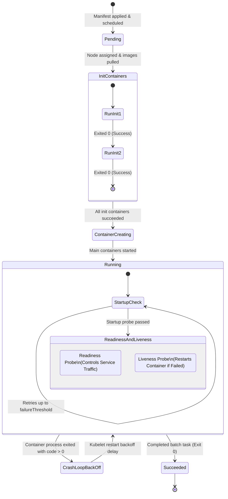
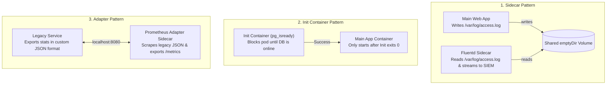
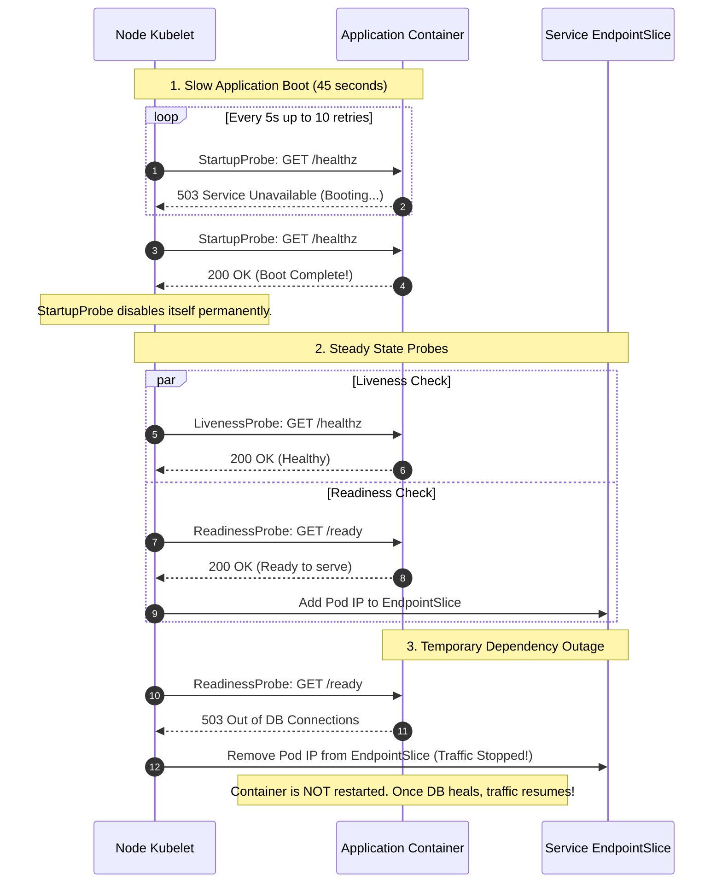
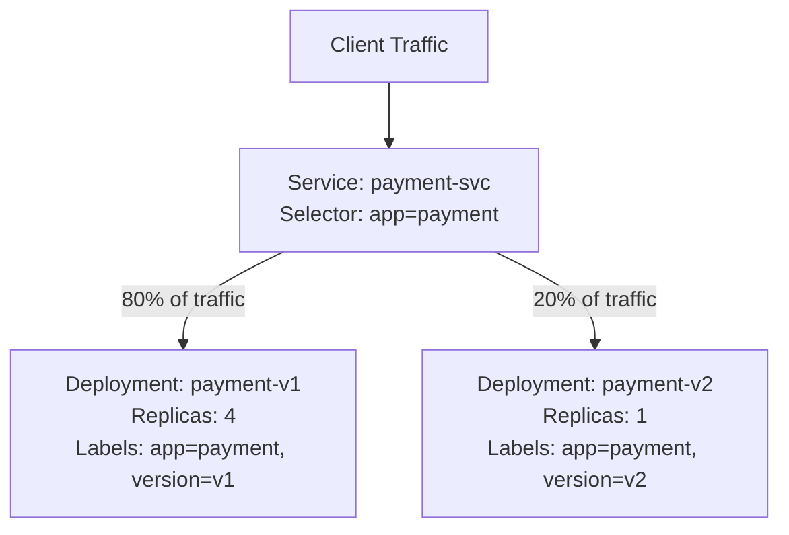
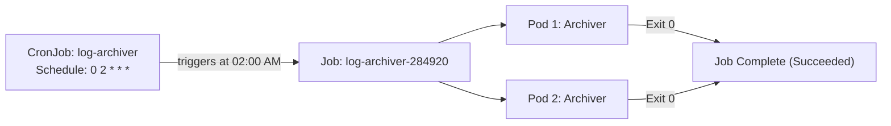

# CKAD Master Lab: Advanced Workloads, Traffic & Observability

Master workload design, multi-container architecture patterns, progressive rollout strategies, and resilient health probing for the **Certified Kubernetes Application Developer (CKAD)** exam and production engineering.



---

## 1. Multi-Container Pod Design Patterns

In Kubernetes, multiple containers in the same Pod share the same **network namespace (localhost)**, **IPC namespace**, and **storage volumes**.



### Pattern 1: Logging Sidecar with Shared Volume

Create `multi-container-logging.yaml`:

```yaml
apiVersion: v1
kind: Pod
metadata:
  name: web-logger-pod
  labels:
    app: web-logger
spec:
  volumes:
  - name: shared-logs
    emptyDir: {}
  containers:
  # Main application generating logs
  - name: web-server
    image: nginx:alpine
    volumeMounts:
    - name: shared-logs
      mountPath: /var/log/nginx
    ports:
    - containerPort: 80

  # Sidecar container processing and tailing the log file
  - name: log-collector
    image: busybox:1.36
    command: ["/bin/sh", "-c"]
    args:
    - >
      while [ ! -f /var/log/nginx/access.log ]; do sleep 1; done;
      tail -n+1 -F /var/log/nginx/access.log | sed 's/^/[NGINX ACCESS LOG] /';
    volumeMounts:
    - name: shared-logs
      mountPath: /var/log/nginx
```

Apply and verify:
```bash
kubectl apply -f multi-container-logging.yaml
# Send traffic to the web-server container
kubectl exec web-logger-pod -c web-server -- wget -qO- http://127.0.0.1
# View the filtered logs from the sidecar container
kubectl logs web-logger-pod -c log-collector
```

### Pattern 2: Init Container Dependency Gating

An init container always runs to completion before application containers start. If an init container fails, kubelet restarts it until it succeeds.

```yaml
apiVersion: v1
kind: Pod
metadata:
  name: app-db-dependent
spec:
  initContainers:
  # Waits for postgresql service to resolve and accept TCP connections
  - name: wait-for-postgres
    image: busybox:1.36
    command: ['sh', '-c']
    args:
    - >
      echo "Testing connection to postgres-db:5432...";
      until nc -z -w 2 postgres-db.default.svc.cluster.local 5432; do
        echo "Postgres is not reachable yet. Sleeping 2 seconds...";
        sleep 2;
      done;
      echo "Postgres is online!";
  containers:
  - name: api-backend
    image: python:3.11-alpine
    command: ["sh", "-c", "echo 'Backend started successfully!' && sleep 3600"]
```

---

## 2. Advanced Health Probes: Startup, Liveness, and Readiness

Misconfigured probes are one of the most common causes of cascading production outages.



### Complete Hardened Probe Configuration

```yaml
apiVersion: apps/v1
kind: Deployment
metadata:
  name: resilient-backend
spec:
  replicas: 3
  selector:
    matchLabels:
      app: resilient-backend
  template:
    metadata:
      labels:
        app: resilient-backend
    spec:
      containers:
      - name: backend
        image: nginx:alpine
        ports:
        - containerPort: 80

        # Startup Probe: Grants up to 30 * 5s = 150 seconds to initialize
        startupProbe:
          httpGet:
            path: /
            port: 80
          initialDelaySeconds: 2
          periodSeconds: 5
          failureThreshold: 30

        # Liveness Probe: Detects deadlocks and restarts unresponsive containers
        livenessProbe:
          httpGet:
            path: /
            port: 80
          periodSeconds: 10
          timeoutSeconds: 3
          failureThreshold: 3

        # Readiness Probe: Removes pod from Service traffic without killing it
        readinessProbe:
          httpGet:
            path: /
            port: 80
          periodSeconds: 5
          timeoutSeconds: 2
          failureThreshold: 2
          successThreshold: 1
```

---

## 3. Progressive Rollouts: RollingUpdate, Canary & Blue-Green

### Deployment Strategies Comparison

| Strategy | Downtime | Resource Overhead | Traffic Splitting |
| :--- | :--- | :--- | :--- |
| **`Recreate`** | Yes (kills all old pods before new ones start) | Minimal (1x) | None |
| **`RollingUpdate`** | Zero Downtime | Controlled (`maxSurge`) | Gradual transition |
| **`Canary`** | Zero Downtime | Low (10-20% extra pods) | Granular via Pod replica ratio |
| **`Blue-Green`** | Zero Downtime | High (200% capacity) | Instant via Service selector switch |

### Strategy 1: Fine-Tuning RollingUpdate

```yaml
apiVersion: apps/v1
kind: Deployment
metadata:
  name: production-web
spec:
  replicas: 10
  strategy:
    type: RollingUpdate
    rollingUpdate:
      # maxSurge: At most 2 extra pods above desired 10 during rollout (12 total max)
      maxSurge: 20%
      # maxUnavailable: At least 9 pods must remain available at all times
      maxUnavailable: 10%
  selector:
    matchLabels:
      app: web
  template:
    metadata:
      labels:
        app: web
    spec:
      containers:
      - name: nginx
        image: nginx:1.25-alpine
```

### Strategy 2: Native Canary Deployment



```bash
# 1. Create baseline v1 deployment (4 replicas)
kubectl create deployment payment-v1 --image=nginx:1.24-alpine --replicas=4
kubectl label deployment payment-v1 app=payment version=v1

# 2. Expose common service selecting app=payment
kubectl expose deployment payment-v1 --name=payment-svc --port=80 --selector=app=payment

# 3. Create canary v2 deployment (1 replica)
kubectl create deployment payment-v2 --image=nginx:1.25-alpine --replicas=1
kubectl label deployment payment-v2 app=payment version=v2

# 4. Result: Kubernetes distributes requests randomly across all 5 matching pods:
# 4 pods running v1 (80% traffic), 1 pod running v2 (20% canary traffic)
```

### Strategy 3: Instant Blue-Green Switchover

```bash
# Deploy Green version alongside Blue
kubectl create deployment web-green --image=nginx:1.26-alpine --replicas=3

# Once Green is fully verified, switch all live traffic instantly:
kubectl set selector service web-production "version=green"

# Rollback instantly if unexpected errors occur:
kubectl set selector service web-production "version=blue"
```

---

## 4. Batch Workloads: Jobs and CronJobs

Jobs run a workload until a specified number of successful completions, while CronJobs trigger Jobs on a recurring schedule.



### Hardened Batch Job Manifest

```yaml
apiVersion: batch/v1
kind: Job
metadata:
  name: data-migrator
spec:
  # Total required successful completions
  completions: 5
  # Number of pods executing concurrently
  parallelism: 2
  # Maximum restart attempts before marking Job as failed
  backoffLimit: 4
  # Kill the entire job if it takes longer than 300 seconds
  activeDeadlineSeconds: 300
  template:
    spec:
      restartPolicy: OnFailure
      containers:
      - name: migrator
        image: busybox:1.36
        command: ["sh", "-c", "echo 'Processing shard...'; sleep 3; exit 0"]
```

### Hardened CronJob with Concurrency Policy

```yaml
apiVersion: batch/v1
kind: CronJob
metadata:
  name: database-backup
spec:
  # Runs every night at 03:00 UTC
  schedule: "0 3 * * *"
  # Forbid: Skip new job if previous backup job is still running
  concurrencyPolicy: Forbid
  successfulJobsHistoryLimit: 3
  failedJobsHistoryLimit: 1
  jobTemplate:
    spec:
      backoffLimit: 2
      template:
        spec:
          restartPolicy: OnFailure
          containers:
          - name: pg-dump
            image: postgres:15-alpine
            command: ["sh", "-c", "echo 'Performing pg_dump...'; sleep 10"]
```

---

## 5. Configuration & Quota Management

### Injecting Metadata via Downward API

The Downward API allows containers to consume cluster metadata (Pod IP, Node name, CPU/memory limits) without calling the Kubernetes API server directly.

```yaml
apiVersion: v1
kind: Pod
metadata:
  name: downward-api-pod
  labels:
    tier: api
spec:
  containers:
  - name: inspector
    image: busybox:1.36
    command: ["sh", "-c", "env && sleep 3600"]
    resources:
      requests:
        memory: "64Mi"
        cpu: "100m"
      limits:
        memory: "128Mi"
        cpu: "250m"
    env:
    # Pod IP address
    - name: POD_IP
      valueFrom:
        fieldRef:
          fieldPath: status.podIP
    # Node name where pod is running
    - name: NODE_NAME
      valueFrom:
        fieldRef:
          fieldPath: spec.nodeName
    # Memory limit assigned to this container
    - name: MEM_LIMIT
      valueFrom:
        resourceFieldRef:
          resource: limits.memory
```

### Enforcing Namespaced ResourceQuotas

Prevent a single namespace or team from exhausting cluster memory and CPU:

```yaml
apiVersion: v1
kind: ResourceQuota
metadata:
  name: team-quota
  namespace: engineering
spec:
  hard:
    requests.cpu: "4"
    requests.memory: 8Gi
    limits.cpu: "8"
    limits.memory: 16Gi
    pods: "20"
    services.loadbalancers: "1"
```

---

## 6. Hands-On Verification Challenges

### Challenge 1: Find and Fix a Failing Readiness Probe

1. Deploy a broken readiness probe:
   ```bash
   kubectl run probe-fail --image=nginx:alpine --port=80 \
     --dry-run=client -o yaml > probe-fail.yaml
   ```
2. Add a readiness probe pointing to `/non-existent`:
   ```yaml
   readinessProbe:
     httpGet:
       path: /non-existent
       port: 80
     periodSeconds: 2
   ```
3. Apply and run `kubectl get pods`: Notice the pod reports `READY: 0/1`.
4. Inspect with `kubectl describe pod probe-fail` to observe `Readiness probe failed: HTTP probe failed with statuscode: 404`.
5. Fix the path to `/` and verify `READY: 1/1`.

---

## Summary Checklist

- [x] Use `emptyDir` volumes for low-latency file sharing between sidecars and primary containers.
- [x] Configure `startupProbe` with high `failureThreshold` for applications with slow initial boot times.
- [x] Never point `livenessProbe` to external network dependencies (DB, Redis) — use `readinessProbe` instead.
- [x] Implement `concurrencyPolicy: Forbid` on sensitive cron jobs to prevent duplicate runs.
- [x] Expose Pod and Container metadata safely using the **Downward API** instead of granting API server privileges.

