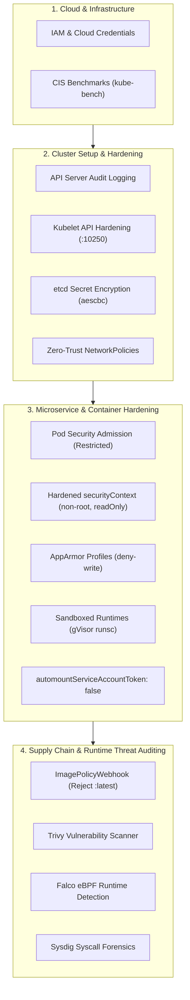
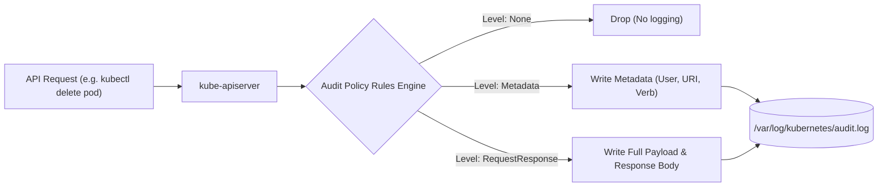
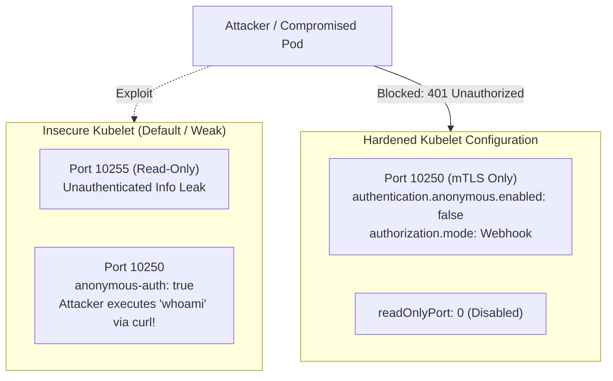
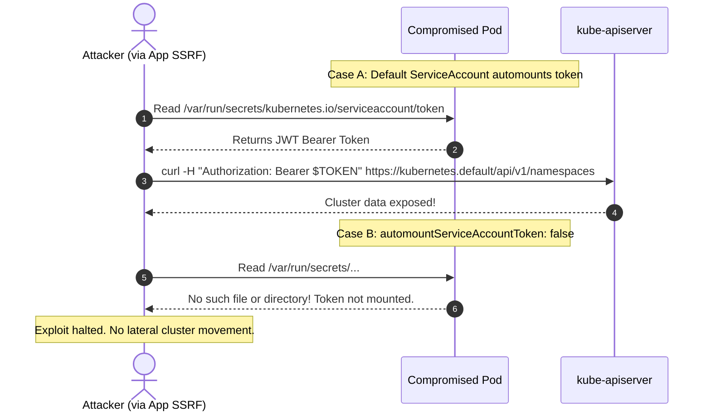
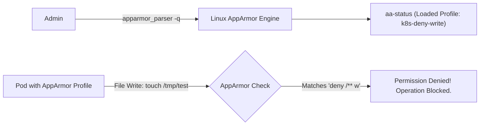
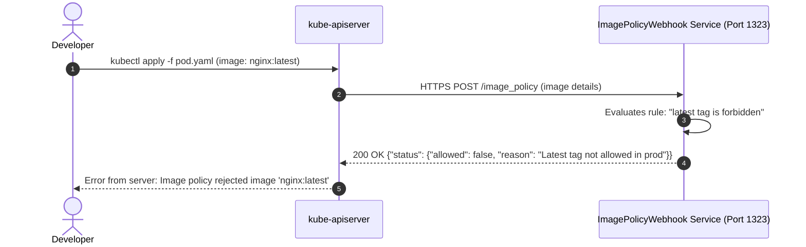
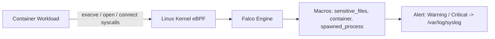

# CKS Master Lab: Cluster Hardening & Runtime Security

Master end-to-end Kubernetes security engineering aligned with the **Certified Kubernetes Security Specialist (CKS)** curriculum and real-world threat models. This hands-on lab covers API server audit logging, kubelet hardening, etcd secret encryption, Pod Security Admission (PSA), zero-trust NetworkPolicies, AppArmor profiles, gVisor sandboxed runtimes (`runsc`), `ImagePolicyWebhook` admission control, CIS benchmarking with `kube-bench`, and runtime threat detection with **Falco** and **Sysdig**.



---

## 1. Kubernetes API Server Audit Logging

Audit logging provides a chronological record of activities affecting the cluster. Each request generates events at multiple stages:
- **`RequestReceived`:** Event generated as soon as the request is received by the audit handler.
- **`ResponseStarted`:** Response headers sent, but before the body is sent (streaming requests).
- **`ResponseComplete`:** Full response body sent.
- **`Panic`:** Events generated when a panic occurred.

### Audit Levels

| Level | What is Logged | Use Case |
| :--- | :--- | :--- |
| **`None`** | Nothing logged | High-frequency read queries (e.g. watch endpoints, kubelet healthz) |
| **`Metadata`** | Request metadata (user, timestamp, resource, verb, namespace) | General compliance tracking with minimal disk overhead |
| **`Request`** | Metadata + Request body | Auditing mutating operations (POST, PUT, PATCH) |
| **`RequestResponse`** | Metadata + Request body + Response body | High-security critical objects (Secrets, RBAC Roles, TokenRequests) |



### Step 1.1: Author the Audit Policy File

Create `/etc/kubernetes/audit-policy.yaml`:

```yaml
apiVersion: audit.k8s.io/v1
kind: Policy
omitStages:
  - "RequestReceived"
rules:
  # 1. Do not log watch and health check requests from kubelet / components
  - level: None
    users: ["system:kube-proxy", "system:nodes"]
    verbs: ["watch"]
  - level: None
    nonResourceURLs:
      - "/healthz*"
      - "/version"
      - "/swagger*"

  # 2. Log Secrets and ConfigMaps at RequestResponse level (detect credential exfiltration)
  - level: RequestResponse
    resources:
      - group: ""
        resources: ["secrets", "configmaps"]

  # 3. Log RBAC and Workload modifications at Request level
  - level: Request
    resources:
      - group: "rbac.authorization.k8s.io"
        resources: ["roles", "rolebindings", "clusterroles", "clusterrolebindings"]
      - group: "apps"
        resources: ["deployments", "daemonsets", "statefulsets"]

  # 4. Default catch-all rule: Log everything else at Metadata level
  - level: Metadata
    omitStages:
      - "RequestReceived"
```

### Step 1.2: Configure `kube-apiserver`

Edit the static pod manifest `/etc/kubernetes/manifests/kube-apiserver.yaml`:

1. Add the following CLI arguments under `spec.containers[0].command`:
   ```yaml
   - --audit-policy-file=/etc/kubernetes/audit-policy.yaml
   - --audit-log-path=/var/log/kubernetes/audit.log
   - --audit-log-maxage=30
   - --audit-log-maxbackup=10
   - --audit-log-maxsize=100
   ```
2. Add volume mounts and host paths so the API server can access the policy file and write logs to the host:
   ```yaml
   volumeMounts:
   - name: audit-policy
     mountPath: /etc/kubernetes/audit-policy.yaml
     readOnly: true
   - name: audit-logs
     mountPath: /var/log/kubernetes
     readOnly: false
   volumes:
   - name: audit-policy
     hostPath:
       path: /etc/kubernetes/audit-policy.yaml
       type: File
   - name: audit-logs
     hostPath:
       path: /var/log/kubernetes
       type: DirectoryOrCreate
   ```

Wait for kubelet to automatically restart `kube-apiserver`.

### Step 1.3: Verify Audit Logging in Real Time

```bash
# 1. Perform an action
kubectl get secrets -n default

# 2. Inspect the audit log for the event
tail -f /var/log/kubernetes/audit.log | grep -i "secrets"
```

Expected JSON record:
```json
{"kind":"Event","apiVersion":"audit.k8s.io/v1","level":"RequestResponse","auditID":"c81e285a...","stage":"ResponseComplete","requestURI":"/api/v1/namespaces/default/secrets","verb":"get","user":{"username":"kubernetes-admin",...}}
```

---

## 2. Kubelet API Security Hardening

The kubelet on each node exposes an HTTPS API on port **10250** and historically an unauthenticated read-only HTTP port on **10255**. If left misconfigured, an attacker on the node network can execute commands in any container using `curl` or `kubeletctl`.



### Step 2.1: Audit the Kubelet API

Test if the kubelet allows anonymous API requests:

```bash
# Attempt to read pods without credentials
curl -sk https://127.0.0.1:10250/pods
```

If it returns a list of pods, anonymous authentication is enabled, representing a critical security flaw.

### Step 2.2: Apply Hardened Kubelet Configuration

Edit `/var/lib/kubelet/config.yaml` on each node:

```yaml
# 1. Disable anonymous authentication
authentication:
  anonymous:
    enabled: false
  webhook:
    enabled: true
  x509:
    clientCAFile: /etc/kubernetes/pki/ca.crt

# 2. Delegate authorization decisions to the API server via Webhook
authorization:
  mode: Webhook

# 3. Disable the insecure read-only port entirely
readOnlyPort: 0
```

Restart kubelet:
```bash
sudo systemctl daemon-reload
sudo systemctl restart kubelet
sudo systemctl status kubelet
```

### Step 2.3: Verification

```bash
curl -sk https://127.0.0.1:10250/pods
# Output: Unauthorized (401)
```

Now, only authenticated clients presenting valid certificates signed by the cluster CA (like `kube-apiserver`) can communicate with kubelet.

---

## 3. CIS Benchmarking with `kube-bench`

`kube-bench` is an open-source tool from Aqua Security that checks whether Kubernetes is deployed according to security best practices specified in the **CIS Kubernetes Benchmark**.

```bash
# Run CIS Benchmark scan on Control Plane
kube-bench run --targets master

# Run CIS Benchmark scan on Worker Node
kube-bench run --targets node
```

Output highlights:
```text
[PASS] 1.1.1 Ensure that the API server pod specification file permissions are set to 600 or more restrictive
[FAIL] 1.2.1 Ensure that the --anonymous-auth argument is set to false
[WARN] 1.2.20 Ensure that the --profiling argument is set to false
```

Review all `[FAIL]` and `[WARN]` items and apply the recommended remediation commands.

---

## 4. ServiceAccount Token Attack Surface Reduction

When an attacker compromises a pod via an application vulnerability (e.g., SSRF, Remote Code Execution), their immediate next step is reading `/var/run/secrets/kubernetes.io/serviceaccount/token` to interrogate the Kubernetes API.



### Step 4.1: Disable Automounting at ServiceAccount Level

```bash
# Disable automounting on the default service account
kubectl patch serviceaccount default -p '{"automountServiceAccountToken": false}'
```

### Step 4.2: Disable Automounting at Pod Level

In production pods that do not interact with the Kubernetes API, explicitly set `automountServiceAccountToken: false`:

```yaml
apiVersion: v1
kind: Pod
metadata:
  name: hardened-web
spec:
  automountServiceAccountToken: false
  containers:
  - name: web
    image: nginx:alpine
```

Apply and verify:
```bash
kubectl apply -f hardened-web.yaml
kubectl exec -it hardened-web -- ls /var/run/secrets/kubernetes.io/serviceaccount
# Output: ls: /var/run/secrets/kubernetes.io/serviceaccount: No such file or directory
```

---

## 5. Sandboxed Runtimes with gVisor (`runsc`)

Standard container runtimes (`runc`) share the host Linux kernel directly via namespaces and cgroups. A kernel vulnerability (e.g. `Dirty COW`, `Dirty Pipe`) allows an attacker in a container to escalate privileges and escape to the host.

**gVisor (`runsc`)** provides an application kernel written in Go that runs in user space, intercepting all application system calls and completely isolating the workload from the host kernel.

```mermaid
flowchart TD
    subgraph StandardRunc["Standard Container (runc)"]
        App1["App Process"] -->|Direct Syscalls (open, socket, clone)| HostKernel1["Host Linux Kernel (SHARED!)"]
        HostKernel1 -. Kernel Exploit .-> Escape["Full Host Node Compromise!"]
    end

    subgraph SandboxedGVisor["Sandboxed Container (gVisor runsc)"]
        App2["Untrusted App"] -->|Syscalls| Sentry["gVisor Sentry (User-Space Kernel)"]
        Sentry -->|Filtered & Emulated| Gofer["Gofer (Isolated File Proxy)"]
        Gofer --> HostKernel2["Host Linux Kernel (Protected)"]
    end
```

### Step 5.1: Define the `RuntimeClass`

```yaml
apiVersion: node.k8s.io/v1
kind: RuntimeClass
metadata:
  name: gvisor
handler: runsc
```

Apply:
```bash
kubectl apply -f runtimeclass-gvisor.yaml
```

### Step 5.2: Deploy an Untrusted Pod on gVisor

```yaml
apiVersion: v1
kind: Pod
metadata:
  name: untrusted-workload
spec:
  runtimeClassName: gvisor
  containers:
  - name: sandboxed-app
    image: nginx:alpine
```

### Step 5.3: Verify Kernel Isolation

Compare the kernel reported by a standard pod vs the gVisor pod:

```bash
# Standard Pod reports real host Linux kernel:
kubectl exec -it standard-pod -- uname -r
# Example output: 5.15.0-89-generic

# gVisor Pod reports synthesized sandbox kernel:
kubectl exec -it untrusted-workload -- uname -r
# Example output: 4.4.0 (gVisor simulated kernel!)

# Check dmesg inside gVisor:
kubectl exec -it untrusted-workload -- dmesg
# Output is completely empty or displays gVisor boot banner. Host hardware logs are hidden!
```

---

## 6. Linux Kernel Hardening with AppArmor

AppArmor (Application Armor) is a Linux Security Module (LSM) that confines programs to a limited set of resources based on security profiles.



### Step 6.1: Create and Load AppArmor Profile on Node

On the worker node, create `/etc/apparmor.d/k8s-deny-write`:

```text
#include <tunables/global>

profile k8s-deny-write flags=(attach_disconnected) {
  #include <abstractions/base>

  file,

  # Deny all file write operations across the entire filesystem
  deny /** w,
}
```

Parse and load into the kernel:
```bash
sudo apparmor_parser -q /etc/apparmor.d/k8s-deny-write

# Verify profile is active
sudo aa-status | grep k8s-deny-write
```

### Step 6.2: Enforce the Profile in Kubernetes (v1.30+ Native Syntax)

In Kubernetes 1.30+, AppArmor uses the native `securityContext.appArmorProfile` field:

```yaml
apiVersion: v1
kind: Pod
metadata:
  name: apparmor-protected-pod
spec:
  securityContext:
    appArmorProfile:
      type: Localhost
      localhostProfile: k8s-deny-write
  containers:
  - name: secure-container
    image: busybox:1.36
    command: ["sh", "-c", "echo 'Protected by AppArmor' && sleep 3600"]
```

Apply and test:
```bash
kubectl apply -f apparmor-pod.yaml
kubectl exec -it apparmor-protected-pod -- touch /tmp/exploit.sh
```

Expected output:
```text
touch: /tmp/exploit.sh: Permission denied
```

Even if the container runs as root, the Linux kernel blocks the write operation!

---

## 7. Admission Control with `ImagePolicyWebhook`

The `ImagePolicyWebhook` admission controller intercepts pod creation requests and evaluates the container images against an external image compliance service (e.g. rejecting images using mutable `:latest` tags or unapproved registries).



### Configuration Files

1. Create `/etc/kubernetes/admission/admission-config.yaml`:
   ```yaml
   apiVersion: apiserver.config.k8s.io/v1
   kind: AdmissionConfiguration
   plugins:
   - name: ImagePolicyWebhook
     configuration:
       imagePolicy:
         kubeConfigFile: /etc/kubernetes/admission/webhook.kubeconfig
         allowTTL: 50
         denyTTL: 50
         retryBackoff: 500
         defaultAllow: false
   ```

2. Pass the flag to `kube-apiserver`:
   ```yaml
   - --enable-admission-plugins=NodeRestriction,ImagePolicyWebhook
   - --admission-control-config-file=/etc/kubernetes/admission/admission-config.yaml
   ```

---

## 8. Runtime Threat Detection: Advanced Falco Rules & Sysdig

Falco intercepts system calls directly from the Linux kernel using eBPF probes.



### Step 8.1: Authoring Macro-Based Falco Rules

Edit `/etc/falco/falco_rules.local.yaml`:

```yaml
# 1. Define reusable macros
- macro: sensitive_credential_files
  condition: fd.name in (/etc/shadow, /etc/sudoers, /root/.ssh/id_rsa)

- macro: unauthorized_network_binaries
  condition: proc.name in (curl, wget, nc, netcat, nmap)

# 2. Rule: Detect unauthorized network tooling inside production pods
- rule: Network Reconnaissance Tool Executed in Container
  desc: Detect curl, wget, or nmap executed inside an active container
  condition: >
    spawned_process and container and
    unauthorized_network_binaries and
    not k8s.ns.name in (kube-system, monitoring)
  output: >
    SECURITY ALERT: Network recon tool spawned in container 
    (user=%user.name pod=%k8s.pod.name ns=%k8s.ns.name cmd=%proc.cmdline)
  priority: WARNING
  tags: [mitre_execution, network]

# 3. Rule: Detect access to sensitive host credential files
- rule: Sensitive File Read Attempt
  desc: Detect read attempts to /etc/shadow or SSH keys
  condition: >
    open_read and container and
    sensitive_credential_files
  output: >
    CRITICAL ALERT: Sensitive file read attempt 
    (file=%fd.name proc=%proc.name pod=%k8s.pod.name user=%user.name)
  priority: CRITICAL
  tags: [credential_access]
```

Restart Falco:
```bash
sudo systemctl restart falco
sudo systemctl status falco
```

### Step 8.2: Real-Time Syscall Auditing with Sysdig

Sysdig allows live command-line inspection of kernel system calls across running containers:

```bash
# Capture and display file open events inside a specific container:
sudo sysdig -c echo_fds container.name=payment-service

# Filter for all failed file opens (EACCES / ENOENT) across the node:
sudo sysdig "evt.type=open and evt.res contains EACCES"

# Filter for interactive shells spawned in containers:
sudo sysdig "proc.name=bash or proc.name=sh and container.id != host"
```

---

## 9. Hands-On CKS Verification Drill

### Drill: The Full Hardening Gauntlet

1. **Verify Kubelet is locked:**
   `curl -sk https://localhost:10250/pods` must return `401 Unauthorized`.
2. **Verify etcd encryption:**
   `etcdctl get /registry/secrets/default/my-secret` must display the `k8s:enc:aescbc:v1` header.
3. **Verify AppArmor protection:**
   Inside `apparmor-protected-pod`, running `touch /tmp/test` must fail with `Permission denied`.
4. **Verify gVisor isolation:**
   Inside `untrusted-workload`, `uname -r` must return a synthesized version distinct from the host kernel.
5. **Verify Falco alert:**
   Run `curl google.com` inside an unapproved pod and confirm the alert appears in `journalctl -u falco`.

---

## Production Security Checklist

- [x] Configure **API Server Audit Logging** with structured rules for Secrets, RBAC, and Workloads.
- [x] Harden **Kubelet** by disabling anonymous authentication (`authentication.anonymous.enabled: false`) and setting `readOnlyPort: 0`.
- [x] Run regular **CIS Kubernetes Benchmarks** using `kube-bench`.
- [x] Mitigate token theft by setting `automountServiceAccountToken: false` on pods and service accounts.
- [x] Isolate untrusted multi-tenant workloads using **gVisor (`runsc`)** `RuntimeClass`.
- [x] Enforce mandatory Linux kernel boundaries with **AppArmor** profiles (`type: Localhost`).
- [x] Encrypt sensitive data at rest in etcd with **AES-CBC-256**.
- [x] Guard container images against mutable `:latest` tags with `ImagePolicyWebhook`.
- [x] Deploy **Falco** eBPF rules to detect terminal shells, sensitive file reads, and unauthorized binaries.
