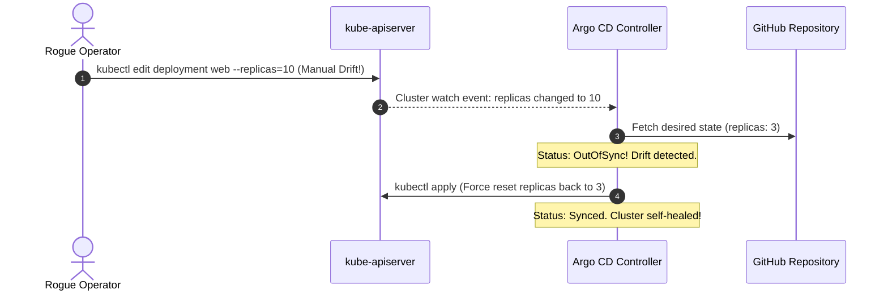
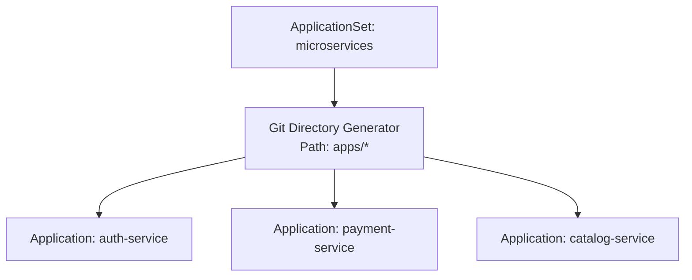
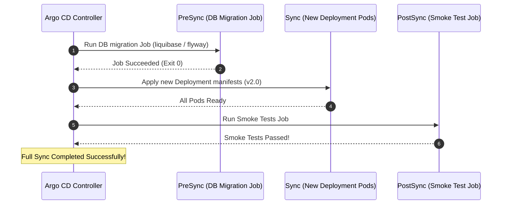
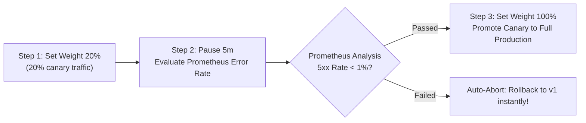

# GitOps Master Lab: Continuous Delivery with Argo CD & Helm

Master declarative continuous delivery and drift reconciliation using **Argo CD**. Learn how pull-based GitOps eliminates deployment drift, configure automated sync with self-healing, scale multi-cluster deployments with `ApplicationSets`, execute migration hooks, and automate canary releases with **Argo Rollouts**.

```mermaid
flowchart TD
    subgraph GitRepository["Git Repository (Single Source of Truth)"]
        GitCommit["git push origin main<br/>(Helm Chart / Kustomize / Manifests)"]
    end

    subgraph ArgoCD["Argo CD Control Plane (Namespace: argocd)"]
        RepoServer["argocd-repo-server<br/>(Clones Git & builds manifests)"]
        AppController["argocd-application-controller<br/>(Compares Desired vs Live State)"]
        APIServer["argocd-server<br/>(Web UI & CLI :443)"]
        
        APIServer <--> AppController
        AppController <--> RepoServer
    end

    subgraph TargetCluster["Target Kubernetes Cluster"]
        K8sAPI["kube-apiserver (:6443)"]
        Workloads["Running Pods, Services, Ingress"]
        
        K8sAPI --> Workloads
    end

    GitCommit -->|Webhook / Polling (3m)| RepoServer
    AppController -->|Reconcile / Self-Heal| K8sAPI
    Workloads -. Manual kubectl edit (DRIFT!) .-> K8sAPI
    AppController -->|Detects OutOfSync -> Overwrites with Git state| K8sAPI
```

---

## 1. The Core Principles of GitOps

Traditional push-based CI/CD pipelines (Jenkins, GitLab CI, GitHub Actions) require granting long-lived cluster admin credentials to external CI runners. **GitOps reverses this model to pull-based delivery**:

1. **Declarative Descriptions:** The entire desired state of the cluster is described declaratively in Git.
2. **Versioned and Immutable:** Git commits represent immutable releases; rollbacks are simple `git revert` operations.
3. **Pulled Automatically:** A software agent running inside the cluster continuously pulls the desired state.
4. **Continuously Reconciled:** The agent detects any manual modification (cluster drift) and automatically restores the state declared in Git.



---

## 2. Declarative `Application` Specification

Rather than clicking around in the UI, production Argo CD deployments use the `Application` Custom Resource Definition.

Create `argocd-app-helm.yaml`:

```yaml
apiVersion: argoproj.io/v1alpha1
kind: Application
metadata:
  name: payment-service-prod
  namespace: argocd
  # Finalizer guarantees all cluster resources are deleted when this Application is deleted
  finalizers:
    - resources-finalizer.argocd.argoproj.io
spec:
  project: default
  source:
    repoURL: 'https://github.com/my-org/gitops-manifests.git'
    targetRevision: main
    path: charts/payment-service
    helm:
      valueFiles:
        - values.yaml
        - values-production.yaml
      parameters:
        - name: "image.tag"
          value: "v2.4.1"
  destination:
    server: 'https://kubernetes.default.svc'
    namespace: production

  # Automated reconciliation configuration
  syncPolicy:
    automated:
      # prune: Automatically deletes resources removed from Git
      prune: true
      # selfHeal: Automatically reverts manual kubectl edits back to Git state
      selfHeal: true
    syncOptions:
      - CreateNamespace=true
      - ServerSideApply=true
    retry:
      limit: 5
      backoff:
        duration: 5s
        factor: 2
        maxDuration: 3m
```

Apply to Argo CD:
```bash
kubectl apply -f argocd-app-helm.yaml
```

---

## 3. Multi-Environment Orchestration with `ApplicationSet`

Instead of creating 50 separate `Application` manifests for 50 microservices across Dev, Staging, and Production, use an **ApplicationSet** with a Git Directory Generator:



Create `applicationset-git-generator.yaml`:

```yaml
apiVersion: argoproj.io/v1alpha1
kind: ApplicationSet
metadata:
  name: platform-workloads
  namespace: argocd
spec:
  generators:
  - git:
      repoURL: https://github.com/my-org/gitops-workloads.git
      revision: main
      directories:
      - path: apps/*
  template:
    metadata:
      name: '{{path.basename}}'
    spec:
      project: default
      source:
        repoURL: https://github.com/my-org/gitops-workloads.git
        targetRevision: main
        path: '{{path}}'
      destination:
        server: https://kubernetes.default.svc
        namespace: '{{path.basename}}'
      syncPolicy:
        automated:
          prune: true
          selfHeal: true
        syncOptions:
          - CreateNamespace=true
```

Adding a new folder under `apps/` in Git automatically creates a fully managed Argo CD Application without touching Kubernetes!

---

## 4. Sync Phases & Resource Hooks

In complex production deployments, database migrations must complete **before** the new application containers boot. Argo CD achieves this with **Resource Hooks**:



### Authoring a Database Migration PreSync Hook

```yaml
apiVersion: batch/v1
kind: Job
metadata:
  name: db-migration-job
  namespace: production
  annotations:
    # Hook triggers before the main sync phase
    argocd.argoproj.io/hook: PreSync
    # Automatically cleans up successful jobs
    argocd.argoproj.io/hook-delete-policy: HookSucceeded
spec:
  template:
    spec:
      restartPolicy: Never
      containers:
      - name: migrator
        image: my-registry/db-migrator:v2.4
        command: ["./migrate.sh", "--apply"]
```

---

## 5. Progressive Delivery with Argo Rollouts

Standard Kubernetes Deployments lack automated metric analysis. **Argo Rollouts** provides advanced deployment strategies (Canary, Blue-Green) with automated metric analysis and instant rollbacks.



### Complete Argo Rollout with Canary Strategy

Create `payment-rollout.yaml`:

```yaml
apiVersion: argoproj.io/v1alpha1
kind: Rollout
metadata:
  name: payment-rollout
  namespace: production
spec:
  replicas: 5
  strategy:
    canary:
      # Analysis template queries Prometheus during rollout
      analysis:
        templates:
          - templateName: success-rate-check
        args:
          - name: service-name
            value: payment-service
      steps:
        # Send 20% of traffic to the new version
        - setWeight: 20
        # Wait 10 minutes for metric stabilization
        - pause: {duration: 10m}
        # Send 50% traffic
        - setWeight: 50
        - pause: {duration: 5m}
  selector:
    matchLabels:
      app: payment
  template:
    metadata:
      labels:
        app: payment
    spec:
      containers:
      - name: payment
        image: my-registry/payment:v2.5.0
        ports:
        - containerPort: 8080
```

### AnalysisTemplate Querying Prometheus

```yaml
apiVersion: argoproj.io/v1alpha1
kind: AnalysisTemplate
metadata:
  name: success-rate-check
  namespace: production
spec:
  metrics:
  - name: success-rate
    interval: 30s
    successCondition: result[0] >= 0.99
    failureLimit: 3
    provider:
      prometheus:
        address: http://prometheus-k8s.monitoring:9090
        query: |
          sum(rate(http_requests_total{service="payment-service", status_code!~"5.."}[1m]))
          /
          sum(rate(http_requests_total{service="payment-service"}[1m]))
```

If the success rate drops below 99% for 3 consecutive intervals, Argo Rollouts **aborts the rollout immediately**, switching all traffic back to the stable revision without human intervention.

---

## 6. Hands-on GitOps Verification Drill

### Scenario: Test Drift Detection and Self-Healing

1. Connect to your cluster and find the managed Deployment:
   ```bash
   kubectl get deployments -n production
   ```
2. Manually tamper with the deployment image tag:
   ```bash
   kubectl set image deployment/payment-rollout payment=nginx:alpine -n production
   ```
3. Watch the Argo CD controller log:
   ```bash
   kubectl logs -n argocd -l app.kubernetes.io/name=argocd-application-controller -f
   ```
4. Within seconds, Argo CD detects the divergence (`OutOfSync`), logs a `Self-Heal` event, and reverts the image back to the Git-declared version.
5. Confirm with `kubectl describe deployment payment-rollout -n production`: The image is restored!

---

## Summary Checklist

- [x] Maintain the entire cluster configuration declaratively in a Git repository.
- [x] Enable `prune: true` and `selfHeal: true` in `syncPolicy.automated` to eliminate manual configuration drift.
- [x] Use `ApplicationSet` to generate applications dynamically across clusters and environments.
- [x] Gate database schema upgrades using `PreSync` hooks with `HookSucceeded` delete policies.
- [x] Replace high-risk deployment updates with **Argo Rollouts** for automated, metric-analyzed canary releases.

