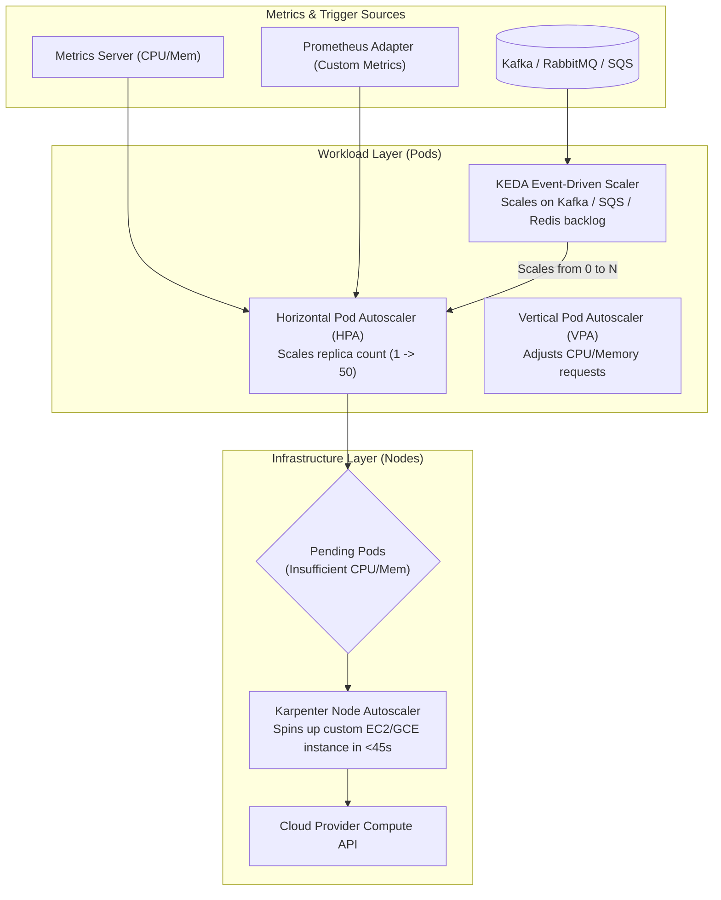
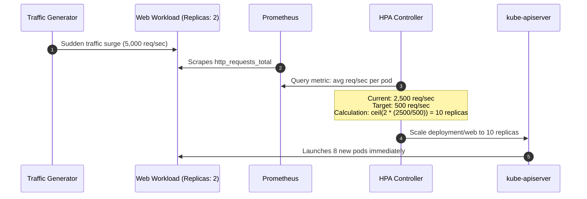
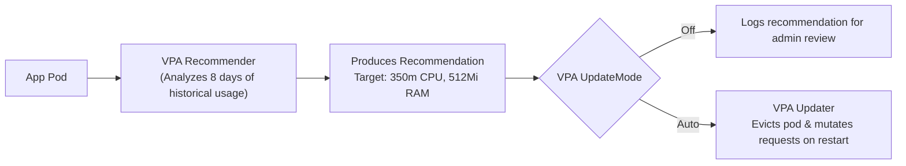
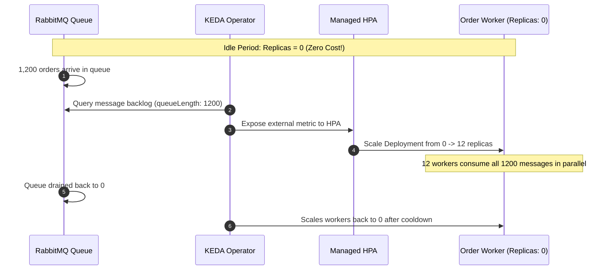

# Kubernetes Autoscaling Master Lab: HPA, VPA, KEDA & Karpenter

Master multi-dimensional autoscaling across workloads and cloud infrastructure. Learn how the Horizontal Pod Autoscaler (HPA v2) balances traffic spikes with custom metrics, optimize container resource boundaries with the Vertical Pod Autoscaler (VPA), scale workloads from zero using **KEDA event triggers**, and provision right-sized nodes in seconds using **Karpenter**.



---

## 1. Horizontal Pod Autoscaler (HPA v2) with Custom Metrics

The standard HPA only scales on raw CPU and Memory. In production, web applications should scale on **traffic demand** (e.g., Requests Per Second or In-Flight Concurrency).



### Complete HPA v2 Manifest with Stabilization Policies

Create `hpa-traffic-stabilized.yaml`:

```yaml
apiVersion: autoscaling/v2
kind: HorizontalPodAutoscaler
metadata:
  name: web-api-scaler
  namespace: production
spec:
  scaleTargetRef:
    apiVersion: apps/v1
    kind: Deployment
    name: web-api
  minReplicas: 3
  maxReplicas: 50
  metrics:
  # Metric 1: CPU Utilization
  - type: Resource
    resource:
      name: cpu
      target:
        type: Utilization
        averageUtilization: 70

  # Metric 2: Memory Utilization
  - type: Resource
    resource:
      name: memory
      target:
        type: Utilization
        averageUtilization: 80

  # Metric 3: Custom Prometheus Metric (Requests Per Second)
  - type: Pods
    pods:
      metric:
        name: http_requests_per_second
      target:
        type: AverageValue
        averageValue: "500m" # Target 500 requests per second per pod

  # Behavior policies prevent flapping (thrashing)
  behavior:
    scaleUp:
      stabilizationWindowSeconds: 0 # React to traffic spikes immediately
      policies:
      - type: Percent
        value: 100 # Double capacity every 15 seconds if needed
        periodSeconds: 15
    scaleDown:
      stabilizationWindowSeconds: 300 # Wait 5 minutes before scaling down
      policies:
      - type: Percent
        value: 20 # Drop at most 20% of pods per minute
        periodSeconds: 60
```

Apply:
```bash
kubectl apply -f hpa-traffic-stabilized.yaml
kubectl get hpa -n production
```

---

## 2. Vertical Pod Autoscaler (VPA)

Developers frequently guess CPU and memory requests, leading to either **overprovisioning** (wasting thousands in cloud bills) or **underprovisioning** (triggering Out-Of-Memory SIGKILL 137).

The **Vertical Pod Autoscaler** observes actual workload consumption over time and recommends or mutates accurate resource requests.



### VPA Manifest in `Off` Mode (Safe Recommendation Mode)

```yaml
apiVersion: autoscaling.k8s.io/v1
kind: VerticalPodAutoscaler
metadata:
  name: analytics-vpa
  namespace: production
spec:
  targetRef:
    apiVersion: apps/v1
    kind: Deployment
    name: analytics-worker
  updatePolicy:
    updateMode: "Off" # Recommends values without restarting pods
  resourcePolicy:
    containerPolicies:
      - containerName: '*'
        minAllowed:
          cpu: 100m
          memory: 128Mi
        maxAllowed:
          cpu: 4
          memory: 8Gi
```

View recommendations:
```bash
kubectl describe vpa analytics-vpa -n production
```

Output:
```text
Recommendation:
  Container Recommendations:
    Target:
      Cpu:     250m
      Memory:  384Mi
    Lower Bound:
      Cpu:     100m
      Memory:  256Mi
    Upper Bound:
      Cpu:     1200m
      Memory:  1024Mi
```

---

## 3. Event-Driven Autoscaling with KEDA (Scale-to-Zero)

Standard Kubernetes cannot scale workloads based on external queue sizes (e.g. AWS SQS, Apache Kafka, RabbitMQ). **KEDA (Kubernetes Event-driven Autoscaling)** enables scaling from **0 to N** replicas based on queue depth, saving compute costs when idle.



### Complete KEDA `ScaledObject` for RabbitMQ

```yaml
apiVersion: keda.sh/v1alpha1
kind: ScaledObject
metadata:
  name: order-processor-scaler
  namespace: production
spec:
  scaleTargetRef:
    apiVersion: apps/v1
    kind: Deployment
    name: order-processor
  minReplicaCount: 0 # Scale to ZERO when queue is empty!
  maxReplicaCount: 30
  cooldownPeriod: 300 # Wait 5 minutes of empty queue before zeroing out
  triggers:
  - type: rabbitmq
    metadata:
      protocol: amqp
      queueName: pending-orders
      mode: QueueLength
      value: "50" # 1 pod for every 50 pending messages
    authenticationRef:
      name: rabbitmq-credentials
```

---

## 4. Sub-Minute Node Autoscaling with Karpenter

Traditional Cluster Autoscaler relies on static cloud Auto Scaling Groups (ASGs). When a pod is unschedulable, Cluster Autoscaler takes **3 to 7 minutes** to resize the ASG, wait for node launch, and run user-data initialization.

**Karpenter** replaces ASGs entirely:
- Evaluates aggregate resource requests of all pending pods directly.
- Bypasses ASGs and calls cloud APIs (e.g., AWS EC2 `CreateFleet`) directly.
- Launches perfectly right-sized instances (e.g., graviton spot instances) in **under 45 seconds**.
- Automatically consolidates underutilized nodes to cut infrastructure bills.

```yaml
apiVersion: karpenter.sh/v1beta1
kind: NodePool
metadata:
  name: general-compute
spec:
  template:
    spec:
      requirements:
        # Prefer cost-efficient ARM64 Graviton instances
        - key: kubernetes.io/arch
          operator: In
          values: ["arm64", "amd64"]
        # Allow Spot instances for maximum cost savings with Fallback to On-Demand
        - key: karpenter.sh/capacity-type
          operator: In
          values: ["spot", "on-demand"]
        # Limit instance families to modern generations
        - key: node.kubernetes.io/instance-type
          operator: In
          values: ["c6g.xlarge", "c6g.2xlarge", "m6g.xlarge", "m6g.2xlarge"]
      nodeClassRef:
        name: default-ec2-config
  limits:
    cpu: 1000
    memory: 2000Gi
  disruption:
    # Automatically consolidate nodes when cheaper or fewer instances can host workloads
    consolidationPolicy: WhenUnderutilized
    expireAfter: 720h # Rotate nodes every 30 days for security patching
```

---

## 5. Summary Checklist

- [x] Configure both `scaleUp` and `scaleDown` stabilization windows in HPA v2 to eliminate thrashing.
- [x] Scale web services on custom metrics (Requests Per Second) rather than raw CPU utilization.
- [x] Use **VPA** in `Off` mode initially to discover real-world container memory baselines without unexpected restarts.
- [x] Implement **KEDA** to enable scale-to-zero for asynchronous background workers and message queues.
- [x] Replace legacy Cluster Autoscaler with **Karpenter** for fast instance provisioning (<45s) and automatic Spot consolidation.

