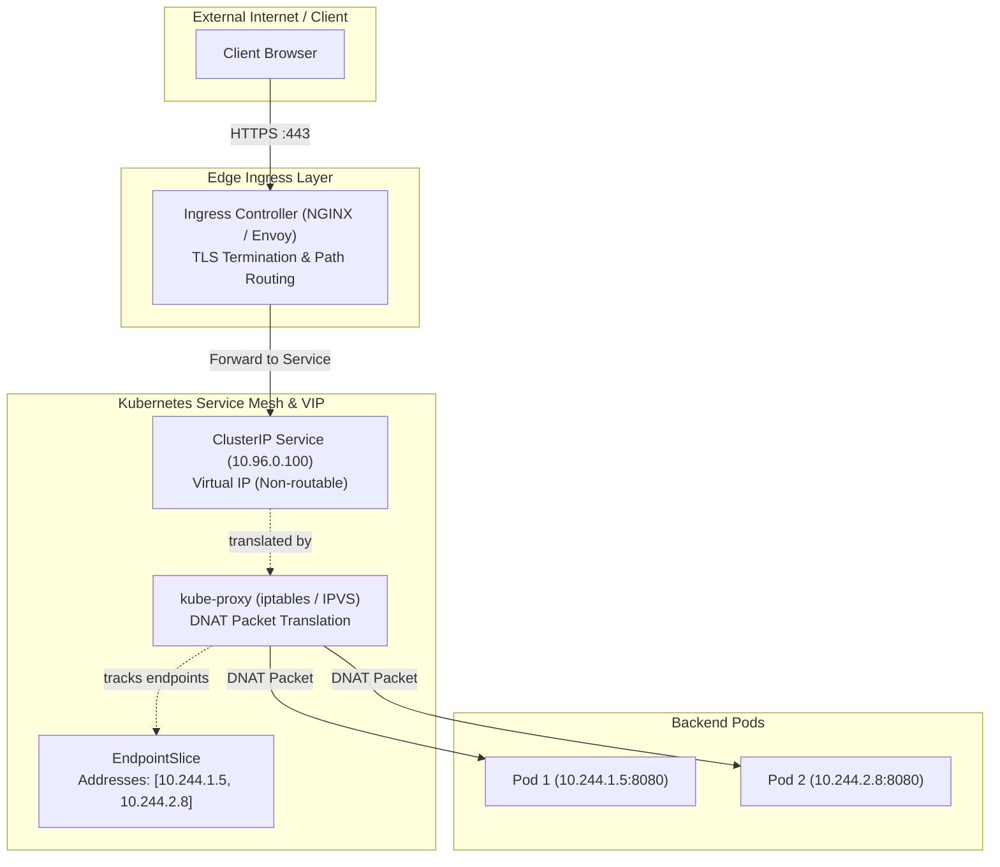
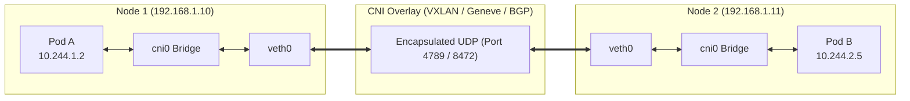
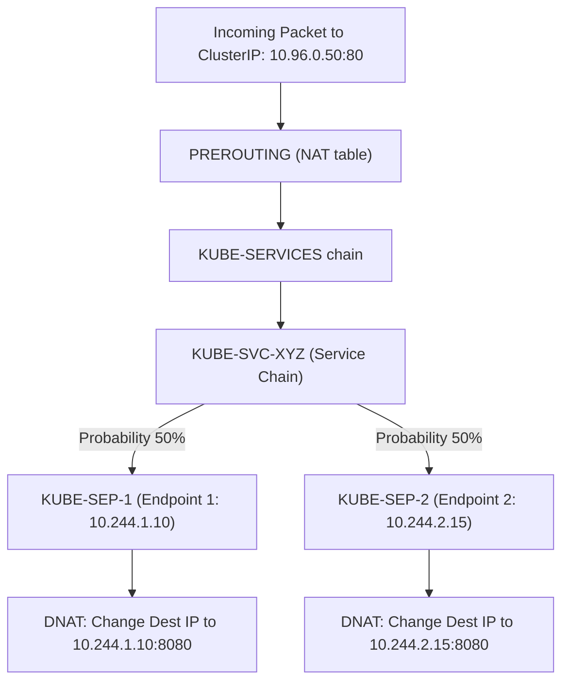
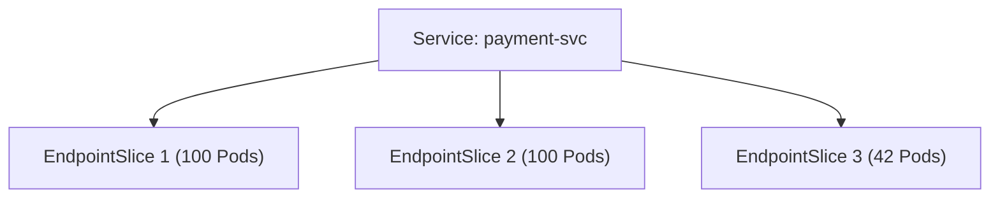
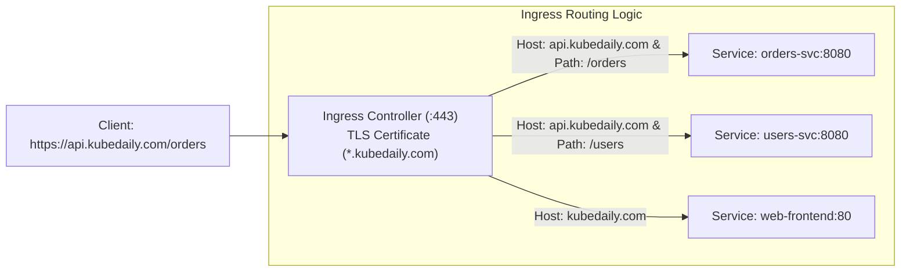
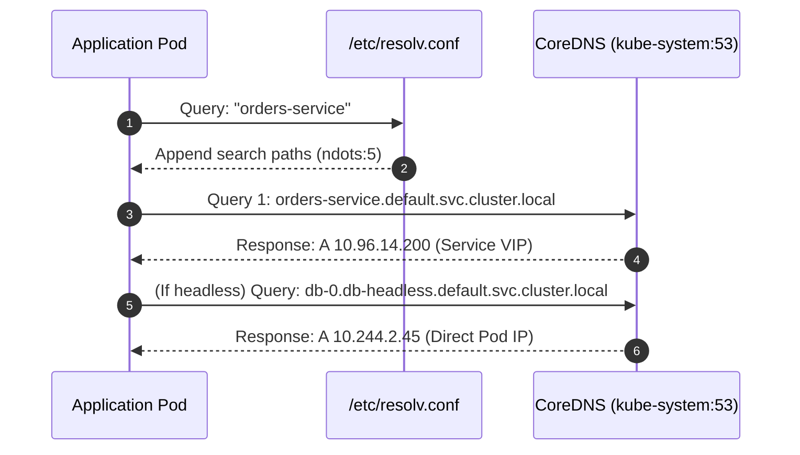

# Kubernetes Networking Deep Dive: Services, Ingress & DNS

Demystify Kubernetes networking from packet traversal to edge ingress. Understand Pod-to-Pod CNI encapsulation, kube-proxy iptables and IPVS load balancing, EndpointSlices, TLS-terminated Ingress controllers, and CoreDNS service discovery.



---

## 1. The Kubernetes Networking Model

Every Kubernetes cluster adheres to three non-negotiable networking tenets:
1. **All Pods can communicate with all other Pods** without Network Address Translation (NAT).
2. **All Nodes can communicate with all Pods** (and vice-versa) without NAT.
3. **The IP that a Pod sees as its own IP is the same IP that other Pods see it as.**



---

## 2. Service Types & Packet Path Translation

A Kubernetes Service is **not a process or a container**. It is an abstraction backed by iptables rules or IPVS virtual servers programmed by `kube-proxy`.



### Comparing Service Types

| Type | Allocation Scope | Typical Use Case | Access Path |
| :--- | :--- | :--- | :--- |
| **`ClusterIP`** | Internal VIP | Inter-pod microservice communication | Within cluster only |
| **`NodePort`** | Node Port (30000-32767) | Direct external debugging or non-cloud clusters | `<NodeIP>:<NodePort>` |
| **`LoadBalancer`** | Cloud Public IP | Public ingress from internet | Cloud Provider LB |
| **`ExternalName`** | CNAME record | Aliasing external databases (e.g., RDS) | DNS redirect |

### Step 2.1: Inspecting iptables Rules Programmed by kube-proxy

Deploy a test service and check its low-level packet transformation:

```bash
# 1. Create deployment and expose via ClusterIP
kubectl create deployment net-demo --image=nginx:alpine --replicas=2
kubectl expose deployment net-demo --port=80 --target-port=80

# 2. Get the assigned ClusterIP
export SVC_IP=$(kubectl get svc net-demo -o jsonpath='{.spec.clusterIP}')
echo "Service VIP: $SVC_IP"

# 3. On a cluster node, inspect the iptables nat table for this VIP:
sudo iptables -t nat -L KUBE-SERVICES -n -v | grep $SVC_IP
```

You will observe iptables jumping to a dedicated `KUBE-SVC-*` chain that uses the random module (`statistic mode random probability 0.5`) to distribute traffic evenly across endpoints.

---

## 3. EndpointSlices: Next-Generation Endpoint Scalability

In large clusters with thousands of pods, traditional `Endpoints` objects suffered severe performance degradation: any single pod restart caused the entire monolithic `Endpoints` object (megabytes in size) to be re-serialized and sent to every node.

**EndpointSlices** break endpoints into chunks of 100 endpoints per slice:



### Inspecting an EndpointSlice

```bash
# List EndpointSlices for the service
kubectl get endpointslices -l kubernetes.io/service-name=net-demo

# View detailed structure
kubectl describe endpointslice -l kubernetes.io/service-name=net-demo
```

Output highlights:
```yaml
Endpoints:
  - Addresses:  10.244.1.12
    Conditions:
      Ready:    true
      Serving:  true
      Terminating: false
    NodeName:   worker-01
    Zone:       us-east-1a
```

Notice the `Zone` and `Conditions` attributes. This enables **Topology-Aware Routing**, routing traffic to pods within the same availability zone to reduce cross-AZ cloud network charges.

---

## 4. Ingress Controllers & TLS Termination

An Ingress Controller runs as an edge reverse-proxy (e.g., NGINX, Envoy, Traefik), terminating TLS and routing HTTP traffic based on hostnames and URL paths.



### Step 4.1: Generate a TLS Secret

```bash
# 1. Generate a self-signed TLS certificate and private key
openssl req -x509 -nodes -days 365 -newkey rsa:2048 \
  -keyout tls.key -out tls.crt \
  -subj "/CN=kubedaily.local/O=kubedaily"

# 2. Store the certificate as a Kubernetes TLS Secret
kubectl create secret tls kubedaily-tls-secret \
  --cert=tls.crt \
  --key=tls.key
```

### Step 4.2: Author the Ingress Resource

Create `ingress-production.yaml`:

```yaml
apiVersion: networking.k8s.io/v1
kind: Ingress
metadata:
  name: kubedaily-ingress
  annotations:
    nginx.ingress.kubernetes.io/rewrite-target: /$2
    nginx.ingress.kubernetes.io/ssl-redirect: "true"
spec:
  ingressClassName: nginx
  tls:
  - hosts:
    - kubedaily.local
    secretName: kubedaily-tls-secret
  rules:
  - host: kubedaily.local
    http:
      paths:
      # Route /api/orders(/|$)(.*) to orders service
      - path: /api/orders(/|$)(.*)
        pathType: ImplementationSpecific
        backend:
          service:
            name: orders-service
            port:
              number: 8080
      # Route all other traffic to frontend service
      - path: /()(.*)
        pathType: ImplementationSpecific
        backend:
          service:
            name: frontend-service
            port:
              number: 80
```

Apply and verify:
```bash
kubectl apply -f ingress-production.yaml
kubectl get ingress kubedaily-ingress
```

---

## 5. CoreDNS Architecture & Service Discovery

CoreDNS is the cluster's internal authoritative DNS server running as a Deployment in `kube-system`.



### Anatomy of `/etc/resolv.conf` Inside a Pod

Inspect the DNS configuration inside any pod:

```bash
kubectl exec -it deployment/net-demo -- cat /etc/resolv.conf
```

Output:
```text
nameserver 10.96.0.10
search default.svc.cluster.local svc.cluster.local cluster.local
options ndots:5
```

### The `ndots:5` Latency Penalty & Optimization

Notice `options ndots:5`. If a query contains fewer than 5 dots (e.g., `api.stripe.com` has 2 dots), the DNS resolver first attempts all internal search paths before querying the public domain:
1. `api.stripe.com.default.svc.cluster.local` (NXDOMAIN)
2. `api.stripe.com.svc.cluster.local` (NXDOMAIN)
3. `api.stripe.com.cluster.local` (NXDOMAIN)
4. `api.stripe.com.` (Finally resolved!)

**Optimization:** For high-throughput external API calls, append a trailing dot (`api.stripe.com.`) to force an immediate absolute query, bypassing all search paths.

### Headless Services (`clusterIP: None`)

For stateful applications (databases, Kafka) requiring direct pod-to-pod routing without a virtual IP:

```yaml
apiVersion: v1
kind: Service
metadata:
  name: database-headless
spec:
  clusterIP: None
  selector:
    app: postgres
  ports:
  - port: 5432
    targetPort: 5432
```

DNS queries to `database-headless.default.svc.cluster.local` return the **set of individual Pod IPs** directly instead of a VIP.

---

## 6. Practical Networking Verification Drill

### Drill: Troubleshoot Cross-Namespace Service Connectivity

1. Create two namespaces:
   ```bash
   kubectl create ns team-alpha && kubectl create ns team-bravo
   ```
2. Deploy an nginx service in `team-bravo`:
   ```bash
   kubectl create deployment web --image=nginx:alpine -n team-bravo
   kubectl expose deployment web --port=80 -n team-bravo
   ```
3. Run a client pod in `team-alpha` and test DNS resolution using FQDN:
   ```bash
   kubectl run test-client --image=busybox:1.36 -n team-alpha -it --rm -- \
     wget -qO- --timeout=3 http://web.team-bravo.svc.cluster.local
   ```
4. Output displays `<!DOCTYPE html>... Welcome to nginx!`, proving cross-namespace DNS resolution and CNI routing work as expected.
5. Clean up:
   ```bash
   kubectl delete ns team-alpha team-bravo
   ```

---

## Summary Checklist

- [x] Pods communicate across nodes without NAT via CNI overlay encapsulation.
- [x] `ClusterIP` is a virtual IP managed by `kube-proxy` through iptables or IPVS.
- [x] Use `EndpointSlices` for scalable, chunked endpoint tracking with zone awareness.
- [x] Terminate TLS at the edge using Kubernetes `Secret` of type `kubernetes.io/tls` with Ingress.
- [x] Append trailing dots to external domain queries (`example.com.`) to eliminate `ndots:5` search path round-trips.
- [x] Use Headless Services (`clusterIP: None`) when stateful workloads need direct Pod IP addresses.

