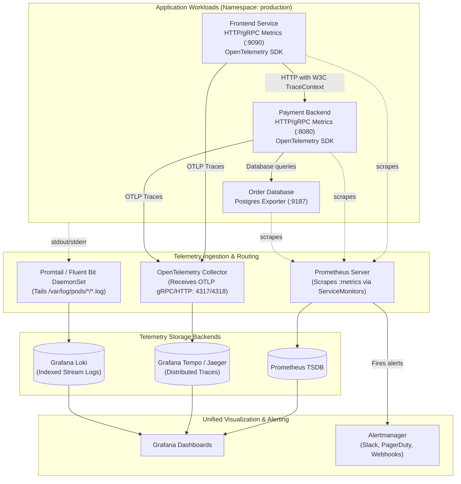
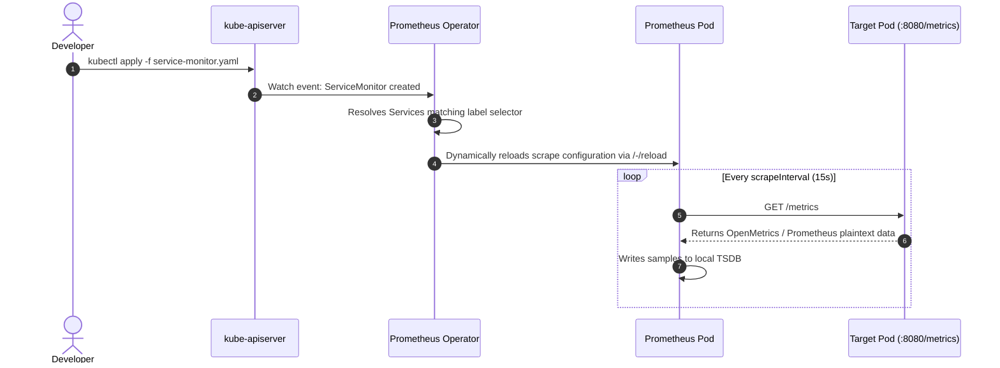
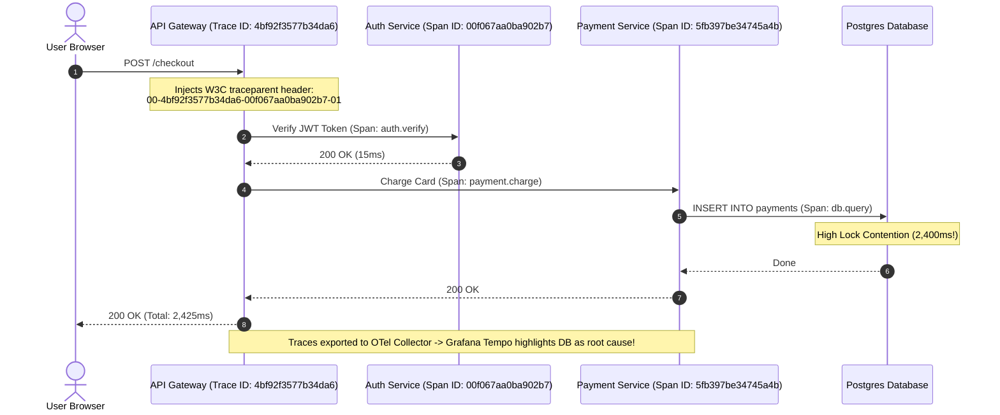
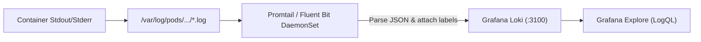

# Kubernetes Observability Deep Dive: Prometheus, Grafana, OpenTelemetry & Logging

Build a production-grade observability pipeline across the three pillars of telemetry: **Metrics**, **Logs**, and **Distributed Traces**. Learn how the Prometheus Operator dynamically discovers endpoints with `ServiceMonitors`, write high-precision PromQL alerting rules, propagate OpenTelemetry distributed trace contexts, and aggregate logs with Grafana Loki.



---

## 1. The Prometheus Operator & Dynamic Discovery

In static Prometheus setups, every scrape target had to be manually declared in `prometheus.yml`. The **Prometheus Operator** revolutionizes this with declarative Kubernetes Custom Resource Definitions (CRDs):
- `Prometheus`: Defines desired Prometheus statefulset deployment.
- `ServiceMonitor`: Declaratively specifies how groups of services should be monitored.
- `PodMonitor`: Scrapes pods directly without requiring a Service.
- `PrometheusRule`: Defines alerting and recording rules.



### Step 1.1: Authoring a Bulletproof ServiceMonitor

Create `payment-servicemonitor.yaml`:

```yaml
apiVersion: monitoring.coreos.com/v1
kind: ServiceMonitor
metadata:
  name: payment-service-monitor
  namespace: monitoring
  labels:
    release: prometheus-stack
spec:
  # Selects target services across all namespaces with label app=payment-service
  namespaceSelector:
    matchNames:
      - production
  selector:
    matchLabels:
      app: payment-service
  endpoints:
  - port: metrics # Name of the port in the Service definition
    path: /metrics
    interval: 15s
    scrapeTimeout: 10s
    metricRelabelings:
    # Drop high-cardinality ephemeral query parameters
    - sourceLabels: [__name__]
      regex: "(http_request_duration_seconds_bucket|http_requests_total)"
      action: keep
```

### Step 1.2: Matching Target Service

Ensure the target service has a named port matching the `ServiceMonitor`:

```yaml
apiVersion: v1
kind: Service
metadata:
  name: payment-service
  namespace: production
  labels:
    app: payment-service
spec:
  ports:
  - name: http
    port: 8080
    targetPort: 8080
  - name: metrics # Must match port name in ServiceMonitor
    port: 9090
    targetPort: 9090
  selector:
    app: payment-service
```

---

## 2. PromQL Production Mastery & Alerting Rules

PromQL (Prometheus Query Language) calculates rates, aggregations, and percentiles over time series data.

### The Four Core Metric Types

1. **Counter:** Monotonically increasing number (e.g., `http_requests_total`). Always use with `rate()` or `increase()`.
2. **Gauge:** Value that can go up and down (e.g., `container_memory_working_set_bytes`, `node_cpu_utilization`).
3. **Histogram:** Samples observations into configurable buckets (e.g., request duration in seconds).
4. **Summary:** Pre-calculated quantiles on the client side.

### Essential Production PromQL Queries

```promql
# 1. Total HTTP request rate (requests/sec) per service over 5 minutes:
sum(rate(http_requests_total[5m])) by (service, status_code)

# 2. HTTP 5xx Error Rate Percentage:
(sum(rate(http_requests_total{status_code=~"5.."}[5m]))
  /
 sum(rate(http_requests_total[5m]))) * 100

# 3. 95th Percentile Request Latency (p95) in milliseconds:
histogram_quantile(0.95, sum(rate(http_request_duration_seconds_bucket[5m])) by (le, service)) * 1000

# 4. Pod Memory Consumption vs Request Limit (Identify near-OOM pods):
(sum(container_memory_working_set_bytes{container!=""}) by (namespace, pod)
  /
 sum(kube_pod_container_resource_limits{resource="memory"}) by (namespace, pod)) * 100 > 85

# 5. Pod CrashLoopBackOff detection (more than 3 restarts in 15 minutes):
increase(kube_pod_container_status_restarts_total[15m]) > 3
```

### Authoring Production `PrometheusRule`

Create `production-alerts.yaml`:

```yaml
apiVersion: monitoring.coreos.com/v1
kind: PrometheusRule
metadata:
  name: payment-service-alerts
  namespace: monitoring
  labels:
    release: prometheus-stack
spec:
  groups:
  - name: payment-api.rules
    rules:
    # Alert: High Error Rate
    - alert: PaymentHighHttp5xxRate
      expr: |
        (sum(rate(http_requests_total{service="payment-service", status_code=~"5.."}[5m]))
         /
         sum(rate(http_requests_total{service="payment-service"}[5m]))) * 100 > 5
      for: 2m
      labels:
        severity: critical
        team: checkout
      annotations:
        summary: "Payment API 5xx error rate exceeded 5% (current: {{ $value | printf \"%.2f\" }}%)"
        description: "Pod {{ $labels.pod }} in namespace {{ $labels.namespace }} is failing customer transactions."
        runbook_url: "https://wiki.internal/runbooks/payment-5xx"

    # Alert: High P99 Latency
    - alert: PaymentApiLatencyHigh
      expr: |
        histogram_quantile(0.99, sum(rate(http_request_duration_seconds_bucket{service="payment-service"}[5m])) by (le)) > 1.5
      for: 3m
      labels:
        severity: warning
      annotations:
        summary: "Payment API 99th percentile latency is above 1.5 seconds"
```

Apply and verify:
```bash
kubectl apply -f production-alerts.yaml
kubectl get prometheusrule -n monitoring
```

---

## 3. Distributed Tracing with OpenTelemetry

Distributed tracing follows a request as it hops across dozens of microservices, pinpointing exact latency bottlenecks and error origins.



### The OpenTelemetry Collector Architecture

The OpenTelemetry Collector consists of three interconnected pipelines:
1. **Receivers:** Ingest telemetry (OTLP gRPC :4317, OTLP HTTP :4318, Zipkin, Jaeger).
2. **Processors:** Batch, sample, memory-limit, and scrub PII data.
3. **Exporters:** Transmit telemetry to backends (Tempo, Prometheus, Datadog).

```yaml
apiVersion: opentelemetry.io/v1alpha1
kind: OpenTelemetryCollector
metadata:
  name: otel-collector
  namespace: monitoring
spec:
  config: |
    receivers:
      otlp:
        protocols:
          grpc:
            endpoint: 0.0.0.0:4317
          http:
            endpoint: 0.0.0.0:4318

    processors:
      batch:
        send_batch_size: 1000
        timeout: 10s
      memory_limiter:
        check_interval: 1s
        limit_percentage: 75
        spike_limit_percentage: 15

    exporters:
      otlp/tempo:
        endpoint: tempo.monitoring.svc.cluster.local:4317
        tls:
          insecure: true
      prometheus:
        endpoint: 0.0.0.0:8889

    service:
      pipelines:
        traces:
          receivers: [otlp]
          processors: [memory_limiter, batch]
          exporters: [otlp/tempo]
        metrics:
          receivers: [otlp]
          processors: [memory_limiter, batch]
          exporters: [prometheus]
```

---

## 4. Centralized Structured Logging with Grafana Loki

Unlike Elasticsearch which builds massive full-text indices for every token, **Grafana Loki** only indexes metadata labels (`namespace`, `app`, `container`, `environment`), compressing the raw log stream into chunk storage (S3/GCS/MinIO).



### LogQL Query Language Mastery

LogQL queries consist of a **Stream Selector** followed by **Filter Expressions**:

```logql
# 1. Stream all error logs from the payment-service in production:
{namespace="production", app="payment-service"} |= "ERROR"

# 2. Case-insensitive regex match excluding health checks:
{namespace="production"} |~ "(?i)exception|fatal|panic" != "/healthz"

# 3. Parse JSON structured logs and filter on extracted fields:
{namespace="production", app="payment-service"} 
  | json 
  | status >= 500 
  | line_format "{{.timestamp}} - [{{.level}}] - {{.msg}} (Client: {{.client_ip}})"

# 4. Metric Query: Calculate the per-second rate of 5xx errors from raw logs:
sum by (app) (rate({namespace="production"} | json | status >= 500 [5m]))
```

---

## 5. Hands-on Incident Drill: Finding the Root Cause

### Scenario: Sudden Latency Spike Alert Triggered

1. **Alert fires in Slack:** `PaymentApiLatencyHigh` (P99 > 1500ms).
2. **Open Grafana Dashboard:** Inspect the RED metrics (Rate, Errors, Duration).
3. **Correlate with Traces:** Jump directly from the high-latency metric spike to an exemplary trace using Grafana Exemplars.
4. **Examine Span Breakdown:** Locate the slow child span (`db.query: SELECT * FROM transactions WHERE user_id = ...` took 2,100ms).
5. **Correlate with Logs:** View logs with matching `TraceID`:
   ```logql
   {namespace="production", app="payment-service"} |= "4bf92f3577b34da6"
   ```
6. **Identify Root Cause:** Log outputs: `Connection pool exhausted; waiting for lock on table user_balances`.
7. **Fix Applied:** Scale database connection pool and add missing table index.

---

## Summary Checklist

- [x] Use the **Prometheus Operator** with declarative `ServiceMonitors` rather than static scraping configs.
- [x] Always use `rate()` or `increase()` on Counters; never query raw counter values directly.
- [x] Use `histogram_quantile(0.95, ...)` to track user-perceived tail latency.
- [x] Propagate the W3C `traceparent` header across all internal HTTP and gRPC calls.
- [x] Standardize application logs to structured JSON (`level`, `msg`, `timestamp`, `trace_id`).
- [x] Keep Loki stream label cardinality low: index `namespace`, `app`, and `environment`, not `user_id` or `ip`.

