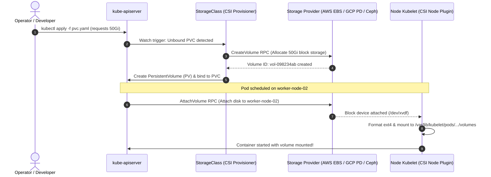
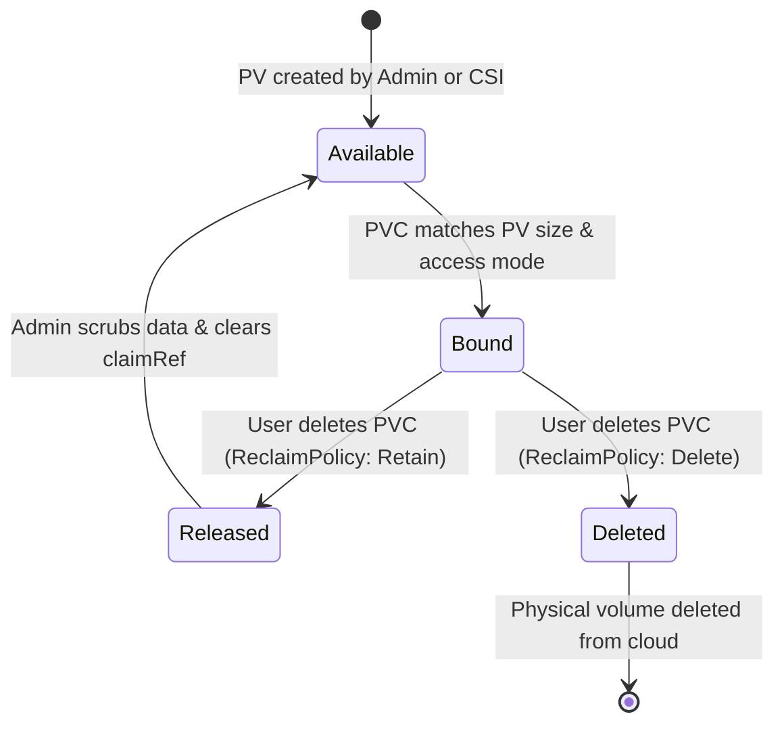
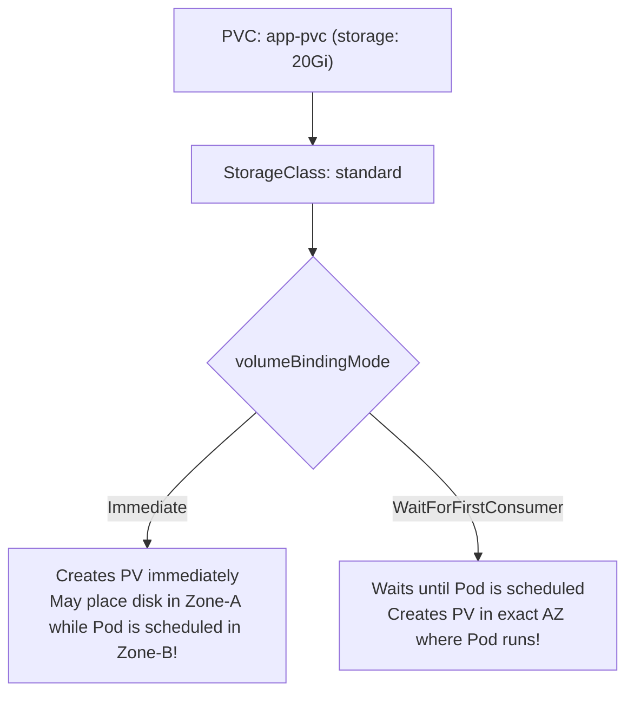
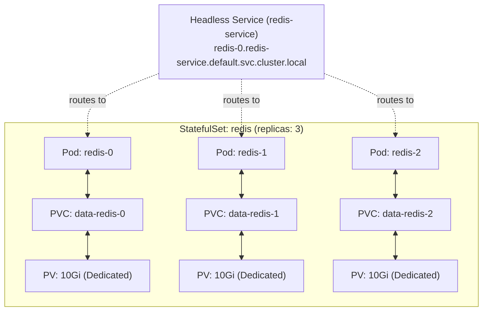
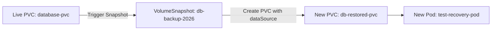

# Kubernetes Storage Deep Dive: PV, PVC, CSI & StatefulSets

Master Kubernetes persistent storage architecture. Learn how the Container Storage Interface (CSI) communicates with cloud block storage, configure dynamic provisioning via StorageClasses, deploy resilient databases with StatefulSets, and perform point-in-time volume snapshots.



---

## 1. Storage Fundamentals: PV, PVC, and Access Modes

Kubernetes decouples storage definition from consumption:
- **PersistentVolume (PV):** A piece of storage in the cluster provisioned by an administrator or dynamically by a StorageClass.
- **PersistentVolumeClaim (PVC):** A user request for storage (capacity and access mode) without needing to know underlying hardware details.



### Access Modes Comparison

| Mode | Short Code | Supported Providers | Description |
| :--- | :--- | :--- | :--- |
| **`ReadWriteOnce`** | `RWO` | EBS, GCP PD, Azure Disk | Can be mounted as read-write by a **single node**. |
| **`ReadOnlyMany`** | `ROX` | NFS, EFS, CephFS | Can be mounted read-only by **many nodes simultaneously**. |
| **`ReadWriteMany`** | `RWX` | NFS, CephFS, Azure Files | Can be mounted as read-write by **many nodes simultaneously**. |
| **`ReadWriteOncePod`**| `RWOP`| CSI 1.27+ | Can be mounted as read-write by a **single Pod only**. |

### Step 1.1: Static Provisioning & Reclaim Policy Test

Create a static PV with `Retain` policy:

```yaml
apiVersion: v1
kind: PersistentVolume
metadata:
  name: static-pv-5gi
spec:
  capacity:
    storage: 5Gi
  accessModes:
    - ReadWriteOnce
  persistentVolumeReclaimPolicy: Retain
  storageClassName: manual
  hostPath:
    path: /tmp/data-storage
```

Create a PVC requesting this storage:

```yaml
apiVersion: v1
kind: PersistentVolumeClaim
metadata:
  name: static-pvc
spec:
  accessModes:
    - ReadWriteOnce
  storageClassName: manual
  resources:
    requests:
      storage: 5Gi
```

Apply and verify binding:
```bash
kubectl apply -f static-pv.yaml
kubectl apply -f static-pvc.yaml

# Observe Status: Bound
kubectl get pv,pvc
```

### Step 1.2: Test Retain Lifecycle

Delete the claim and observe that data is preserved:

```bash
kubectl delete pvc static-pvc
kubectl get pv static-pv-5gi
```

Status changes to `Released`. The underlying data in `/tmp/data-storage` is **not deleted**, protecting against accidental data loss.

---

## 2. Dynamic Provisioning with StorageClasses

In modern clusters, manual PV creation does not scale. A `StorageClass` defines a provisioner and parameters to create PVs on-demand when a PVC arrives.



### Recommended StorageClass: `WaitForFirstConsumer`

Create `storageclass-topology.yaml`:

```yaml
apiVersion: storage.k8s.io/v1
kind: StorageClass
metadata:
  name: fast-storage
provisioner: kubernetes.io/no-provisioner # Replace with your CSI (e.g. ebs.csi.aws.com)
# CRITICAL: Prevents cross-availability zone scheduling failures
volumeBindingMode: WaitForFirstConsumer
# Enables increasing volume size without recreating pods
allowVolumeExpansion: true
reclaimPolicy: Delete
```

Apply:
```bash
kubectl apply -f storageclass-topology.yaml
```

### Step 2.1: Online Volume Expansion

When an application runs out of disk space, Kubernetes allows expanding the volume without downtime if the StorageClass supports `allowVolumeExpansion: true`:

```bash
# Edit PVC capacity directly
kubectl patch pvc data-pvc -p '{"spec":{"resources":{"requests":{"storage":"100Gi"}}}}'

# Inspect PVC status for FileSystemResizePending
kubectl describe pvc data-pvc
```

Kubelet automatically resizes the underlying filesystem (`ext4` or `xfs`) while the pod is running.

---

## 3. StatefulSets with `volumeClaimTemplates`

Deploying databases (MySQL, MongoDB, PostgreSQL, Kafka) using `Deployments` is an anti-pattern: all pods would attempt to mount the same single persistent volume, causing multi-attach lock errors.

A **StatefulSet** provides:
1. **Stable, unique network identifiers:** `db-0`, `db-1`, `db-2`.
2. **Dedicated, persistent storage per pod:** `data-db-0`, `data-db-1`, `data-db-2`.
3. **Ordered graceful deployment and termination:** Pod 0 must be ready before Pod 1 starts; Pod 1 terminates before Pod 0 terminates.



### Complete StatefulSet Manifest

Create `redis-statefulset.yaml`:

```yaml
apiVersion: v1
kind: Service
metadata:
  name: redis-headless
  labels:
    app: redis
spec:
  ports:
  - port: 6379
    name: redis
  clusterIP: None
  selector:
    app: redis
---
apiVersion: apps/v1
kind: StatefulSet
metadata:
  name: redis
spec:
  serviceName: "redis-headless"
  replicas: 3
  selector:
    matchLabels:
      app: redis
  template:
    metadata:
      labels:
        app: redis
    spec:
      containers:
      - name: redis
        image: redis:7-alpine
        ports:
        - containerPort: 6379
          name: redis
        volumeMounts:
        - name: data
          mountPath: /data
  # Unique volume automatically created for EACH replica
  volumeClaimTemplates:
  - metadata:
      name: data
    spec:
      accessModes: [ "ReadWriteOnce" ]
      storageClassName: "fast-storage"
      resources:
        requests:
          storage: 10Gi
```

Apply and inspect the ordered creation:
```bash
kubectl apply -f redis-statefulset.yaml

# Watch pods spawn in strict sequence (0 -> 1 -> 2)
kubectl get pods -l app=redis -w

# Check generated PVCs: data-redis-0, data-redis-1, data-redis-2
kubectl get pvc -l app=redis
```

---

## 4. Volume Snapshots & Restoring from Snapshots

Volume snapshots allow capturing point-in-time backups of persistent disks using the CSI driver.



### Step 4.1: Take a Point-in-Time Snapshot

Create `snapshot.yaml`:

```yaml
apiVersion: snapshot.storage.k8s.io/v1
kind: VolumeSnapshot
metadata:
  name: redis-snapshot-point-in-time
spec:
  volumeSnapshotClassName: csi-aws-vsc
  source:
    persistentVolumeClaimName: data-redis-0
```

Apply and verify readiness:
```bash
kubectl apply -f snapshot.yaml
kubectl get volumesnapshot redis-snapshot-point-in-time
```

Expected output:
```text
NAME                           READYTOUSE   SOURCEPVC      RESTORESIZE
redis-snapshot-point-in-time   true         data-redis-0   10Gi
```

### Step 4.2: Restore from Snapshot into a New PVC

Create `restore-pvc.yaml`:

```yaml
apiVersion: v1
kind: PersistentVolumeClaim
metadata:
  name: redis-restored-pvc
spec:
  storageClassName: fast-storage
  dataSource:
    name: redis-snapshot-point-in-time
    kind: VolumeSnapshot
    apiGroup: snapshot.storage.k8s.io
  accessModes:
    - ReadWriteOnce
  resources:
    requests:
      storage: 10Gi
```

Apply and verify:
```bash
kubectl apply -f restore-pvc.yaml
kubectl get pvc redis-restored-pvc
```

The new PVC contains an exact duplicate of the snapshot's filesystem ready to be attached to any recovery pod.

---

## 5. Storage Troubleshooting Diagnostic Scenarios

### Diagnostic Decision Flowchart

```mermaid
flowchart TD
    Issue["Pod stuck in ContainerCreating / Pending"] --> CheckDescribe["kubectl describe pod <name>"]
    CheckDescribe --> Reason{"Inspect Events"}

    Reason -->|FailedAttachVolume / Multi-Attach error| MultiAttach["Previous node did not release disk lock.<br/>Check if old pod terminated cleanly."]
    Reason -->|FailedScheduling (unbound PVC)| CheckSC["Check StorageClass & CSI provisioner logs"]
    Reason -->|Node affinity mismatch| AZMismatch["Disk exists in Zone-A, but node is in Zone-B.<br/>Fix with volumeBindingMode: WaitForFirstConsumer"]
```

### Scenario: Resolving Multi-Attach Error

When a worker node crashes abruptly, cloud providers may keep the volume attached to the dead instance:

```text
Warning  FailedAttachVolume  2m  attachdetach-controller  
Multi-Attach error for volume "pvc-xxxx" Volume is already exclusively attached to node worker-01
```

**Resolution:**
1. Check VolumeAttachment object:
   ```bash
   kubectl get volumeattachments
   ```
2. If `worker-01` is confirmed dead or stopped, force deletion of the orphaned Pod or clean up the VolumeAttachment:
   ```bash
   kubectl delete pod <stuck-pod> --grace-period=0 --force
   ```

---

## Summary Checklist

- [x] Use `ReadWriteOnce` for block storage and `ReadWriteMany` for shared network filesystems (NFS).
- [x] Use `persistentVolumeReclaimPolicy: Retain` on mission-critical databases to prevent accidental deletion.
- [x] Always set `volumeBindingMode: WaitForFirstConsumer` on StorageClasses in multi-AZ clusters.
- [x] Enable `allowVolumeExpansion: true` to permit online disk resizing without application downtime.
- [x] Deploy databases using **StatefulSets** with `volumeClaimTemplates` to guarantee dedicated per-replica storage.
- [x] Capture consistent backups using the Kubernetes **VolumeSnapshot** API.

