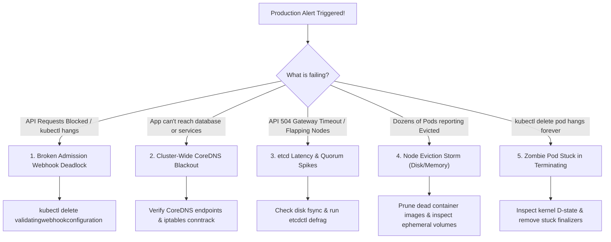
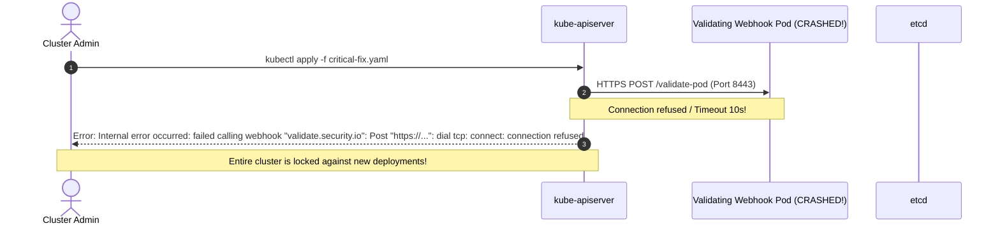
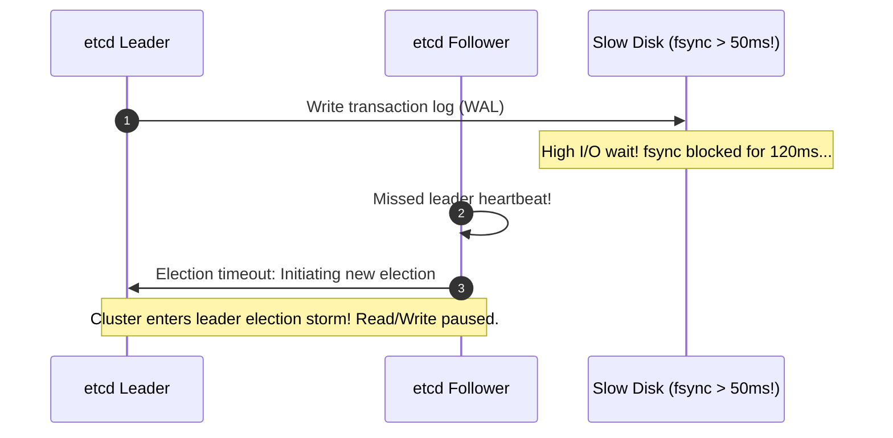
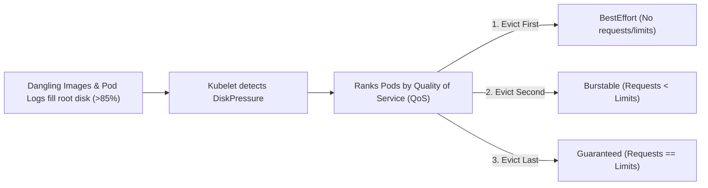

# Kubernetes Production Incident Response & Troubleshooting Playbook

Master the most critical high-severity production failure modes in Kubernetes. This playbook provides battle-tested war-room triage workflows for **broken webhook deadlocks**, **cluster DNS blackouts**, **etcd quorum and disk latency crises**, **node eviction storms**, and **pods permanently stuck in `Terminating`**.



---

## 1. The Validating Webhook Deadlock

**The Scenario:** You install a security or policy engine (e.g., OPA Gatekeeper, Kyverno, or Istio). Later, the webhook pod crashes or its certificate expires. Because the webhook was configured with `failurePolicy: Fail`, **the Kubernetes API server rejects all new pod creations and updates cluster-wide**.



### Emergency Triage & Recovery

1. **Identify the offending webhook configuration:**
   ```bash
   kubectl get validatingwebhookconfigurations,mutatingwebhookconfigurations
   ```
2. **Inspect the failing webhook rules:**
   ```bash
   kubectl describe validatingwebhookconfiguration security-policy-webhook
   ```
3. **Emergency Fix A: Switch `failurePolicy` from `Fail` to `Ignore`**
   ```bash
   kubectl patch validatingwebhookconfiguration security-policy-webhook \
     --type='json' -p='[{"op": "replace", "path": "/webhooks/0/failurePolicy", "value": "Ignore"}]'
   ```
4. **Emergency Fix B: Delete the webhook configuration entirely:**
   ```bash
   # Deleting the configuration unblocks the API server immediately (does not delete workloads)
   kubectl delete validatingwebhookconfiguration security-policy-webhook
   ```

---

## 2. Cluster-Wide CoreDNS Blackouts

**The Scenario:** Microservices abruptly throw connection errors: `Dial tcp: lookup postgres-db.production.svc.cluster.local: no such host`.

```mermaid
flowchart TD
    Issue["DNS Resolution Fails"] --> Step1["1. Check CoreDNS Pod Status<br/>kubectl get pods -n kube-system -l k8s-app=kube-dns"]
    Step1 --> ArePodsRunning{"Are pods Running & Ready?"}
    
    ArePodsRunning -->|CrashLoopBackOff| CheckLoop["Check for DNS Loop Plugin error in logs:<br/>Loop detected in CoreDNS Corefile!"]
    ArePodsRunning -->|Running (READY: 1/1)| Step2["2. Check Service Endpoints<br/>kubectl get endpoints -n kube-system kube-dns"]
    
    Step2 --> EndpointsExist{"Endpoints populated?"}
    EndpointsExist -->|Empty Endpoints| FixEP["Fix label selectors or CoreDNS readiness probe"]
    EndpointsExist -->|Valid Endpoints| Step3["3. Test direct resolution with dig/nslookup from test pod"]
    
    Step3 --> ConntrackCheck["Check iptables conntrack exhaustion on node:<br/>dmesg | grep 'nf_conntrack: table full'"]
```

### Emergency Triage Commands

```bash
# 1. Check CoreDNS pod status and logs
kubectl get pods -n kube-system -l k8s-app=kube-dns -o wide
kubectl logs -n kube-system -l k8s-app=kube-dns --tail=100

# 2. Check the kube-dns service endpoints
kubectl get endpoints -n kube-system kube-dns

# 3. Test DNS resolution from an ephemeral debug container
kubectl run dns-test --image=nicolaka/netshoot -it --rm -- nslookup kubernetes.default

# 4. Check Linux kernel conntrack table saturation on the host node
sudo sysctl net.netfilter.nf_conntrack_count net.netfilter.nf_conntrack_max
```

If `nf_conntrack_count` equals `nf_conntrack_max`, the Linux kernel drops UDP DNS packets silently. Increase table size immediately:
```bash
sudo sysctl -w net.netfilter.nf_conntrack_max=1048576
```

---

## 3. etcd Latency Spikes & Leader Election Thrashing

**The Scenario:** `kubectl` commands take 15+ seconds or return `504 Gateway Timeout`. Kubelet logs report `Failed to update node status`.

### Root Cause Analysis

etcd requires disk write syncs (`fsync`) to complete in **under 10ms**. When hosted on slow spinning disks, network NFS, or IOPS-throttled cloud volumes, etcd heartbeats miss their deadlines, triggering constant leader re-election storms.



### Emergency Triage & Defragmentation

```bash
# 1. Check etcd disk commit latency metrics via Prometheus
# Warning if 99th percentile exceeds 0.01s (10ms):
# histogram_quantile(0.99, rate(etcd_disk_wal_fsync_duration_seconds_bucket[5m]))

# 2. Check etcd database space and alarms
sudo ETCDCTL_API=3 etcdctl \
  --cacert=/etc/kubernetes/pki/etcd/ca.crt \
  --cert=/etc/kubernetes/pki/etcd/server.crt \
  --key=/etc/kubernetes/pki/etcd/server.key \
  alarm list

# 3. If "NOSPACE" alarm is active, run defragmentation across all members:
sudo ETCDCTL_API=3 etcdctl \
  --cacert=/etc/kubernetes/pki/etcd/ca.crt \
  --cert=/etc/kubernetes/pki/etcd/server.crt \
  --key=/etc/kubernetes/pki/etcd/server.key \
  --endpoints=https://127.0.0.1:2379 \
  defrag

# 4. Disarm the alarm
sudo ETCDCTL_API=3 etcdctl \
  --cacert=/etc/kubernetes/pki/etcd/ca.crt \
  --cert=/etc/kubernetes/pki/etcd/server.crt \
  --key=/etc/kubernetes/pki/etcd/server.key \
  alarm disarm
```

---

## 4. Node Eviction Storms (DiskPressure & MemoryPressure)

**The Scenario:** Multiple worker nodes enter `DiskPressure` state simultaneously, and dozens of workloads are abruptly killed and marked with status `Evicted`.

### Anatomy of Kubelet Eviction Thresholds

Kubelet evicts pods when node storage drops below hard limits (typically `imagefs.available < 15%` or `nodefs.available < 10%`).



### Emergency Disk Pruning

```bash
# 1. Identify which disk partition is full on the affected node
df -h /var/lib/containerd /var/lib/kubelet /var/log

# 2. Emergency prune of unreferenced container images
sudo crictl rmi --prune

# 3. Locate runaway container log files (>1GB)
sudo find /var/log/pods -name "*.log" -size +1G -exec ls -lh {} +

# 4. Truncate oversized log file without restarting container
sudo truncate -s 0 /var/log/pods/production_web-app-xxx/web-app/0.log

# 5. Remove evicted pod corpses across all namespaces
kubectl get pods -A | grep Evicted | awk '{print $1, $2}' | xargs -n2 kubectl delete pod -n
```

---

## 5. Pod Stuck Permanently in `Terminating`

**The Scenario:** You run `kubectl delete pod my-pod`, but 20 minutes later the pod is still stuck in `Terminating`.

### Root Cause 1: CSI Volume Detachment Hang

If an NFS or cloud block device fails to unmount cleanly, the Linux kernel holds the process in an **Uninterruptible Sleep State (State `D`)**.

```bash
# Check the pod events to see if unmount failed
kubectl describe pod stuck-pod

# Look for: "Unable to unmount volume... target is busy"
```

### Root Cause 2: Stuck Finalizers

Third-party controllers often attach a `finalizer` to pods. If the controller is offline, the API server refuses to delete the object until the finalizer array is empty.

```bash
# Check if the pod has active finalizers
kubectl get pod stuck-pod -o jsonpath='{.metadata.finalizers}'

# Force remove the finalizer to unblock immediate deletion:
kubectl patch pod stuck-pod -p '{"metadata":{"finalizers":null}}'
```

### Root Cause 3: Force Deletion Safeguard

```bash
# Force delete the pod immediately from the API server:
kubectl delete pod stuck-pod --grace-period=0 --force
```

> [!WARNING]
> Only use `--force` after verifying that the container on the node has actually stopped executing. Otherwise, two pods with stateful database storage could write simultaneously, corrupting data.

---

## Summary Checklist

- [x] In admission webhook deadlocks, patch `failurePolicy: Ignore` or delete the `ValidatingWebhookConfiguration`.
- [x] On DNS blackouts, verify `kube-dns` Endpoints and inspect node kernel `nf_conntrack` tables.
- [x] Monitor `etcd_disk_wal_fsync_duration_seconds`; run `etcdctl defrag` and `alarm disarm` if space alarms fire.
- [x] Clean up node `DiskPressure` using `crictl rmi --prune` and truncating oversized `/var/log/pods/` files.
- [x] Remove stuck `Terminating` pods by patching dangling `finalizers` to `null`.

