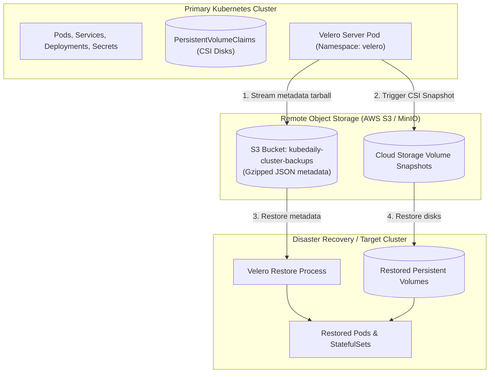

# Kubernetes Disaster Recovery & Backup with Velero

Implement enterprise disaster recovery, scheduled backups, and cross-cluster migration using **Velero**. Learn how to back up cluster metadata and persistent volume snapshots to cloud object storage (AWS S3, MinIO, GCS), schedule automated retention policies, and recover entire namespaces after catastrophic failures.



---

## 1. Velero Architecture

Velero operates inside your cluster via a single controller deployment:
- **Backup:** Serializes Kubernetes API objects into compressed JSON tarballs and writes them to remote object storage while triggering storage volume snapshots via CSI.
- **Restore:** Reads backup archives from object storage and creates the resources in the destination cluster, matching PersistentVolumes to their point-in-time snapshots.

---

## 2. On-Demand and Scheduled Backups

### Step 2.1: Create an On-Demand Backup of a Namespace

```bash
# Back up the entire 'production' namespace including persistent volumes
velero backup create prod-backup-$(date +%F) \
  --include-namespaces production \
  --snapshot-volumes \
  --wait
```

### Step 2.2: Check Backup Progress and Summary

```bash
velero backup describe prod-backup-2026-11-01 --details
```

Output highlights:
```text
Phase:  Completed
Namespaces:
  Included: production
Resource List:
  apps/v1/Deployment: 6
  v1/PersistentVolumeClaim: 4
  v1/Secret: 12
  v1/Service: 6
Persistent Volumes:
  pvc-9a8234ab: Snapshot created successfully
```

### Step 2.3: Author Automated Scheduled Backups

Create a `Schedule` resource to run automated nightly backups with a 30-day retention period:

```yaml
apiVersion: velero.io/v1
kind: Schedule
metadata:
  name: nightly-prod-backup
  namespace: velero
spec:
  # Runs at 02:00 AM every night
  schedule: "0 2 * * *"
  template:
    includeNamespaces:
      - production
    snapshotVolumes: true
    # Automatically delete backup after 720 hours (30 days)
    ttl: 720h0m0s
```

Apply:
```bash
kubectl apply -f nightly-backup-schedule.yaml
velero schedule get
```

---

## 3. Simulating a Catastrophic Failure & Restoring

### Disaster Simulation

Accidentally delete the production namespace:

```bash
kubectl delete namespace production
# All deployments, services, secrets, and data are gone!
```

### Emergency Restore

```bash
# 1. List available backups stored in S3
velero backup get

# 2. Trigger restore from the latest backup
velero restore create --from-backup prod-backup-2026-11-01 --wait

# 3. Check restore status
velero restore describe prod-restore-20261101...
```

Output:
```text
Phase: Completed
Warnings: 0
Errors:   0
```

Verify with `kubectl get all -n production`: All workloads, secrets, and persistent volumes are completely restored and operational!

---

## Summary Checklist

- [x] Configure remote S3-compatible object storage for off-site backup storage.
- [x] Enable volume snapshots via CSI plugins to guarantee application data recovery.
- [x] Schedule automated nightly backups with explicit retention (`ttl: 720h`).
- [x] Conduct regular disaster recovery drills to validate restore procedures and recovery time objectives (RTO).

