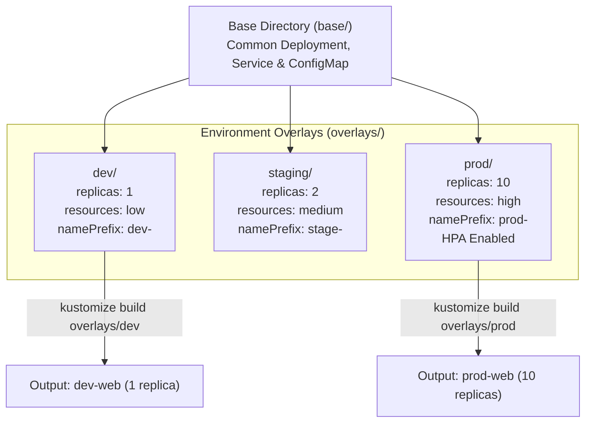
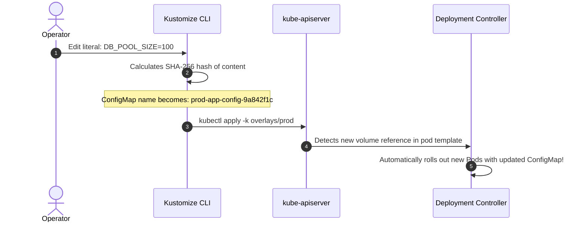

# Kustomize Master Lab: Bases, Overlays & GitOps Patching

Master template-free Kubernetes configuration management using **Kustomize**. Learn how to structure clean `base` manifests, customize environment-specific `overlays` (development, staging, production), apply Strategic Merge and JSON 6902 patches, and trigger automated zero-downtime rolling restarts using `configMapGenerator`.



---

## 1. Directory Structure

Kustomize organizes configurations into **bases** (pure reusable manifests) and **overlays** (deltas that patch the base):

```text
app/
├── base/
│   ├── deployment.yaml
│   ├── service.yaml
│   └── kustomization.yaml
└── overlays/
    ├── dev/
    │   └── kustomization.yaml
    └── prod/
        ├── hpa.yaml
        ├── replica-patch.yaml
        └── kustomization.yaml
```

---

## 2. Authoring the Base Manifests

In `base/kustomization.yaml`:

```yaml
apiVersion: kustomize.config.k8s.io/v1beta1
kind: Kustomization

resources:
  - deployment.yaml
  - service.yaml

commonLabels:
  app.kubernetes.io/name: web-store
```

---

## 3. Authoring Environment Overlays

In `overlays/prod/kustomization.yaml`:

```yaml
apiVersion: kustomize.config.k8s.io/v1beta1
kind: Kustomization

# Inherit from common base
resources:
  - ../../base
  - hpa.yaml

# Prepend environment prefix to all generated resource names
namePrefix: prod-

# Add production labels
commonLabels:
  environment: production

# 1. Strategic Merge Patch: Scale replicas and memory limits
patches:
  - path: replica-patch.yaml

# 2. Automated ConfigMap Generator with Content Hash
configMapGenerator:
  - name: app-config
    literals:
      - LOG_LEVEL=warn
      - DB_POOL_SIZE=50
```

In `overlays/prod/replica-patch.yaml`:

```yaml
apiVersion: apps/v1
kind: Deployment
metadata:
  name: web-store
spec:
  replicas: 10
  template:
    spec:
      containers:
      - name: web
        resources:
          limits:
            cpu: 1000m
            memory: 2Gi
```

---

## 4. Automatic Rolling Restarts via Hash Suffixes

One of Kustomize's most powerful features is the **`configMapGenerator` hash suffix**:
- Generates: `prod-app-config-g8fb275f`
- When you update `DB_POOL_SIZE=100`, the new hash becomes `prod-app-config-9a842f1c`.
- Because the Deployment's volume mount reference changes, Kubernetes **automatically triggers a zero-downtime rolling update**, eliminating stale configuration bugs without manual pod restarts!



---

## 5. Build and Apply

```bash
# Preview generated manifests without applying
kubectl kustomize overlays/prod

# Inspect live diff against cluster state
kubectl diff -k overlays/prod

# Apply to cluster
kubectl apply -k overlays/prod
```

---

## Summary Checklist

- [x] Separate reusable core manifests into `base/` and environment-specific changes into `overlays/`.
- [x] Use `namePrefix` and `commonLabels` to prevent naming collisions across environments.
- [x] Patch resources cleanly with Strategic Merge Patches without duplicating YAML files.
- [x] Leverage `configMapGenerator` to trigger automated rolling restarts upon configuration changes.

