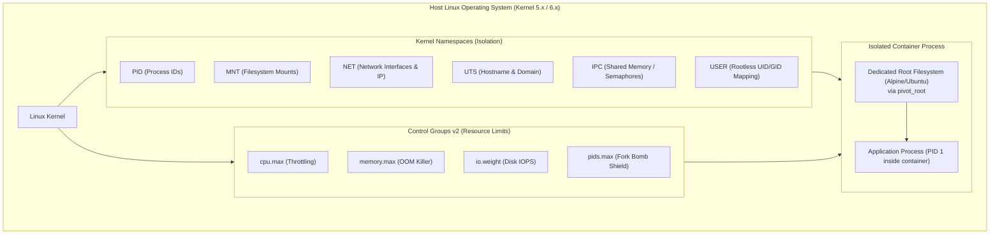
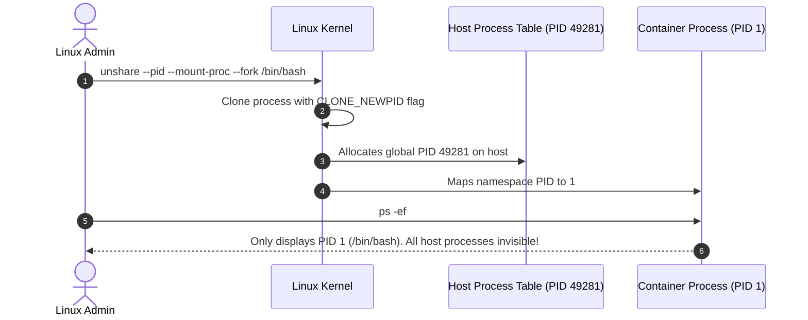
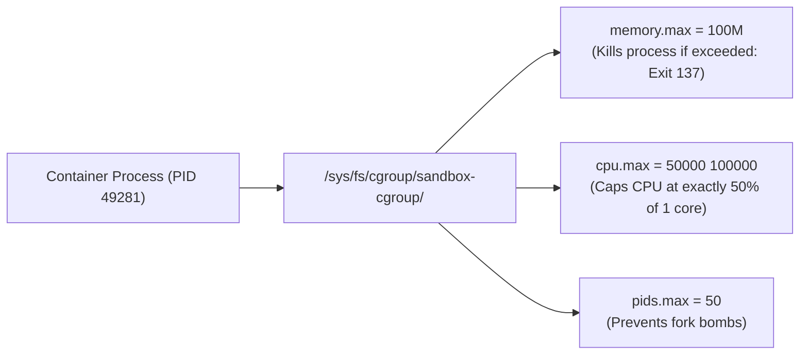
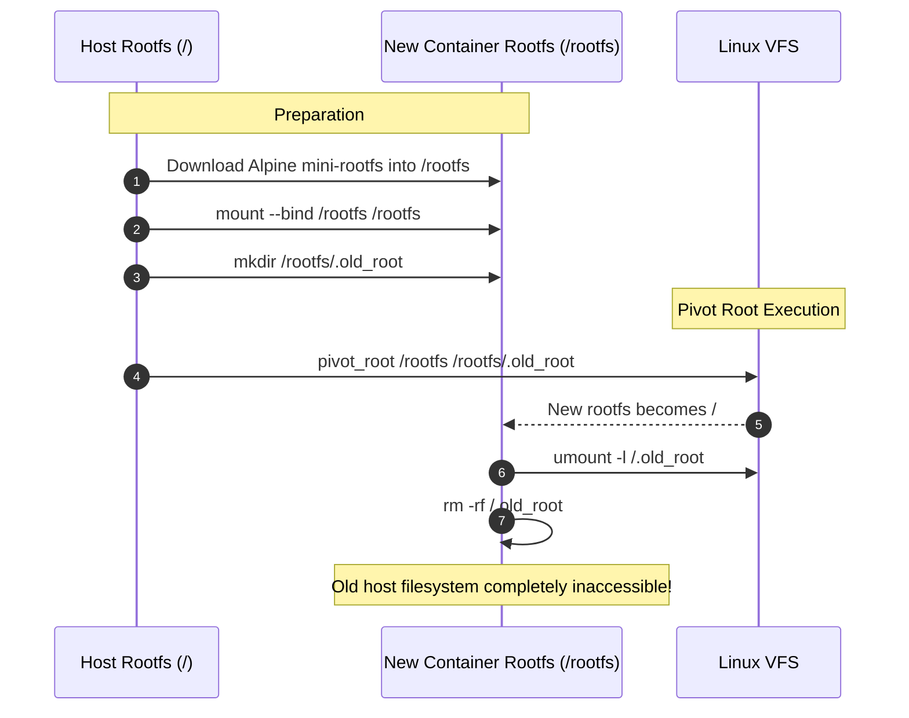
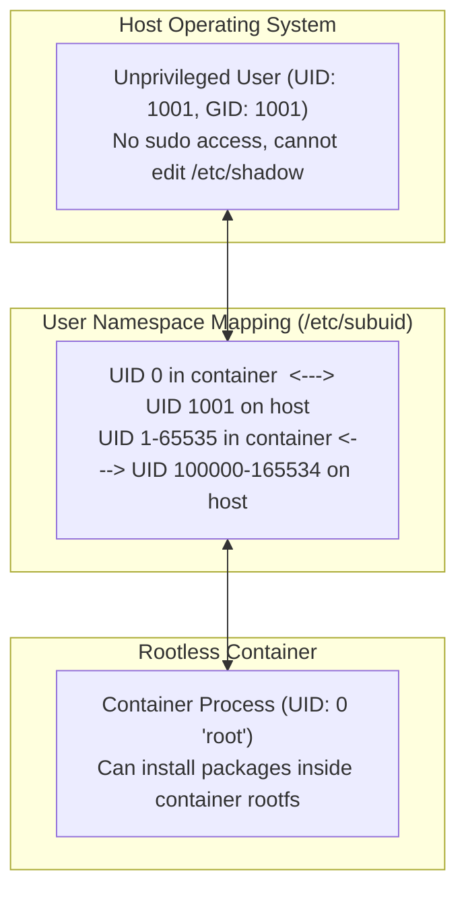

# Linux Containers from Scratch: Namespaces, Cgroups v2 & Rootless Runtimes

Demystify containers by building them using raw Linux kernel primitives. Learn how the Linux kernel isolates processes through **Namespaces**, throttles CPU and memory with **Cgroups v2**, imprisons filesystems with `pivot_root`, and executes secure unprivileged sandboxes with **Rootless containers**.



---

## 1. The 6 Core Linux Namespaces

A container is simply a standard Linux process running with restricted views of kernel resources.

| Namespace | Flag (`unshare`) | What It Isolates |
| :--- | :--- | :--- |
| **`pid`** | `--pid` | Process IDs (the container process believes it is PID 1) |
| **`mnt`** | `--mount` | Mount points and filesystem hierarchies |
| **`net`** | `--net` | Network devices, IP addresses, routing tables, port bindings |
| **`uts`** | `--uts` | Hostname and NIS domain name |
| **`ipc`** | `--ipc` | System V IPC and POSIX message queues |
| **`user`**| `--user` | User IDs and Group IDs (non-root on host = root in container) |



### Step 1.1: Hands-On Isolation with `unshare`

Launch an isolated shell with private PID, UTS, and Mount namespaces:

```bash
# 1. Inspect current host hostname and PID
hostname
echo $$

# 2. Spawn an isolated namespace
sudo unshare --pid --uts --mount --fork /bin/bash

# 3. Inside the new namespace, mount a private /proc filesystem
mount -t proc proc /proc

# 4. Change hostname inside namespace (does not affect host!)
hostname container-sandbox
hostname

# 5. Check process table
ps -ef
```

Output:
```text
UID          PID    PPID  C STIME TTY          TIME CMD
root           1       0  0 14:22 pts/0    00:00:00 /bin/bash
root           8       1  0 14:23 pts/0    00:00:00 ps -ef
```

The shell sees itself as **PID 1**, and none of the host's background daemons are visible. Exit the namespace (`exit`) and notice the host hostname remains unchanged.

---

## 2. Resource Throttling with Cgroups v2

While Namespaces control **what you can see**, Control Groups (Cgroups) control **how much you can use**.



### Step 2.1: Create a Custom Cgroup

```bash
# In cgroups v2, creating a directory automatically initializes controller files
sudo mkdir -p /sys/fs/cgroup/kubedaily-demo

# 1. Limit memory to 64 Megabytes
echo "67108864" | sudo tee /sys/fs/cgroup/kubedaily-demo/memory.max

# 2. Limit CPU to 20% of one core (20,000 quota per 100,000 period)
echo "20000 100000" | sudo tee /sys/fs/cgroup/kubedaily-demo/cpu.max

# 3. Limit maximum processes to 20 (fork bomb mitigation)
echo "20" | sudo tee /sys/fs/cgroup/kubedaily-demo/pids.max
```

### Step 2.2: Attach a Process and Trigger OOMKiller

```bash
# Spawn a shell in the background
sleep 3600 &
TARGET_PID=$!

# Move the process into the cgroup by writing its PID to cgroup.procs
echo $TARGET_PID | sudo tee /sys/fs/cgroup/kubedaily-demo/cgroup.procs

# Verify process membership
cat /sys/fs/cgroup/kubedaily-demo/cgroup.procs
```

Now launch a memory stress test inside this cgroup. When it allocates 65MB, the kernel immediately terminates it with **Out-Of-Memory (Exit 137)** without affecting any other host service.

---

## 3. Filesystem Jails: `chroot` vs `pivot_root`

`chroot` (change root) is historically vulnerable to jailbreak exploits (e.g. an attacker opening a file descriptor to a directory outside the jail before chrooting and using `fchdir`).

Production runtimes (`runc`, `containerd`) use **`pivot_root`**, which swaps the entire host mount namespace root with the new container rootfs and unmounts the old root entirely:



---

## 4. Rootless Containers: The User Namespace

In standard Docker, `root` inside a container shares user ID `0` with the host kernel. If a container breakout occurs, the attacker has root privileges over the entire server.

**Rootless containers** leverage the **User Namespace (`CLONE_NEWUSER`)**:
- Inside the container: Process runs as UID `0` (`root`).
- On the host machine: Process runs as UID `1001` (an unprivileged standard user).



### Testing Rootless User Namespaces

Run as a non-root standard user:

```bash
# Execute unshare with user namespace mapping
unshare --user --map-root-user /bin/bash

# Inside the shell, check identity:
id
# Output: uid=0(root) gid=0(root)

# Try reading a host root file:
cat /etc/shadow
# Output: cat: /etc/shadow: Permission denied
```

Inside the namespace you appear as `root`, but the host kernel enforces unprivileged permissions!

---

## Summary Checklist

- [x] Use Linux **Namespaces** (`PID`, `NET`, `MNT`, `UTS`, `IPC`, `USER`) for virtualized system views.
- [x] Enforce resource constraints using **Cgroups v2** (`cpu.max`, `memory.max`, `pids.max`).
- [x] Use `pivot_root` rather than legacy `chroot` to eliminate filesystem escape exploits.
- [x] Deploy **Rootless containers** with User Namespaces to map container root to unprivileged host UIDs.

