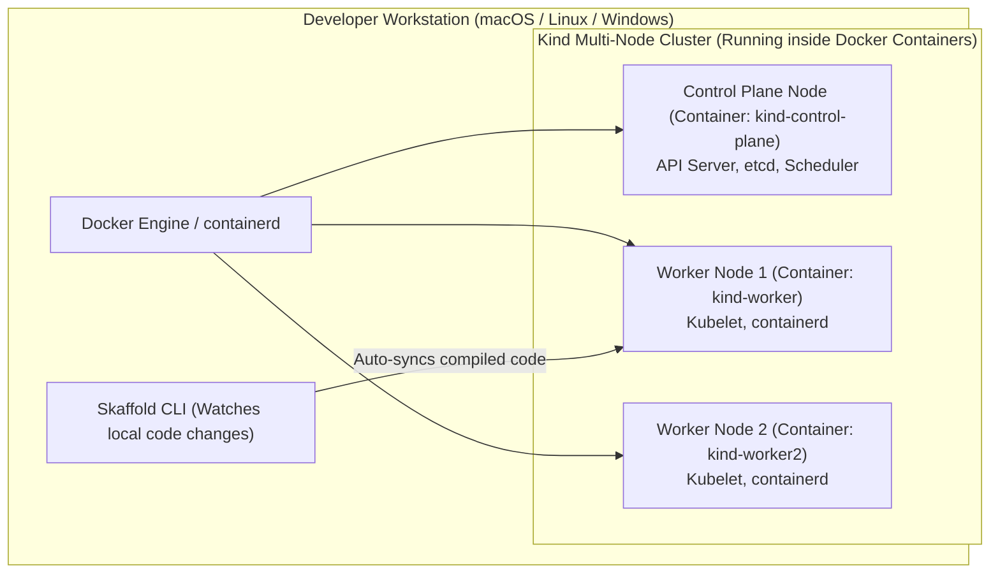
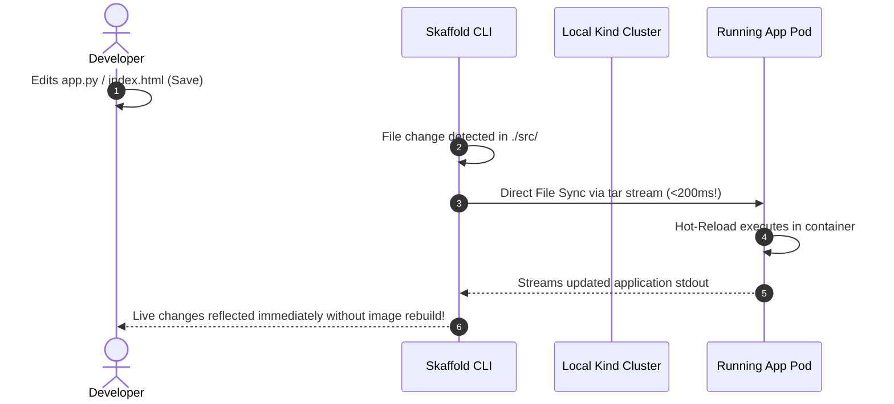

# Local Kubernetes Clusters: Multi-Node Kind, K3s & Fast Dev Loops

Master local cloud-native development without spending cloud budget. Learn how to launch multi-node clusters using **Kind (Kubernetes in Docker)**, configure custom ingress port mappings, run lightweight **K3s** edge distributions, and achieve sub-second live code synchronization with **Skaffold**.



---

## 1. Advanced Multi-Node Cluster Configuration with Kind

By default, `kind create cluster` launches a single-node cluster. For realistic testing of node affinities, pod anti-affinities, ingress controllers, and cross-node network policies, deploy a multi-node topology.

Create `kind-multinode-ingress.yaml`:

```yaml
kind: Cluster
apiVersion: kind.x-k8s.io/v1alpha4
nodes:
# 1. Control Plane Node with Ingress Port Mappings
- role: control-plane
  kubeadmConfigPatches:
  - |
    kind: InitConfiguration
    nodeRegistration:
      kubeletExtraArgs:
        node-labels: "ingress-ready=true"
  extraPortMappings:
  - containerPort: 80
    hostPort: 80
    protocol: TCP
  - containerPort: 443
    hostPort: 443
    protocol: TCP

# 2. Worker Node 1
- role: worker

# 3. Worker Node 2
- role: worker
```

Launch the cluster:
```bash
kind create cluster --name kubedaily-local --config kind-multinode-ingress.yaml
kubectl get nodes -o wide
```

Output:
```text
NAME                            STATUS   ROLES           AGE   VERSION
kubedaily-local-control-plane   Ready    control-plane   45s   v1.30.0
kubedaily-local-worker          Ready    <none>          30s   v1.30.0
kubedaily-local-worker2         Ready    <none>          30s   v1.30.0
```

---

## 2. Deploying NGINX Ingress on Kind

Because Kind runs inside Docker, cloud load balancers do not assign real public IPs. Kind routes host ports 80/443 directly to the control plane container:

```bash
# Deploy Ingress-NGINX specifically tuned for Kind
kubectl apply -f https://raw.githubusercontent.com/kubernetes/ingress-nginx/main/deploy/static/provider/kind/deploy.yaml

# Wait for Ingress controller readiness
kubectl wait --namespace ingress-nginx \
  --for=condition=ready pod \
  --selector=app.kubernetes.io/component=controller \
  --timeout=90s
```

Now any Ingress route pointing to `localhost` or `127.0.0.1` will resolve immediately without modifying `/etc/hosts`!

---

## 3. Sub-Second Dev Loops with Skaffold

Rebuilding container images and running `docker push` and `kubectl apply` for every single line of code change destroys developer productivity.

**Skaffold** detects file modifications, syncs files directly into running pods without restarting them, and streams logs in real time.



Create `skaffold.yaml`:

```yaml
apiVersion: skaffold/v4beta1
kind: Config
metadata:
  name: rapid-dev
build:
  artifacts:
  - image: local-dev-app
    sync:
      infer:
        - "**/*.py"
        - "**/*.html"
manifests:
  rawYaml:
    - k8s/*.yaml
```

Run:
```bash
skaffold dev
```

---

## Summary Checklist

- [x] Configure multi-node topologies in **Kind** to test real-world pod scheduling and taints.
- [x] Use `extraPortMappings` to bind host ports 80 and 443 directly to local Ingress controllers.
- [x] Pre-load images directly into Kind using `kind load docker-image` to bypass registry pushes.
- [x] Accelerate developer inner loops using **Skaffold** file synchronization.

