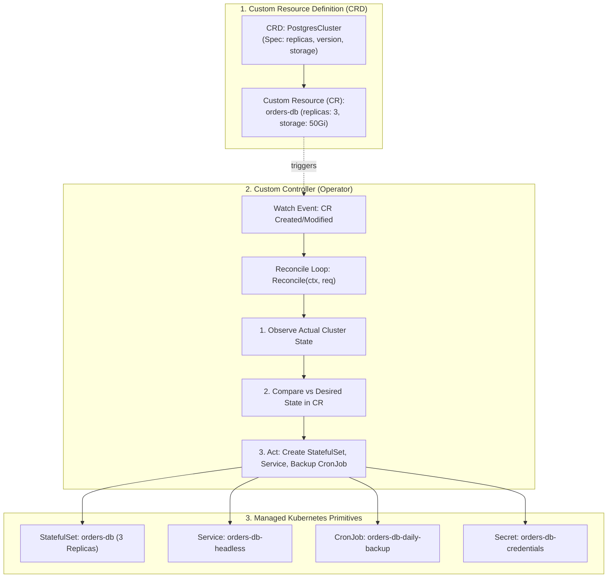
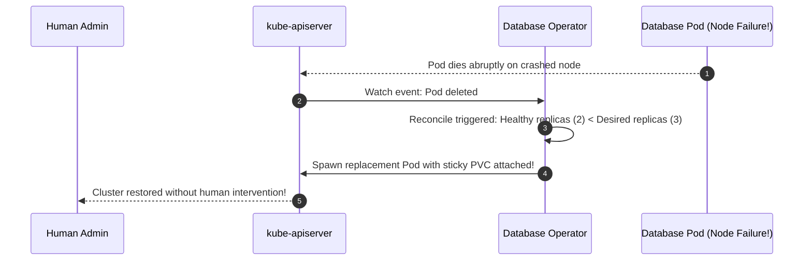

# Kubernetes Operator Pattern & Custom Resource Definitions (CRDs)

Extend the Kubernetes API to automate complex, stateful applications. Learn how **Custom Resource Definitions (CRDs)** model domain-specific architectures, how the **Operator Pattern** encodes human operational knowledge into software, and how the **Reconciliation Loop** (`Reconcile`) guarantees self-healing and Day-2 lifecycle automation.



---

## 1. The Anatomy of a Custom Resource Definition (CRD)

A CRD teaches `kube-apiserver` how to store and validate custom object schemas using OpenAPI v3 validation.

Create `postgrescluster-crd.yaml`:

```yaml
apiVersion: apiextensions.k8s.io/v1
kind: CustomResourceDefinition
metadata:
  name: postgresclusters.database.kubedaily.com
spec:
  group: database.kubedaily.com
  names:
    kind: PostgresCluster
    listKind: PostgresClusterList
    plural: postgresclusters
    singular: postgrescluster
    shortNames:
      - pg
  scope: Namespaced
  versions:
    - name: v1alpha1
      served: true
      storage: true
      subresources:
        status: {}
      schema:
        openAPIV3Schema:
          type: object
          properties:
            spec:
              type: object
              required: ["replicas", "storage"]
              properties:
                replicas:
                  type: integer
                  minimum: 1
                  maximum: 9
                version:
                  type: string
                  default: "16"
                storage:
                  type: string
            status:
              type: object
              properties:
                phase:
                  type: string
                healthyReplicas:
                  type: integer
```

Apply:
```bash
kubectl apply -f postgrescluster-crd.yaml
kubectl api-resources | grep postgres
```

Now `kubectl get pg` is a first-class citizen in your cluster!

---

## 2. Instantiating a Custom Resource

Developers can now declare enterprise databases with a tiny declarative manifest:

Create `orders-db.yaml`:

```yaml
apiVersion: database.kubedaily.com/v1alpha1
kind: PostgresCluster
metadata:
  name: orders-database
  namespace: production
spec:
  replicas: 3
  version: "16.1"
  storage: "100Gi"
```

Apply:
```bash
kubectl apply -f orders-db.yaml
kubectl get postgrescluster -n production
```

---

## 3. The Reconciliation Loop (`Reconcile`)

In Go, using `controller-runtime` and Kubebuilder / Operator SDK, the heart of an Operator is the **Reconcile loop**:

```go
func (r *PostgresClusterReconciler) Reconcile(ctx context.Context, req ctrl.Request) (ctrl.Result, error) {
    log := log.FromContext(ctx)

    // 1. Fetch the PostgresCluster instance
    var pg databasev1alpha1.PostgresCluster
    if err := r.Get(ctx, req.NamespacedName, &pg); err != nil {
        return ctrl.Result{}, client.IgnoreNotFound(err)
    }

    // 2. Check if the underlying StatefulSet exists
    var sts appsv1.StatefulSet
    err := r.Get(ctx, types.NamespacedName{Name: pg.Name, Namespace: pg.Namespace}, &sts)
    if errors.IsNotFound(err) {
        log.Info("Creating StatefulSet for PostgresCluster", "name", pg.Name)
        sts = r.constructStatefulSet(&pg)
        if err := r.Create(ctx, &sts); err != nil {
            return ctrl.Result{}, err
        }
        return ctrl.Result{Requeue: true}, nil
    }

    // 3. Ensure replicas match desired state
    if *sts.Spec.Replicas != pg.Spec.Replicas {
        log.Info("Scaling StatefulSet replicas", "current", *sts.Spec.Replicas, "desired", pg.Spec.Replicas)
        sts.Spec.Replicas = &pg.Spec.Replicas
        if err := r.Update(ctx, &sts); err != nil {
            return ctrl.Result{}, err
        }
    }

    // 4. Update Custom Resource Status
    pg.Status.Phase = "Running"
    pg.Status.HealthyReplicas = sts.Status.ReadyReplicas
    if err := r.Status().Update(ctx, &pg); err != nil {
        return ctrl.Result{}, err
    }

    return ctrl.Result{RequeueAfter: time.Minute * 5}, nil
}
```



---

## Summary Checklist

- [x] Extend Kubernetes using **Custom Resource Definitions (CRDs)** with strict OpenAPI v3 validation.
- [x] Implement the **Operator Pattern** to automate Day-2 operations (backups, failover, upgrades).
- [x] Author level-triggered, idempotent **Reconcile loops** with `controller-runtime`.
- [x] Update subresource `.status` fields to provide clear operational feedback to operators.

