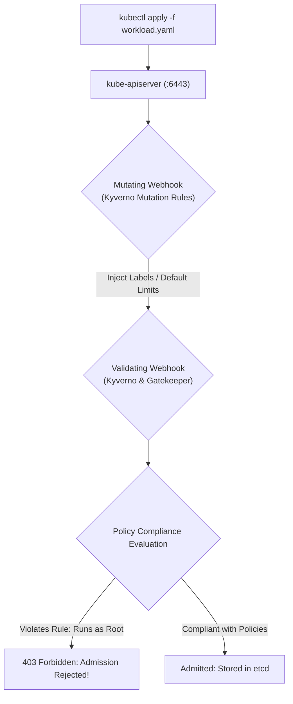
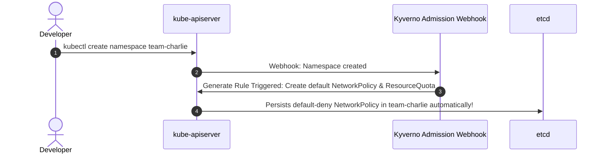
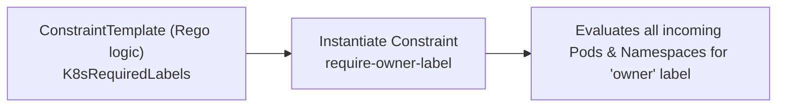

# Policy as Code Master Lab: Kyverno & OPA Gatekeeper

Implement enterprise-grade Kubernetes governance using **Policy as Code**. Learn how **Kyverno** validates, mutates, and generates resources using pure declarative YAML, and understand how **OPA Gatekeeper** enforces complex logic with the **Rego** query language to block unapproved registries, require resource limits, and disallow root execution.



---

## 1. Kyverno: Declarative Kubernetes-Native Policy Engine

Unlike OPA Gatekeeper which requires learning Rego, **Kyverno** policies are written in standard Kubernetes YAML. Kyverno can:
1. **Validate:** Block or audit non-compliant resources.
2. **Mutate:** Automatically patch resources (e.g. inject security contexts, labels, or sidecars).
3. **Generate:** Automatically create new resources (e.g. create a default NetworkPolicy or ResourceQuota when a new namespace is created).



### Policy 1: Validate - Disallow Root Containers Cluster-Wide

Create `disallow-root-user.yaml`:

```yaml
apiVersion: kyverno.io/v1
kind: ClusterPolicy
metadata:
  name: disallow-root-user
spec:
  validationFailureAction: Enforce # Enforce blocks creation; Audit only warns
  background: true
  rules:
  - name: check-runAsNonRoot
    match:
      any:
      - resources:
          kinds:
          - Pod
    validate:
      message: "Running as root is forbidden. Set securityContext.runAsNonRoot: true"
      pattern:
        spec:
          =(securityContext):
            runAsNonRoot: true
          containers:
          - =(securityContext):
              runAsNonRoot: true
```

Apply and test:
```bash
kubectl apply -f disallow-root-user.yaml

# Attempt to run a root container (Blocked!)
kubectl run root-pod --image=nginx
# Error from server: admission webhook "validate.kyverno.svc" denied the request: 
# Running as root is forbidden. Set securityContext.runAsNonRoot: true
```

### Policy 2: Mutate - Automatically Add Security Labels

Create `add-env-label.yaml`:

```yaml
apiVersion: kyverno.io/v1
kind: ClusterPolicy
metadata:
  name: inject-environment-label
spec:
  rules:
  - name: add-environment-label
    match:
      any:
      - resources:
          kinds:
          - Pod
    mutate:
      patchStrategicMerge:
        metadata:
          labels:
            environment: production
            managed-by: kyverno
```

Any pod created will automatically have the `environment: production` label injected by the mutating webhook before reaching etcd!

### Policy 3: Generate - Clone Default NetworkPolicy on New Namespaces

```yaml
apiVersion: kyverno.io/v1
kind: ClusterPolicy
metadata:
  name: generate-default-networkpolicy
spec:
  rules:
  - name: clone-default-netpol
    match:
      any:
      - resources:
          kinds:
          - Namespace
    generate:
      apiVersion: networking.k8s.io/v1
      kind: NetworkPolicy
      name: default-deny-all
      namespace: "{{request.object.metadata.name}}"
      synchronize: true
      data:
        spec:
          podSelector: {}
          policyTypes:
          - Ingress
          - Egress
```

Every time a developer creates a namespace, a default-deny NetworkPolicy is instantly stamped out in that namespace.

---

## 2. OPA Gatekeeper: Rego-Based Policy Enforcement

**Open Policy Agent (OPA) Gatekeeper** separates policy definitions into two distinct resources:
1. **`ConstraintTemplate`:** Defines the Rego logic and configurable parameters schema.
2. **`Constraint`:** Instantiates the template with specific parameters and targets.



### Step 2.1: Define ConstraintTemplate with Rego

Create `k8srequiredlabels-template.yaml`:

```yaml
apiVersion: templates.gatekeeper.sh/v1
kind: ConstraintTemplate
metadata:
  name: k8srequiredlabels
spec:
  crd:
    spec:
      names:
        kind: K8sRequiredLabels
      validation:
        openAPIV3Schema:
          type: object
          properties:
            labels:
              type: array
              items:
                type: string
  targets:
    - target: admission.k8s.gatekeeper.sh
      rego: |
        package k8srequiredlabels

        violation[{"msg": msg}] {
          provided := {label | input.review.object.metadata.labels[label]}
          required := {label | label := input.parameters.labels[_]}
          missing := required - provided
          count(missing) > 0
          msg := sprintf("Missing required label(s): %v", [missing])
        }
```

### Step 2.2: Apply the Constraint

Create `require-owner-label.yaml`:

```yaml
apiVersion: constraints.gatekeeper.sh/v1beta1
kind: K8sRequiredLabels
metadata:
  name: require-owner-and-team
spec:
  match:
    kinds:
      - apiGroups: [""]
        kinds: ["Namespace"]
  parameters:
    labels: ["owner", "cost-center"]
```

Apply both:
```bash
kubectl apply -f k8srequiredlabels-template.yaml
kubectl apply -f require-owner-label.yaml
```

Now try creating a namespace without labels:
```bash
kubectl create namespace test-ns
# Error from server: admission webhook "validation.gatekeeper.sh" denied the request: 
# [require-owner-and-team] Missing required label(s): {"cost-center", "owner"}
```

---

## Summary Checklist

- [x] Use **Kyverno** for Kubernetes-native validation, mutation, and generation without learning external DSLs.
- [x] Use **OPA Gatekeeper** when complex policy logic and formal Rego mathematical queries are required.
- [x] Enforce `securityContext.runAsNonRoot: true` cluster-wide at admission time.
- [x] Generate default NetworkPolicies and ResourceQuotas automatically on namespace creation.
- [x] Enforce mandatory cost allocation tags (`owner`, `cost-center`) on all deployed namespaces.

