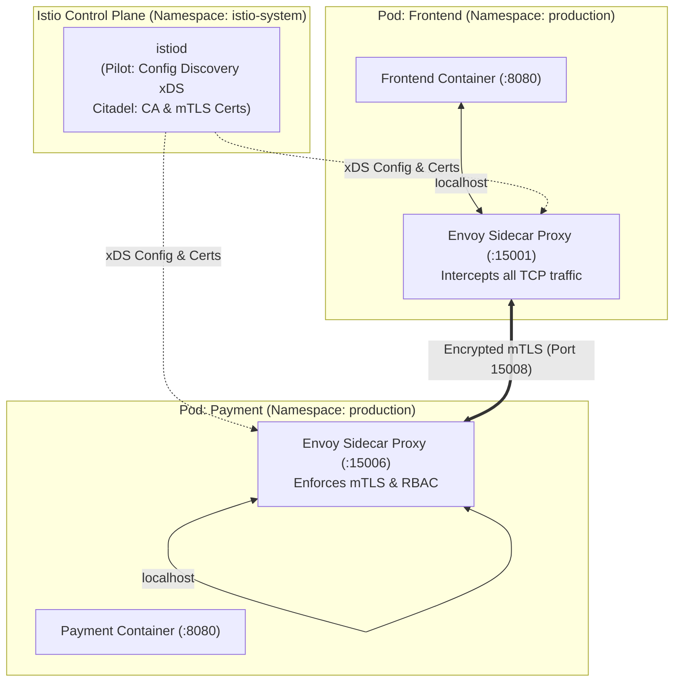
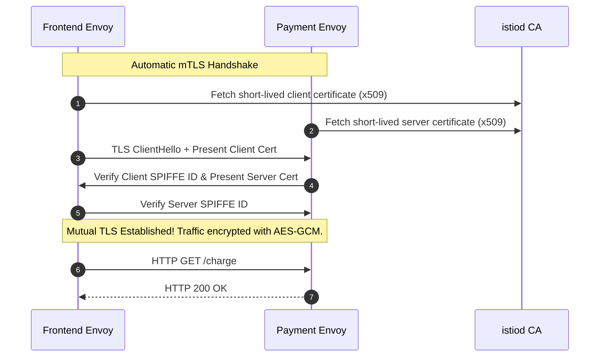

# Service Mesh Master Lab: Istio Traffic Management & mTLS Security

Master modern service mesh engineering with **Istio**. Learn how `istiod` programs Envoy data plane proxies, enforce zero-trust Mutual TLS (mTLS) with `PeerAuthentication`, execute fine-grained traffic routing via `VirtualService` and `DestinationRule`, and safeguard downstream services with circuit breaking and fault injection.



---

## 1. Automatic Sidecar Injection & Packet Redirection

When a pod is scheduled in an Istio-enabled namespace, the **Istio Sidecar Injector webhook** injects two containers into the Pod specification:
1. `istio-init`: A short-lived init container that configures `iptables` rules to intercept all incoming and outgoing TCP packets on the pod's network interface.
2. `istio-proxy`: The long-running **Envoy proxy** that executes all L7 routing, telemetry extraction, and TLS encryption.

```bash
# Enable automatic sidecar injection for the production namespace
kubectl label namespace production istio-injection=enabled

# Verify label
kubectl get namespace production --show-labels
```

Any new Pod created in `production` will automatically launch with `2/2 READY` containers.

---

## 2. Zero-Trust Security with Mutual TLS (mTLS)

Istio assigns every workload a unique cryptographic identity called a **SPIFFE ID** encoded into x509 certificates generated by `istiod`:
```text
spiffe://cluster.local/ns/production/sa/payment-service-account
```



### Enforcing Strict mTLS Cluster-Wide

By default, Istio operates in `PERMISSIVE` mode (accepts both plaintext and mTLS). To achieve compliance, enforce `STRICT` mode:

```yaml
apiVersion: security.istio.io/v1beta1
kind: PeerAuthentication
metadata:
  name: default
  namespace: production
spec:
  mtls:
    mode: STRICT
```

Apply:
```bash
kubectl apply -f peer-auth-strict.yaml
```

Any workload sending plaintext traffic from outside the mesh will be rejected immediately with an SSL connection reset.

---

## 3. Dynamic Traffic Management: VirtualService & DestinationRule

In Istio, routing logic is decoupled into two complementary resources:
- **`DestinationRule`:** Defines the subsets (versions) of a service and client-side connection policies (load balancing, circuit breaking, TLS settings).
- **`VirtualService`:** Defines the routing rules matching incoming requests (URL, headers, query params) and directs them to DestinationRule subsets.

```mermaid
flowchart TD
    Request["Incoming HTTP Request"] --> VS{"VirtualService: payment-vs"}
    VS -->|Header 'end-user: tester'| SubsetV2["Subset: v2 (Canary)"]
    VS -->|Default (Weighted 90%)| SubsetV1["Subset: v1 (Stable)"]
    VS -->|Default (Weighted 10%)| SubsetV2

    SubsetV1 --> DR["DestinationRule: payment-dr"]
    SubsetV2 --> DR
    DR --> PodsV1["Pods labeled version=v1"]
    DR --> PodsV2["Pods labeled version=v2"]
```

### Step 3.1: Define Service Subsets via DestinationRule

Create `payment-destinationrule.yaml`:

```yaml
apiVersion: networking.istio.io/v1alpha3
kind: DestinationRule
metadata:
  name: payment-service
  namespace: production
spec:
  host: payment-service.production.svc.cluster.local
  subsets:
  - name: v1
    labels:
      version: v1
  - name: v2
    labels:
      version: v2
  trafficPolicy:
    loadBalancer:
      simple: LEAST_REQUEST
```

### Step 3.2: Fine-Grained Routing via VirtualService

Create `payment-virtualservice.yaml`:

```yaml
apiVersion: networking.istio.io/v1alpha3
kind: VirtualService
metadata:
  name: payment-service
  namespace: production
spec:
  hosts:
  - payment-service.production.svc.cluster.local
  http:
  # 1. Feature Flag / Beta Tester Match: Route QA engineers directly to v2
  - match:
    - headers:
        end-user:
          exact: beta-tester
    route:
    - destination:
        host: payment-service.production.svc.cluster.local
        subset: v2

  # 2. Canary Weight Shifting for regular traffic
  - route:
    - destination:
        host: payment-service.production.svc.cluster.local
        subset: v1
      weight: 90
    - destination:
        host: payment-service.production.svc.cluster.local
        subset: v2
      weight: 10
```

Apply both manifests:
```bash
kubectl apply -f payment-destinationrule.yaml
kubectl apply -f payment-virtualservice.yaml
```

---

## 4. Resilience Engineering: Circuit Breaking & Fault Injection

### Circuit Breaking with Outlier Detection

A slow or failing dependency can saturate connection pools across all calling microservices. **Circuit breaking** temporarily ejects unhealthy instances from the load balancer pool.

```yaml
apiVersion: networking.istio.io/v1alpha3
kind: DestinationRule
metadata:
  name: payment-circuit-breaker
  namespace: production
spec:
  host: payment-service.production.svc.cluster.local
  trafficPolicy:
    connectionPool:
      tcp:
        maxConnections: 100
      http:
        http1MaxPendingRequests: 10
        maxRequestsPerConnection: 5
    outlierDetection:
      # If 3 consecutive 5xx errors occur...
      consecutive5xxErrors: 3
      # ...check every 10 seconds...
      interval: 10s
      # ...and eject the failing pod for 30 seconds
      baseEjectionTime: 30s
      maxEjectionPercent: 50
```

### Chaos Testing with Fault Injection

Validate your application's timeout handling by injecting synthetic latency and HTTP 500 aborts without modifying code:

```yaml
apiVersion: networking.istio.io/v1alpha3
kind: VirtualService
metadata:
  name: payment-fault-injection
  namespace: production
spec:
  hosts:
  - payment-service.production.svc.cluster.local
  http:
  - fault:
      delay:
        percentage:
          value: 30.0 # Inject a 5-second delay into 30% of requests
        fixedDelay: 5s
      abort:
        percentage:
          value: 10.0 # Return HTTP 503 to 10% of requests
        httpStatus: 503
    route:
    - destination:
        host: payment-service.production.svc.cluster.local
        subset: v1
```

---

## 5. Hands-on Verification Exercise

### Test Header-Based Routing

1. Send standard traffic (observe responses served predominantly by `v1`):
   ```bash
   curl -I http://payment-service.production.svc.cluster.local:8080/version
   # Output header: X-App-Version: v1
   ```
2. Send request with the beta-tester header:
   ```bash
   curl -I -H "end-user: beta-tester" http://payment-service.production.svc.cluster.local:8080/version
   # Output header: X-App-Version: v2
   ```
3. 100% of requests with the header reach the `v2` canary instance!

---

## Summary Checklist

- [x] Label namespaces with `istio-injection=enabled` for automatic Envoy sidecar provisioning.
- [x] Enforce `PeerAuthentication` with `mode: STRICT` to eliminate plaintext cluster communications.
- [x] Decouple routing rules (`VirtualService`) from version endpoints (`DestinationRule`).
- [x] Protect backends with **Outlier Detection** circuit breakers to prevent cascading outages.
- [x] Test system resiliency before incidents happen using **Fault Injection** delays and aborts.

